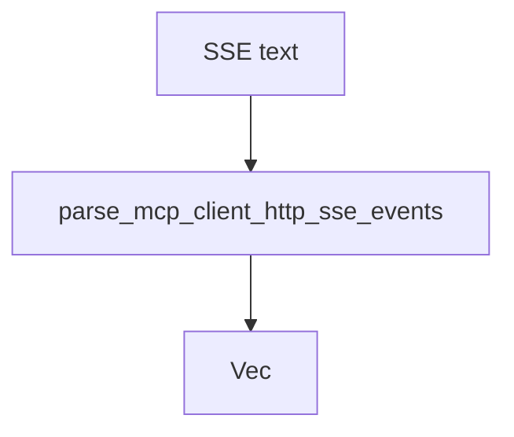

# M46-01 SSE Event Contracts Spec

## Purpose

Add pure SSE event parsing contracts for MCP HTTP client responses.

## Product Context

Streamable HTTP responses may use `text/event-stream`; the runtime needs a deterministic parser before the transport or client session can consume streamed JSON-RPC frames.

## Scope

This spec delivers:

- `McpClientHttpSseEvent` contract
- bounded parsing from SSE text into events
- support for comments, blank-line dispatch, multi-line `data:`, `event:`, `id:`, and numeric `retry:`
- safe diagnostics for malformed or oversized event data

Owned by other specs:

- response-mode frame extraction in M46-02
- reqwest response classification in M46-03
- client dispatch in M46-04

## Architecture

`client_http.rs` owns the parser and exports it through `ruse-mcp`.



## Public Contracts

```rust
pub struct McpClientHttpSseEvent {
    pub event: Option<String>,
    pub id: Option<String>,
    pub retry_ms: Option<u64>,
    pub data: String,
}

pub fn parse_mcp_client_http_sse_events(
    body: &str,
) -> Result<Vec<McpClientHttpSseEvent>, McpError>;
```

## State and Failure Handling

- Empty event blocks are ignored.
- Comment lines beginning with `:` are ignored.
- Multi-line data fields are joined with `\n`.
- Unknown fields are ignored.
- Invalid numeric retry values are ignored.
- Oversized body or event data returns `McpError::InvalidServerRequest`.
- Error text must not include raw event data.

## Security and Privacy

- Event data is untrusted and may contain secrets.
- Public errors must not include raw body or event data.
- Parser limits must be deterministic and test-covered.

## Testing Strategy

- parse single data event
- parse multi-line data event
- parse comments, id, event, and retry
- ignore invalid retry and unknown fields
- reject oversized body without leaking content

## Acceptance Criteria

- `CARGO_TARGET_DIR=target/codex-m46 cargo test -p ruse-mcp mcp_client_http_sse_contracts`
- `CARGO_TARGET_DIR=target/codex-m46 cargo fmt --all -- --check`
- `CARGO_TARGET_DIR=target/codex-m46 cargo clippy -p ruse-mcp --all-targets -- -D warnings`

## Completion Signal

M46-01 is complete when SSE event parsing is typed, exported, redacted, and covered by focused tests.
