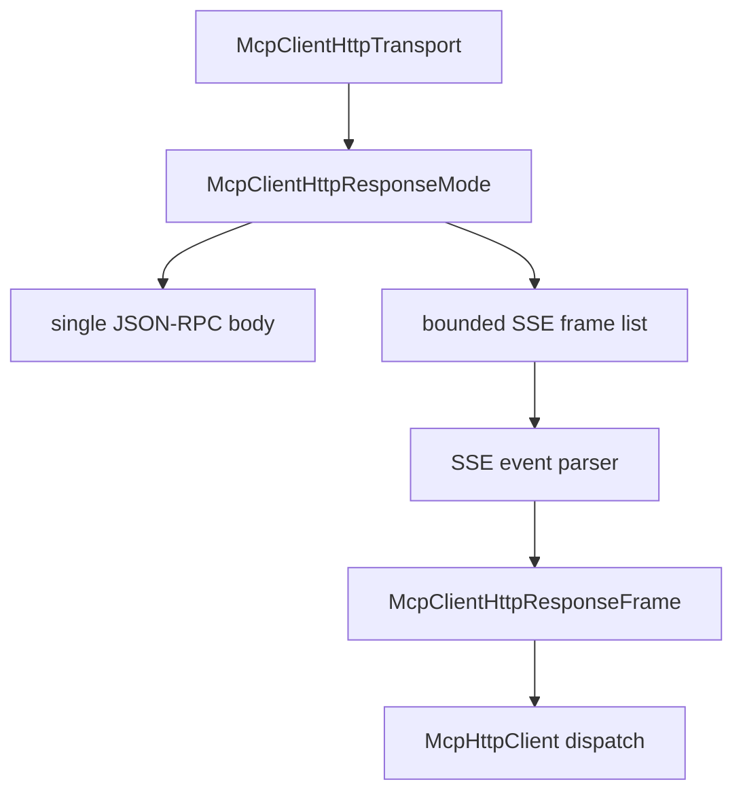

# M46 MCP HTTP SSE Response Runtime Spec

## Purpose

Add the response-stream foundation for MCP streamable HTTP clients so `agent-mcp` can safely parse server-sent events beside the request/response JSON path introduced in M45.

## Product Context

M45 can drive streamable HTTP MCP servers through JSON-RPC HTTP POST responses. The next gap is MCP streamable HTTP response streams: servers may return JSON-RPC frames through `text/event-stream`, and later milestones need that foundation for resumable streams, progress, logging, task notifications, and reentrant server-to-client traffic.

## Scope

This milestone delivers:

- typed SSE event parsing contracts in `agent-mcp`
- a response-mode abstraction that can represent one JSON-RPC body or a bounded stream of JSON-RPC frames
- reqwest transport support for `application/json` and `text/event-stream` responses
- HTTP client dispatch that consumes the first matching JSON-RPC response frame safely
- redacted diagnostics for malformed SSE data, oversized events, unexpected ids, and stream transport errors
- README, milestone status, focused checks, and final quality gate evidence

Owned by later milestones:

- resumable stream ids and reconnect
- OAuth/DCR and token refresh
- MCP progress/logging/task protocol handling
- server-to-client request dispatch while a stream is open
- Desktop stream management UX

## Architecture

`agent-mcp` keeps all MCP wire parsing and response-mode decisions inside `client_http.rs`. CLI, TUI, and Desktop continue to consume typed client and gateway contracts.



## Public Contracts

M46 introduces typed contracts shaped like:

```rust
pub enum McpClientHttpResponseMode {
    Json(McpClientHttpResponse),
    Sse(McpClientHttpSseResponse),
}

pub struct McpClientHttpSseEvent {
    pub event: Option<String>,
    pub id: Option<String>,
    pub retry_ms: Option<u64>,
    pub data: String,
}
```

Names may evolve during implementation, but response-mode behavior must remain typed, serializable where useful, and testable without network access.

## State and Failure Handling

- JSON responses preserve M45 behavior.
- SSE parsing ignores comments and empty separators.
- Multi-line SSE `data:` fields are joined with newline characters.
- Oversized SSE event data fails before JSON parsing.
- Malformed event JSON returns a bounded diagnostic without echoing raw data.
- Client dispatch selects the JSON-RPC response whose id matches the request id.
- Non-response SSE notifications are ignored until later protocol milestones define handling.
- Streams are bounded in fixture and reqwest paths to avoid unbounded memory growth.

## Security and Privacy

- Raw SSE event data is untrusted and must not appear in public errors.
- Secret-like remote failure messages are redacted exactly like JSON responses.
- Header names, header values, URLs with credentials, request bodies, and tool arguments remain excluded from diagnostics.
- SSE response parsing does not grant remote tools any permission; local gateway policy remains authoritative.

## Testing Strategy

- contract tests for SSE event parsing, multi-line data, comments, retry ids, and malformed inputs
- response-mode tests for JSON and SSE JSON-RPC mapping
- fixture transport tests for dispatching matching frames and rejecting unexpected ids
- reqwest local-server tests for `text/event-stream`
- redaction regressions for malformed SSE data and remote JSON-RPC failures
- final `agent-mcp` focused checks and workspace CI gate

## Acceptance Criteria

- `CARGO_TARGET_DIR=target/codex-m46 cargo test -p agent-mcp mcp_client_http_sse_contracts`
- `CARGO_TARGET_DIR=target/codex-m46 cargo test -p agent-mcp mcp_client_http_response_mode`
- `CARGO_TARGET_DIR=target/codex-m46 cargo test -p agent-mcp mcp_client_http_transport`
- `CARGO_TARGET_DIR=target/codex-m46 cargo test -p agent-mcp mcp_client_http_sse_dispatch`
- `CARGO_TARGET_DIR=target/codex-m46 cargo xtask ci`

## Completion Signal

M46 is complete when HTTP MCP clients can consume JSON-RPC response frames from both JSON HTTP bodies and bounded SSE response streams with safe diagnostics and passing focused plus workspace gates.
