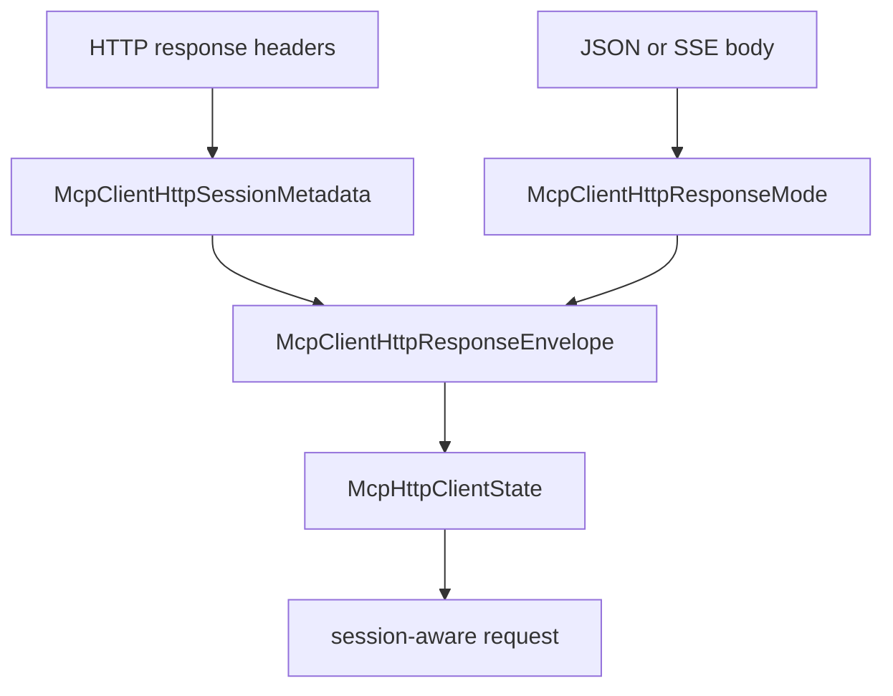

# M47-00 MCP HTTP Session Resume Technical Design Spec

## Purpose

Define the M47 implementation boundary for session-aware MCP streamable HTTP clients before code changes begin.

## Product Context

M46 can parse bounded SSE response bodies, but it discards HTTP response metadata and treats each POST as independent. Resumable streamable HTTP needs a safe place to store session ids and SSE event checkpoints before later milestones add reconnect loops and long-lived stream ownership.

## Scope

This spec delivers:

- ownership boundaries for HTTP session metadata in `ruse-mcp`
- typed validation rules for session ids, protocol versions, and SSE event ids
- response-envelope boundaries for body mode plus safe metadata
- client-state rules for session header propagation
- checkpoint rules for bounded SSE event ids
- slice decomposition for M47 implementation

Owned by other specs:

- concrete metadata contracts in M47-01
- response-envelope transport mapping in M47-02
- session header propagation in M47-03
- SSE checkpoint tracking in M47-04
- README and final gates in M47-05

## Architecture

`client_http.rs` remains the owner of HTTP MCP client behavior. Transport implementations may inspect headers, but only typed metadata crosses the transport trait boundary. UI layers never parse MCP HTTP headers.



## Public Contracts

M47 should introduce:

```rust
pub struct McpClientHttpSessionMetadata {
    pub session_id: Option<String>,
    pub protocol_version: Option<String>,
    pub last_event_id: Option<String>,
}

pub fn parse_mcp_client_http_session_metadata(
    headers: &BTreeMap<String, String>,
    response: &McpClientHttpResponseMode,
) -> Result<McpClientHttpSessionMetadata, McpError>;
```

Names may change during implementation, but contracts must remain typed and fixture-testable.

## State and Failure Handling

- M47-01 validates metadata without mutating client state.
- M47-02 wraps existing JSON/SSE response modes without changing frame parsing behavior.
- M47-03 records session id only after initialize maps successfully.
- M47-03 adds session headers to subsequent initialized requests.
- M47-04 updates the last-event checkpoint only after a matching response frame is accepted.
- Invalid metadata fails before state mutation and without exposing raw header values.
- Reconnect attempts, GET stream ownership, and missed-event replay remain later work.

## Security and Privacy

- Session ids and event ids may be bearer-like operational secrets.
- Public errors must not include raw header values, URL credentials, request bodies, or SSE data.
- Captured metadata must not bypass local policy, sandbox, or gateway approval.
- Metadata values are bounded to prevent memory growth.

## Testing Strategy

- unit tests for metadata validation
- response-envelope tests proving body-mode compatibility
- fixture tests for session state transitions and request headers
- SSE checkpoint tests over bounded events
- final `ruse-mcp` clippy and workspace CI gates

## Acceptance Criteria

- M47 slice specs and plans exist.
- Milestone index lists M47.
- Active work points at M47-01.

## Completion Signal

M47-00 is complete when the milestone has a concrete slice plan that can be implemented without re-deciding architecture.
