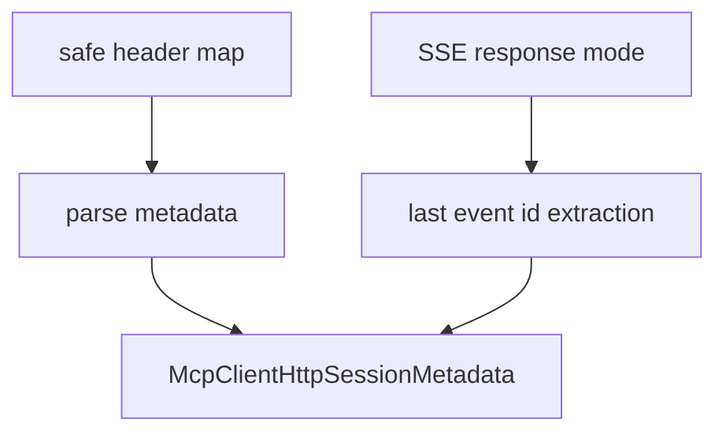

# M47-01 HTTP Session Metadata Contracts Spec

## Purpose

Add pure contracts for safe MCP streamable HTTP session metadata.

## Product Context

Before the client can propagate session headers or resume streams, it needs deterministic validation for server-provided session ids, protocol versions, and SSE event ids.

## Scope

This spec delivers:

- `McpClientHttpSessionMetadata` contract
- safe validation for session id, protocol version, and last event id values
- header-name tolerant metadata extraction from response headers
- checkpoint extraction from bounded SSE response events
- redacted diagnostics for malformed metadata

Owned by other specs:

- response-envelope integration in M47-02
- request header propagation in M47-03
- client-state checkpoint mutation in M47-04

## Architecture

`client_http.rs` owns metadata parsing next to the existing HTTP response and SSE event contracts.



## Public Contracts

```rust
pub struct McpClientHttpSessionMetadata {
    pub session_id: Option<String>,
    pub protocol_version: Option<String>,
    pub last_event_id: Option<String>,
}

pub fn parse_mcp_client_http_session_metadata(
    headers: &BTreeMap<String, String>,
    response: &McpClientHttpResponseMode,
) -> Result<McpClientHttpSessionMetadata, McpError>;
```

## State and Failure Handling

- Empty metadata returns an empty contract.
- Header names are matched case-insensitively.
- Session ids and event ids must be non-empty, bounded, and control-character free.
- Protocol versions must be non-empty, bounded, and control-character free.
- Invalid values return `McpError::InvalidServerRequest`.
- Public errors do not echo raw values.

## Security and Privacy

- Session ids and event ids are treated as sensitive operational metadata.
- Metadata validation does not log raw header values or SSE data.
- No permissions are granted by metadata extraction.

## Testing Strategy

- parse empty metadata
- parse session id and protocol version from mixed-case headers
- parse last event id from the final SSE event id
- reject empty, oversized, and control-character metadata
- verify public errors omit raw values

## Acceptance Criteria

- `CARGO_TARGET_DIR=target/codex-m47 cargo test -p agent-mcp mcp_client_http_session_metadata`
- `CARGO_TARGET_DIR=target/codex-m47 cargo fmt --all -- --check`
- `CARGO_TARGET_DIR=target/codex-m47 cargo clippy -p agent-mcp --all-targets -- -D warnings`

## Completion Signal

M47-01 is complete when HTTP session metadata parsing is typed, exported, redacted, and covered by focused tests.
