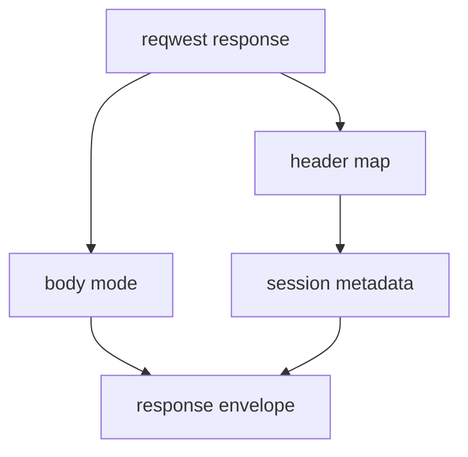

# M47-02 HTTP Response Envelope Spec

## Purpose

Wrap MCP HTTP response body modes with safe session metadata so transport implementations can expose resumability inputs without leaking raw headers.

## Product Context

M47-01 defines pure metadata contracts. The live and fixture transports now need a typed envelope that carries both the M45/M46 response mode and the M47 metadata.

## Scope

This spec delivers:

- `McpClientHttpResponseEnvelope`
- fixture transport support for enveloped responses
- reqwest response header extraction into metadata
- compatibility helpers for existing JSON and SSE response fixtures
- tests proving M46 response frame extraction still works

Owned by other specs:

- client request header propagation in M47-03
- checkpoint state mutation in M47-04
- README updates in M47-05

## Architecture

`McpClientHttpTransport::send_request` returns a response envelope. Frame extraction continues to operate on `McpClientHttpResponseMode`.



## Public Contracts

```rust
pub struct McpClientHttpResponseEnvelope {
    pub mode: McpClientHttpResponseMode,
    pub metadata: McpClientHttpSessionMetadata,
}
```

## State and Failure Handling

- Existing fixtures can still provide JSON or SSE response modes through `Into` conversions.
- Invalid metadata fails before the envelope is returned.
- HTTP status and content-type behavior from M45/M46 remains unchanged.
- Raw header values are not included in public errors.

## Security and Privacy

- Raw headers remain transport-local.
- Envelope metadata is bounded and redacted.
- Request bodies and tool arguments remain absent from diagnostics.

## Testing Strategy

- envelope construction from JSON and SSE response modes
- fixture compatibility with existing response mode fixtures
- reqwest local-server test capturing session metadata
- redaction test for invalid header metadata

## Acceptance Criteria

- `CARGO_TARGET_DIR=target/codex-m47 cargo test -p ruse-mcp mcp_client_http_response_envelope`
- `CARGO_TARGET_DIR=target/codex-m47 cargo test -p ruse-mcp mcp_client_http_transport`
- `CARGO_TARGET_DIR=target/codex-m47 cargo fmt --all -- --check`

## Completion Signal

M47-02 is complete when HTTP transports return typed response envelopes while preserving JSON/SSE response behavior.
