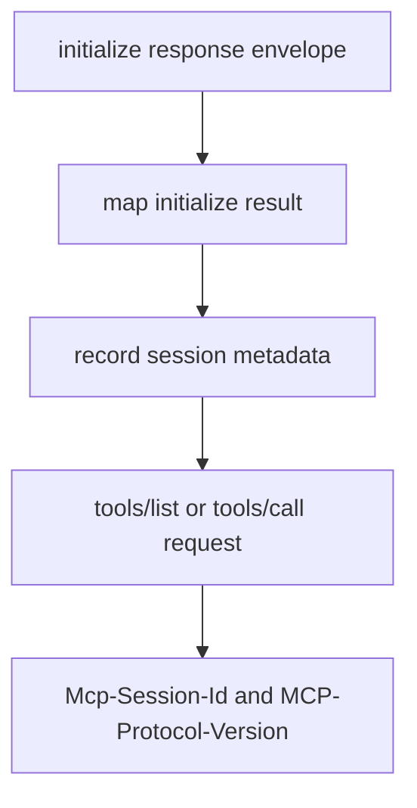

# M47-03 Session Header Propagation Spec

## Purpose

Persist safe HTTP session metadata after initialize and include session headers on later MCP streamable HTTP requests.

## Product Context

M47-02 makes metadata available to the client. The runtime now needs state transitions that keep initialize isolated while making tools/list and tools/call session-aware.

## Scope

This spec delivers:

- `McpHttpClientState` storage for captured session id and protocol version
- request rendering that includes session headers only after initialize succeeds
- fixture tests for initialize failure, initialize success, and later request headers
- safe diagnostics for invalid state

Owned by other specs:

- last-event checkpoint mutation in M47-04
- long-lived stream GET requests in a later milestone

## Architecture

Session state remains inside `McpHttpClientState<T>`. `McpClientHttpRequest::from_config` accepts optional session metadata and merges it with resolved config headers.



## Public Contracts

Public request fields remain typed:

```rust
pub struct McpClientHttpRequest {
    pub url: String,
    pub headers: BTreeMap<String, String>,
    pub body_json: Value,
    pub timeout_ms: u64,
}
```

Any helper used to add session metadata must reject unsafe header values before request construction.

## State and Failure Handling

- Session metadata is not recorded if initialize returns a failure frame or invalid result.
- Session metadata is recorded after initialize result mapping succeeds.
- Existing literal config headers remain honored.
- Session headers must not override user-provided literal headers silently; conflicts fail with bounded diagnostics.
- Subsequent operations still reject unknown server ids.

## Security and Privacy

- Session header values are not printed in diagnostics.
- Config secret refs remain unresolved errors before transport execution.
- Header propagation does not grant remote tool permission.

## Testing Strategy

- initialize success captures metadata
- initialize failure does not send session headers later
- tools/list sends session headers after successful initialize
- header conflict fails safely
- diagnostics do not include raw session id

## Acceptance Criteria

- `CARGO_TARGET_DIR=target/codex-m47 cargo test -p agent-mcp mcp_client_http_session_headers`
- `CARGO_TARGET_DIR=target/codex-m47 cargo test -p agent-mcp mcp_client_http_mcp_client`
- `CARGO_TARGET_DIR=target/codex-m47 cargo fmt --all -- --check`

## Completion Signal

M47-03 is complete when initialized HTTP MCP sessions propagate safe session headers on later requests without leaking metadata.
