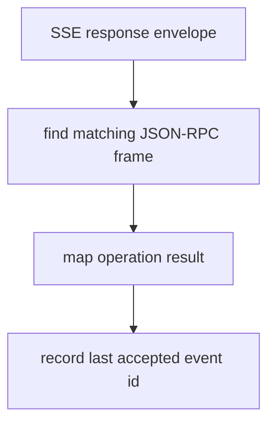

# M47-04 SSE Checkpoint Tracking Spec

## Purpose

Track the latest accepted SSE event id for MCP streamable HTTP responses.

## Product Context

M46 parses SSE event ids and M47-01 extracts metadata. Resumable stream work needs the client to know the latest event id that was accepted into a successful operation before any reconnect logic can safely use it.

## Scope

This spec delivers:

- client state for the latest accepted SSE event id
- update rules tied to matching response-frame acceptance
- request metadata suitable for later `Last-Event-ID` use
- focused tests for accepted, mismatched, and malformed SSE responses

Owned by other specs:

- actual reconnect GET requests in a later milestone
- remote missed-event replay semantics in a later milestone
- progress/logging/task notification handling in later milestones

## Architecture

Response dispatch returns the matching frame and the response metadata needed for state updates. The checkpoint mutates only after the operation maps successfully.

## Public Contracts

Checkpoint state may remain private in M47, but test helpers can inspect sent requests or client summaries if needed. Public metadata contracts from M47-01 remain the durable shape.

## State and Failure Handling

- JSON responses do not change the SSE checkpoint.
- SSE responses without event ids do not change the checkpoint.
- Mismatched response ids do not change the checkpoint.
- Failed operation mapping does not change the checkpoint.
- Accepted matching response frames record the last event id from the response envelope metadata.

## Security and Privacy

- Event ids are not included in public diagnostics.
- Checkpoints do not imply permission or trust in remote event data.
- Checkpoint state remains scoped to the initialized MCP server session.

## Testing Strategy

- accepted SSE response updates checkpoint
- mismatched response id leaves checkpoint unchanged
- malformed result leaves checkpoint unchanged
- subsequent request can carry checkpoint metadata only through later-owned APIs

## Acceptance Criteria

- `CARGO_TARGET_DIR=target/codex-m47 cargo test -p agent-mcp mcp_client_http_sse_checkpoints`
- `CARGO_TARGET_DIR=target/codex-m47 cargo test -p agent-mcp mcp_client_http_sse_dispatch`
- `CARGO_TARGET_DIR=target/codex-m47 cargo fmt --all -- --check`

## Completion Signal

M47-04 is complete when accepted SSE response event ids are checkpointed safely and failure paths leave checkpoint state unchanged.
