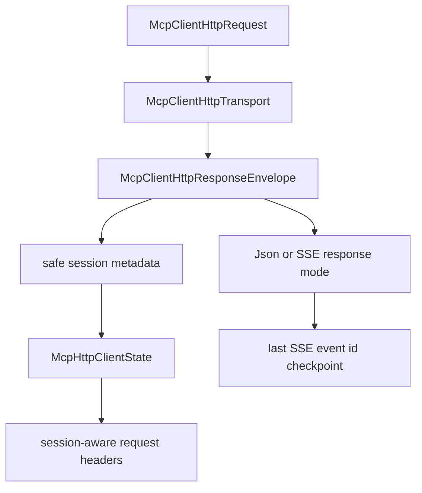

# M47 MCP HTTP Session Resume Runtime Spec

## Purpose

Add the session metadata and event checkpoint foundation needed for resumable MCP streamable HTTP clients.

## Product Context

M45 added request/response HTTP MCP calls and M46 added bounded SSE response parsing. The next runtime gap is continuity: streamable HTTP servers can identify sessions and SSE events, and clients need typed, redacted state before implementing reconnect loops or long-lived background streams.

## Scope

This milestone delivers:

- typed HTTP session metadata contracts for MCP streamable HTTP responses
- validated session id and event id values suitable for durable client state
- response envelopes that preserve body mode plus safe HTTP metadata
- session header propagation after initialize
- SSE last-event checkpoint tracking for bounded response streams
- README, milestone status, focused checks, and final quality gate evidence

Owned by later milestones:

- long-lived GET stream ownership
- automatic reconnect loops and retry backoff
- replaying missed events from a remote server
- OAuth/DCR and token refresh
- MCP progress, logging, task, and elicitation protocol handling
- Desktop stream management UX

## Architecture

`agent-mcp` continues to own HTTP MCP protocol behavior. The HTTP transport returns a typed response envelope rather than exposing raw headers to CLI/Desktop. The client state records safe session metadata and uses it when rendering subsequent requests.



## Public Contracts

M47 introduces contracts shaped like:

```rust
pub struct McpClientHttpSessionMetadata {
    pub session_id: Option<String>,
    pub protocol_version: Option<String>,
    pub last_event_id: Option<String>,
}

pub struct McpClientHttpResponseEnvelope {
    pub mode: McpClientHttpResponseMode,
    pub metadata: McpClientHttpSessionMetadata,
}
```

Names may evolve during implementation, but metadata must remain typed, serializable where useful, bounded, redacted, and fixture-testable.

## State and Failure Handling

- Initialize may capture a server-provided session id from response metadata.
- Subsequent HTTP requests include the captured session id only after initialize succeeds.
- Protocol version headers are explicit and stable; unresolved secret headers remain rejected before transport execution.
- SSE event ids update the local checkpoint only after a matching response frame is accepted.
- Invalid session ids, event ids, or protocol header values fail with bounded diagnostics.
- JSON response behavior from M45 and SSE response behavior from M46 remain compatible.

## Security and Privacy

- Raw header values are untrusted and must not be echoed in public diagnostics.
- Session ids and event ids are treated as sensitive operational metadata.
- Metadata capture does not grant filesystem, command, Git, browser, Desktop, secret, MCP tool, or sampling permissions.
- Local gateway policy remains authoritative before remote `tools/call`.

## Testing Strategy

- contract tests for session metadata validation and extraction
- response-envelope tests that preserve JSON/SSE body behavior
- fixture tests proving session headers are sent only after initialize succeeds
- checkpoint tests proving last SSE event id updates after accepted matching responses
- redaction regressions for malformed metadata
- final `agent-mcp` focused checks and workspace CI gate

## Acceptance Criteria

- `CARGO_TARGET_DIR=target/codex-m47 cargo test -p agent-mcp mcp_client_http_session_metadata`
- `CARGO_TARGET_DIR=target/codex-m47 cargo test -p agent-mcp mcp_client_http_response_envelope`
- `CARGO_TARGET_DIR=target/codex-m47 cargo test -p agent-mcp mcp_client_http_session_headers`
- `CARGO_TARGET_DIR=target/codex-m47 cargo test -p agent-mcp mcp_client_http_sse_checkpoints`
- `CARGO_TARGET_DIR=target/codex-m47 cargo xtask ci`

## Completion Signal

M47 is complete when HTTP MCP clients persist safe session metadata, propagate session headers after initialize, checkpoint bounded SSE event ids, document the implemented boundary, and pass focused plus workspace gates.
