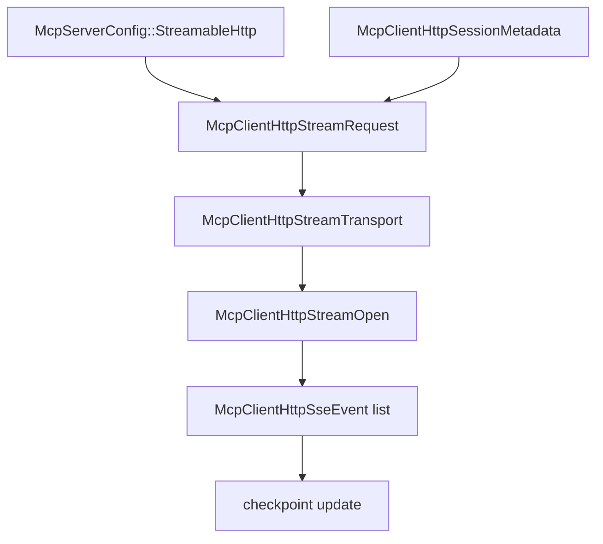

# M48-00 MCP HTTP Stream Ownership Technical Design Spec

## Purpose

Define the M48 implementation boundary for typed MCP streamable HTTP GET stream ownership before code changes begin.

## Product Context

M47 preserved safe session metadata and SSE checkpoints, but there is no GET stream request path. M48 creates that path while keeping reconnect loops, missed-event replay, and background scheduling out of scope.

## Scope

This spec delivers:

- ownership boundaries for stream request contracts in `agent-mcp`
- stream transport trait boundaries
- reqwest GET response validation rules
- resume header and checkpoint rules
- bounded event drain state mutation rules
- slice decomposition for M48 implementation

Owned by other specs:

- concrete stream request contracts in M48-01
- reqwest stream opening in M48-02
- resume snapshot/header behavior in M48-03
- bounded drain/checkpoint behavior in M48-04
- README and final gates in M48-05

## Architecture

`client_http.rs` remains the owner of MCP HTTP client behavior. The POST transport trait stays stable; M48 adds a stream-specific trait and contracts so stream open logic can be tested without requiring long-lived background tasks.



## Public Contracts

M48 should introduce:

```rust
pub struct McpClientHttpStreamRequest {
    pub url: String,
    pub headers: BTreeMap<String, String>,
    pub timeout_ms: u64,
}

#[async_trait]
pub trait McpClientHttpStreamTransport: Send {
    async fn open_stream(
        &mut self,
        request: McpClientHttpStreamRequest,
    ) -> Result<McpClientHttpStreamOpen, McpError>;
}
```

Names may change during implementation, but the stream-open boundary must remain typed and fixture-testable.

## State and Failure Handling

- M48-01 validates stream requests without network IO.
- M48-02 maps reqwest GET responses into typed stream-open results.
- M48-03 builds stream requests from initialized session metadata and includes resume headers safely.
- M48-04 drains bounded SSE events and mutates checkpoint state only after accepted events.
- Invalid metadata, headers, status, content type, oversized bodies, or malformed events fail with redacted diagnostics.
- M48 does not spawn long-lived tasks or retry loops.

## Security and Privacy

- Stream request diagnostics must not include raw header values, session ids, event ids, URL credentials, or stream bodies.
- Existing secret-ref rejection for HTTP headers applies to stream requests.
- Stream ownership does not weaken local policy or sandbox decisions.

## Testing Strategy

- pure request contract tests
- fixture stream transport tests
- reqwest stream-open tests with local HTTP server fixtures
- checkpoint mutation tests over accepted events
- `agent-mcp` clippy and workspace CI gates

## Acceptance Criteria

- M48 slice specs and plans exist.
- Milestone index lists M48.
- Active work points at M48-01.

## Completion Signal

M48-00 is complete when the milestone has a concrete slice plan that can be implemented without re-deciding architecture.
