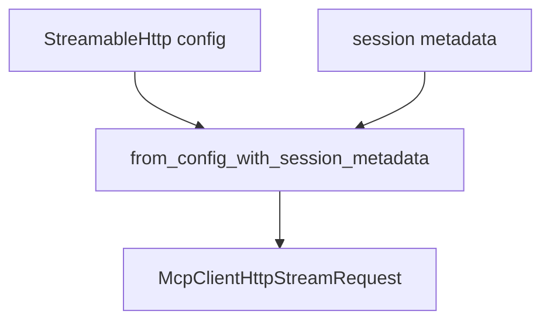

# M48-01 HTTP Stream Request Contracts Spec

## Purpose

Add pure contracts for constructing safe MCP streamable HTTP GET stream requests.

## Product Context

Before a client can open a resumable SSE stream, it needs deterministic request construction that reuses streamable HTTP config, rejects unresolved secrets, and carries safe session metadata.

## Scope

This spec delivers:

- `McpClientHttpStreamRequest` contract
- stream request construction from `McpServerConfig`
- session metadata headers for stream requests
- `Last-Event-ID` resume header when a checkpoint exists
- validation and redacted diagnostics for invalid stream request inputs

Owned by other specs:

- live reqwest GET stream opening in M48-02
- initialized client-state stream snapshots in M48-03
- drain and checkpoint mutation in M48-04

## Architecture

`client_http.rs` owns the stream request contract next to `McpClientHttpRequest`. Request construction remains pure and testable.



## Public Contracts

```rust
pub struct McpClientHttpStreamRequest {
    pub url: String,
    pub headers: BTreeMap<String, String>,
    pub timeout_ms: u64,
}

impl McpClientHttpStreamRequest {
    pub fn from_config_with_session_metadata(
        config: &McpServerConfig,
        session_metadata: &McpClientHttpSessionMetadata,
    ) -> Result<Self, McpError>;
}
```

## State and Failure Handling

- Disabled or non-HTTP configs are rejected.
- Secret-ref headers are rejected before request construction completes.
- User-configured conflicts with MCP session, protocol, or `Last-Event-ID` headers are rejected.
- `Last-Event-ID` is included only when `last_event_id` exists.
- Request construction does not mutate client state.

## Security and Privacy

- Header values are treated as sensitive and never echoed in errors.
- Session ids and event ids are not logged.
- No permissions are granted by request construction.

## Testing Strategy

- construct a GET stream request from streamable HTTP config
- include session id, protocol version, and last event id headers
- omit absent metadata headers
- reject disabled/non-HTTP configs and unresolved secret refs
- reject configured resume-header conflicts with redacted errors

## Acceptance Criteria

- `CARGO_TARGET_DIR=target/codex-m48 cargo test -p ruse-mcp mcp_client_http_stream_request`
- `CARGO_TARGET_DIR=target/codex-m48 cargo fmt --all -- --check`
- `CARGO_TARGET_DIR=target/codex-m48 cargo clippy -p ruse-mcp --all-targets -- -D warnings`

## Completion Signal

M48-01 is complete when GET stream request construction is typed, exported, redacted, and covered by focused tests.
