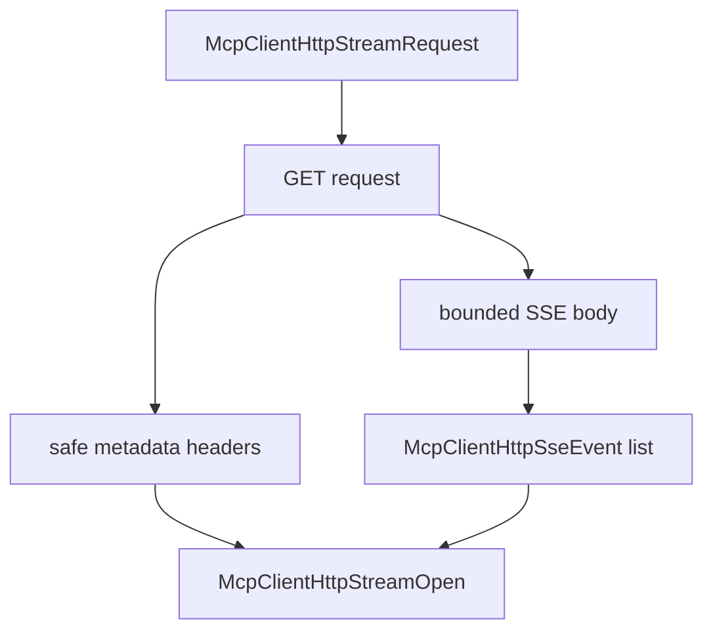

# M48-02 Reqwest GET SSE Stream Open Spec

## Purpose

Add a live reqwest-backed GET stream-open boundary for MCP streamable HTTP SSE streams.

## Product Context

M48-01 creates request contracts. The next step is a transport boundary that proves the runtime can issue a GET request, validate an SSE response, and map it into typed stream-open data without exposing raw transport details.

## Scope

This spec delivers:

- `McpClientHttpStreamTransport` trait
- fixture stream transport
- reqwest GET implementation
- `McpClientHttpStreamOpen` result contract
- status, content-type, body bound, metadata, and redaction behavior

Owned by other specs:

- initialized client stream snapshot APIs in M48-03
- bounded drain/checkpoint mutation in M48-04
- reconnect and background stream loops in later milestones

## Architecture

The stream transport mirrors the existing POST transport but uses GET and returns stream-open data. For M48, the reqwest implementation may read bounded SSE response text into parsed events rather than exposing an indefinite async stream.



## Public Contracts

```rust
pub struct McpClientHttpStreamOpen {
    pub metadata: McpClientHttpSessionMetadata,
    pub events: Vec<McpClientHttpSseEvent>,
}

#[async_trait]
pub trait McpClientHttpStreamTransport: Send {
    async fn open_stream(
        &mut self,
        request: McpClientHttpStreamRequest,
    ) -> Result<McpClientHttpStreamOpen, McpError>;
}
```

## State and Failure Handling

- Non-2xx status fails with existing redacted status diagnostics.
- Non-SSE content type fails before body parsing.
- Oversized bodies fail before parsing.
- Invalid SSE event data or invalid session metadata fails with redacted diagnostics.
- Fixture transport records requests and returns queued results.

## Security and Privacy

- Transport errors do not expose raw URLs, headers, body chunks, session ids, or event ids.
- Remote response bodies are never included in public errors.
- Stream open does not execute tools or bypass gateway policy.

## Testing Strategy

- fixture transport records stream requests
- reqwest sends GET and configured headers
- reqwest rejects JSON/non-SSE content type
- reqwest parses bounded SSE events and response metadata
- public errors omit sensitive header and body values

## Acceptance Criteria

- `CARGO_TARGET_DIR=target/codex-m48 cargo test -p agent-mcp mcp_client_http_stream_transport`
- `CARGO_TARGET_DIR=target/codex-m48 cargo fmt --all -- --check`
- `CARGO_TARGET_DIR=target/codex-m48 cargo clippy -p agent-mcp --all-targets -- -D warnings`

## Completion Signal

M48-02 is complete when stream-open transport contracts and reqwest GET SSE behavior are typed, bounded, redacted, and covered by focused tests.
