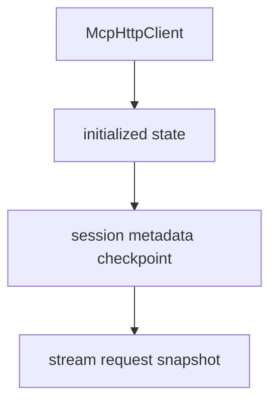

# M48-03 Stream Resume Snapshot Spec

## Purpose

Expose initialized HTTP client stream request snapshots that include safe resume headers.

## Product Context

After stream request contracts and transport open behavior exist, the runtime needs a client-state API that builds the stream request from the initialized session without mutating state or leaking metadata.

## Scope

This spec delivers:

- initialized-client stream request snapshot API
- session id and protocol header propagation for stream opens
- `Last-Event-ID` propagation from the latest accepted checkpoint
- safe failure when the HTTP session is not initialized
- focused tests proving no state mutation during snapshot construction

Owned by other specs:

- reqwest stream-open transport behavior in M48-02
- event drain and checkpoint mutation in M48-04
- background stream ownership in later milestones

## Architecture

`McpHttpClient` owns initialized state. A stream request snapshot lets CLI/Desktop or future schedulers inspect or pass a typed request to the stream transport without parsing runtime internals.



## Public Contracts

```rust
impl<T> McpHttpClient<T> {
    pub async fn stream_request_snapshot(
        &self,
        server_id: &McpServerId,
    ) -> Result<McpClientHttpStreamRequest, McpError>;
}
```

## State and Failure Handling

- Snapshot creation requires matching initialized server id.
- Snapshot creation clones safe metadata but does not mutate state.
- Header conflicts surface as redacted config errors.
- Missing session metadata is allowed, but no empty metadata headers are emitted.

## Security and Privacy

- Snapshot diagnostics do not expose session ids, event ids, or header values.
- Snapshot APIs expose only typed request fields already required for transport execution.
- No tool, filesystem, command, Git, browser, Desktop, or secret permission changes occur.

## Testing Strategy

- initialized clients produce stream snapshots with session headers
- last accepted SSE checkpoint becomes `Last-Event-ID`
- uninitialized or wrong server id fails safely
- snapshot construction does not change session metadata

## Acceptance Criteria

- `CARGO_TARGET_DIR=target/codex-m48 cargo test -p agent-mcp mcp_client_http_stream_resume`
- `CARGO_TARGET_DIR=target/codex-m48 cargo fmt --all -- --check`
- `CARGO_TARGET_DIR=target/codex-m48 cargo clippy -p agent-mcp --all-targets -- -D warnings`

## Completion Signal

M48-03 is complete when initialized HTTP clients can produce safe stream request snapshots with resume headers and focused tests prove state behavior.
