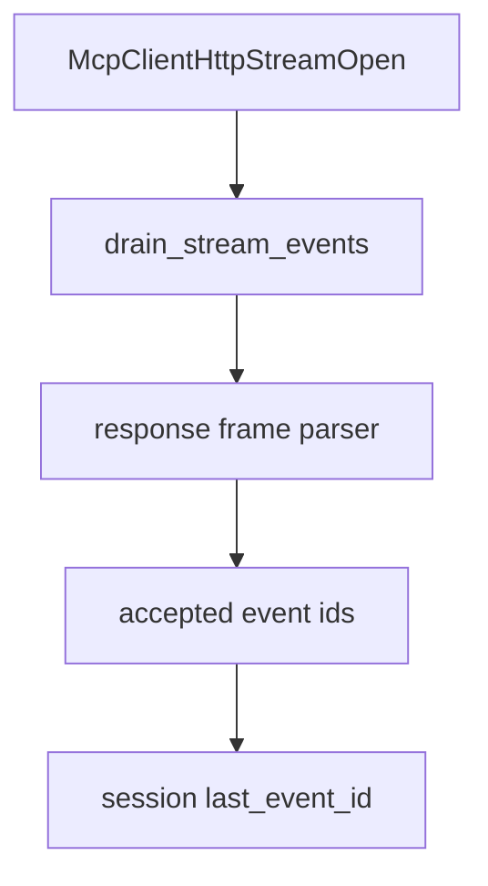

# M48-04 Bounded Stream Event Drain Spec

## Purpose

Add a bounded stream event drain that accepts parsed SSE stream events and updates the HTTP client checkpoint safely.

## Product Context

M48-02 can open a bounded SSE stream and M48-03 can build resume snapshots. The runtime then needs a deterministic way to accept stream events and move checkpoint state forward before later milestones add reconnect loops.

## Scope

This spec delivers:

- stream event drain API over `McpClientHttpStreamOpen`
- accepted event checkpoint mutation
- validation that malformed event payloads fail before unsafe mutation
- redacted diagnostics for drain failures
- focused tests for checkpoint ordering and partial failure behavior

Owned by other specs:

- stream request contracts in M48-01
- reqwest stream-open mapping in M48-02
- background stream loops and retry in later milestones

## Architecture

The drain path uses existing SSE event and response-frame parsers. It records only safe checkpoints in `McpHttpClientState`.



## Public Contracts

```rust
pub struct McpClientHttpStreamDrainReport {
    pub accepted_events: usize,
    pub last_event_id: Option<String>,
}

impl<T> McpHttpClient<T> {
    pub async fn record_stream_open(
        &self,
        server_id: &McpServerId,
        stream: McpClientHttpStreamOpen,
    ) -> Result<McpClientHttpStreamDrainReport, McpError>;
}
```

## State and Failure Handling

- Drain requires matching initialized server id.
- Empty streams are accepted without checkpoint mutation.
- Event ids are validated through existing metadata rules.
- Checkpoint state advances to the last accepted event id.
- If parsing fails before an event is accepted, state is unchanged.
- Public failures do not include raw stream data.

## Security and Privacy

- Event ids are sensitive operational metadata.
- Drain reports include only counts and safe checkpoint presence/value if already part of typed metadata contract.
- Drain does not execute remote tool calls or local actions.

## Testing Strategy

- drain empty streams without mutation
- drain multiple events and checkpoint the last accepted id
- reject malformed event payloads without leaking body data
- require initialized matching server id
- preserve prior checkpoint on failure before acceptance

## Acceptance Criteria

- `CARGO_TARGET_DIR=target/codex-m48 cargo test -p ruse-mcp mcp_client_http_stream_drain`
- `CARGO_TARGET_DIR=target/codex-m48 cargo fmt --all -- --check`
- `CARGO_TARGET_DIR=target/codex-m48 cargo clippy -p ruse-mcp --all-targets -- -D warnings`

## Completion Signal

M48-04 is complete when bounded stream events can be accepted into HTTP client checkpoint state with redacted failures and focused tests.
