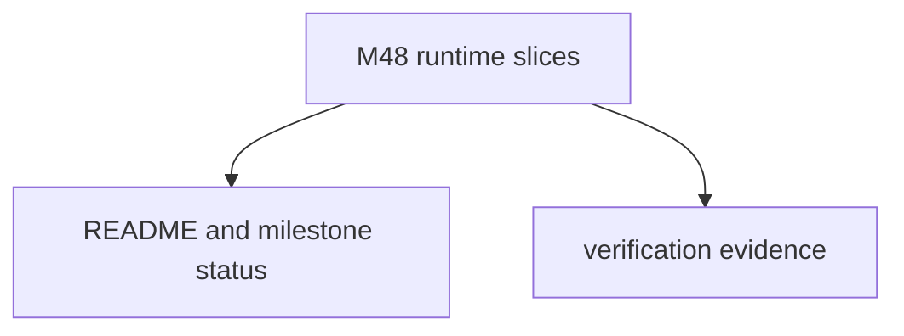

# M48-05 Hardening Docs Spec

## Purpose

Document the completed M48 MCP HTTP stream ownership boundary and record final verification evidence.

## Product Context

M48 adds the first typed GET stream ownership foundation. README and milestone status must describe exactly what works and what remains later work.

## Scope

This spec delivers:

- README update for MCP HTTP GET stream ownership
- milestone status update for M48 completion
- final focused test evidence
- final workspace quality gate evidence

Owned by later specs:

- reconnect loops and retry backoff
- missed-event replay guarantees
- background stream tasks
- Desktop stream management UX

## Architecture

Documentation-only hardening over runtime changes in `ruse-mcp`.

## Public Contracts

No new runtime contracts are introduced by this slice.

## State and Failure Handling

- Docs must not claim reconnect, replay, OAuth, progress/logging/task protocols, or Desktop stream UX.
- Verification evidence must use `target/codex-m48`.

## Security and Privacy

- Documentation must preserve the redaction and permission boundary language for session ids, event ids, headers, and stream bodies.

## Testing Strategy

- final M48 focused tests
- `git diff --check`
- `cargo fmt --all -- --check`
- `cargo xtask ci`

## Acceptance Criteria

- `CARGO_TARGET_DIR=target/codex-m48 cargo test -p ruse-mcp mcp_client_http_stream_request`
- `CARGO_TARGET_DIR=target/codex-m48 cargo test -p ruse-mcp mcp_client_http_stream_transport`
- `CARGO_TARGET_DIR=target/codex-m48 cargo test -p ruse-mcp mcp_client_http_stream_resume`
- `CARGO_TARGET_DIR=target/codex-m48 cargo test -p ruse-mcp mcp_client_http_stream_drain`
- `CARGO_TARGET_DIR=target/codex-m48 cargo xtask ci`

## Completion Signal

M48-05 is complete when docs, milestone status, plan evidence, and final gates prove M48 is complete.
