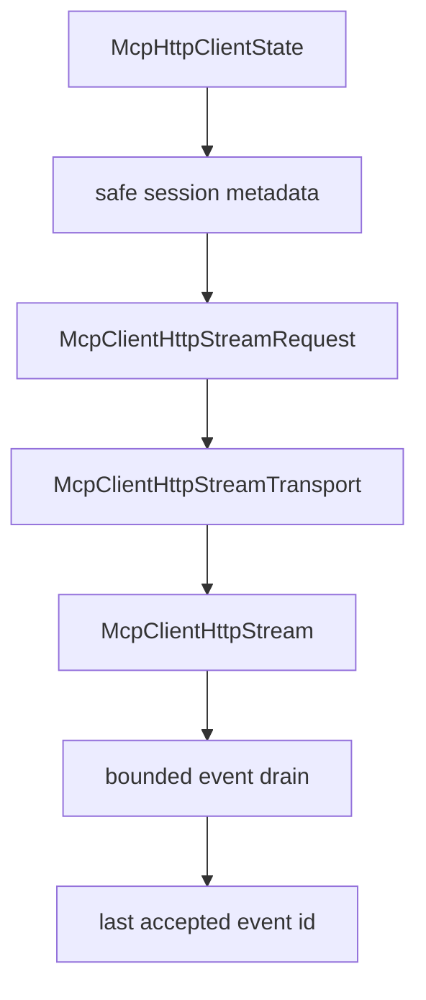

# M48 MCP HTTP Stream Ownership Runtime Spec

## Purpose

Add the typed runtime foundation for opening and owning resumable MCP streamable HTTP GET streams.

## Product Context

M45 added HTTP POST request/response execution, M46 added bounded SSE response parsing, and M47 added safe session metadata plus SSE checkpoints. The next gap is stream ownership: a client needs a safe GET stream request contract and bounded stream drain path before it can support reconnect loops or missed-event replay.

## Scope

This milestone delivers:

- typed HTTP GET stream request contracts for streamable HTTP sessions
- stream-open transport abstraction over `agent-mcp`
- reqwest-backed GET `text/event-stream` opening with bounded diagnostics
- resume header propagation for `Mcp-Session-Id`, `MCP-Protocol-Version`, and `Last-Event-ID`
- bounded event drain that updates safe checkpoints only after accepted events
- README, milestone status, focused checks, and final quality gate evidence

Owned by later milestones:

- automatic reconnect loops and retry backoff
- missed-event replay guarantees from a remote server
- long-running background stream task scheduling
- MCP progress, logging, task, and elicitation protocol handling
- Desktop stream management UX
- OAuth/DCR and token refresh

## Architecture

`agent-mcp` continues to own streamable HTTP protocol behavior. M48 adds a GET stream path next to the POST request path, but still keeps raw response headers, stream chunks, and transport errors behind typed contracts.



## Public Contracts

M48 should introduce contracts shaped like:

```rust
pub struct McpClientHttpStreamRequest {
    pub url: String,
    pub headers: BTreeMap<String, String>,
    pub timeout_ms: u64,
}

pub struct McpClientHttpStreamOpen {
    pub metadata: McpClientHttpSessionMetadata,
    pub events: Vec<McpClientHttpSseEvent>,
}
```

Names may evolve during implementation, but stream contracts must remain typed, serializable where useful, bounded, redacted, and fixture-testable.

## State and Failure Handling

- A stream may be opened only after initialize has captured session state.
- Stream requests include safe session headers and checkpoint headers when present.
- Stream open rejects unsupported content types, invalid metadata, oversized bodies, and malformed SSE events.
- Checkpoints update only after accepted SSE events are parsed and validated.
- Failures do not mutate stream checkpoint state unless an event was accepted before the failure boundary.
- Reconnect loops remain later work.

## Security and Privacy

- Session ids and event ids are sensitive operational metadata.
- Public diagnostics must not expose raw URLs with credentials, header values, stream chunks, event ids, session ids, or remote failure bodies.
- GET stream ownership does not grant local filesystem, command, Git, browser, Desktop, secret, plugin, or tool-call permissions.
- Local gateway policy remains authoritative before remote tool calls.

## Testing Strategy

- contract tests for stream request construction and resume headers
- fixture tests for stream-open transport behavior
- reqwest tests for GET method, header propagation, content-type validation, and redaction
- drain tests for bounded SSE parsing and checkpoint mutation
- final `agent-mcp` focused checks and workspace CI gate

## Acceptance Criteria

- `CARGO_TARGET_DIR=target/codex-m48 cargo test -p agent-mcp mcp_client_http_stream_request`
- `CARGO_TARGET_DIR=target/codex-m48 cargo test -p agent-mcp mcp_client_http_stream_transport`
- `CARGO_TARGET_DIR=target/codex-m48 cargo test -p agent-mcp mcp_client_http_stream_resume`
- `CARGO_TARGET_DIR=target/codex-m48 cargo test -p agent-mcp mcp_client_http_stream_drain`
- `CARGO_TARGET_DIR=target/codex-m48 cargo xtask ci`

## Completion Signal

M48 is complete when HTTP MCP clients can open a typed, bounded GET SSE stream with safe session and checkpoint headers, drain accepted events into checkpoints, document the implemented boundary, and pass focused plus workspace gates.
