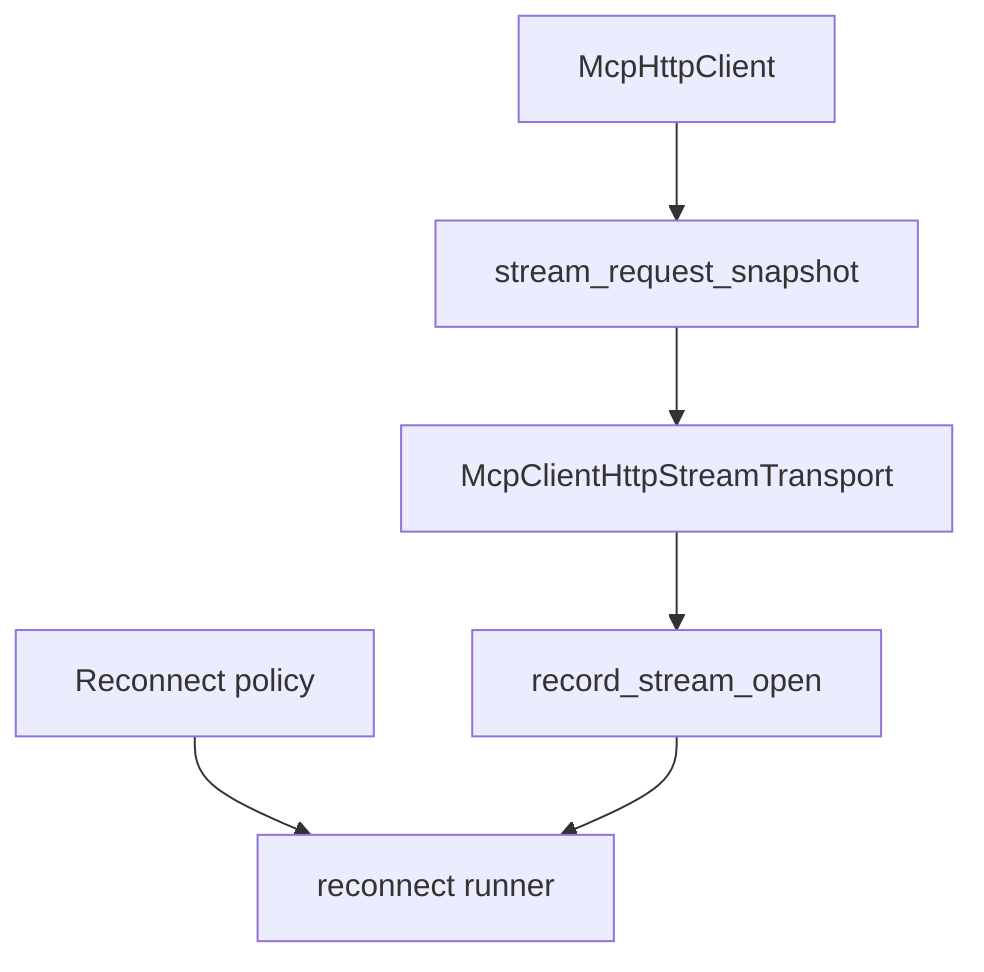

# M49-00 MCP HTTP Stream Reconnect Technical Design Spec

## Purpose

Define the M49 implementation boundary for bounded MCP streamable HTTP reconnect behavior before code changes begin.

## Product Context

M48 introduced typed GET stream open and drain behavior but does not retry after stream failure or end. M49 adds deterministic reconnect policy and reports without claiming background supervision or server replay guarantees.

## Scope

This spec delivers:

- reconnect policy ownership in `ruse-mcp`
- retry classification and backoff rules
- reconnect runner composition over M48 contracts
- missed-event replay diagnostics boundary
- redacted trace/report boundaries
- slice decomposition for M49 implementation

Owned by other specs:

- concrete policy contracts in M49-01
- reconnect runner in M49-02
- missed-event replay diagnostics in M49-03
- reconnect trace reports in M49-04
- README and final gates in M49-05

## Architecture

The runner must compose existing typed contracts rather than adding UI or scheduler ownership.



## Public Contracts

```rust
pub struct McpClientHttpReconnectPolicy {
    pub max_attempts: u32,
    pub initial_backoff_ms: u64,
    pub max_backoff_ms: u64,
}

pub enum McpClientHttpReconnectDecision {
    Retry { backoff_ms: u64 },
    Stop,
}
```

## State and Failure Handling

- M49-01 validates policy without IO.
- M49-02 runs bounded retry attempts through fixture stream transports.
- M49-03 proves resume headers use the latest checkpoint and reports replay gaps only as local diagnostics.
- M49-04 emits redacted attempt traces.
- M49 does not spawn background tasks or sleep in tests unless explicitly injected.

## Security and Privacy

- Reconnect reports must not expose raw transport errors, headers, URLs with credentials, event ids, session ids, or stream bodies.
- Reconnect cannot bypass local policy or sandboxing.

## Testing Strategy

- pure policy tests
- fixture reconnect loop tests
- checkpoint/resume tests
- report redaction tests
- final `ruse-mcp` clippy and workspace CI gates

## Acceptance Criteria

- M49 slice specs and plans exist.
- Milestone index lists M49.
- Active work points at M49-01.

## Completion Signal

M49-00 is complete when the milestone has a concrete slice plan that can be implemented without re-deciding architecture.
