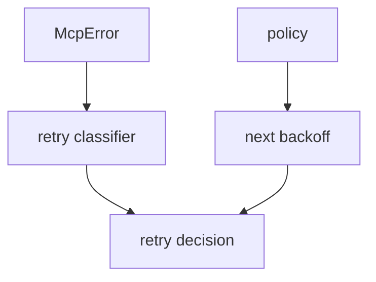

# M49-01 Reconnect Policy Contracts Spec

## Purpose

Add pure contracts for bounded MCP HTTP stream reconnect policy and retry classification.

## Product Context

Reconnect behavior must be deterministic and auditable before it drives stream transport attempts.

## Scope

This spec delivers:

- `McpClientHttpReconnectPolicy`
- policy validation for attempts and backoff bounds
- deterministic next-backoff calculation
- retryable/non-retryable error classification
- redacted public diagnostics for invalid policy

Owned by other specs:

- reconnect runner in M49-02
- replay diagnostics in M49-03
- trace reports in M49-04

## Architecture

`client_http.rs` owns reconnect policy contracts next to M48 stream contracts.



## Public Contracts

```rust
pub struct McpClientHttpReconnectPolicy {
    pub max_attempts: u32,
    pub initial_backoff_ms: u64,
    pub max_backoff_ms: u64,
}
```

## State and Failure Handling

- Zero attempts are rejected.
- Backoff values must be non-zero and capped.
- Retry classification is deterministic and side-effect free.
- Invalid policy errors do not include secret-like input.

## Security and Privacy

- Policy does not grant permissions.
- Error classification must not expose raw remote bodies or headers.

## Testing Strategy

- accept valid policy defaults
- reject zero attempts and invalid backoff bounds
- compute capped exponential backoff
- classify transport/status failures safely
- classify validation/config failures as non-retryable

## Acceptance Criteria

- `CARGO_TARGET_DIR=target/codex-m49 cargo test -p agent-mcp mcp_client_http_reconnect_policy`
- `CARGO_TARGET_DIR=target/codex-m49 cargo fmt --all -- --check`
- `CARGO_TARGET_DIR=target/codex-m49 cargo clippy -p agent-mcp --all-targets -- -D warnings`

## Completion Signal

M49-01 is complete when reconnect policy contracts are typed, exported, deterministic, redacted, and covered by focused tests.
