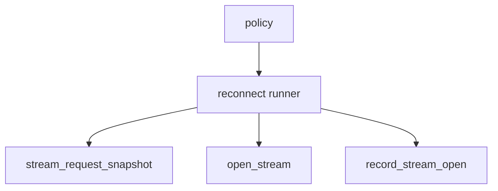

# M49-02 Stream Reconnect Runner Spec

## Purpose

Add a bounded reconnect runner that composes stream request snapshots, GET stream transport, and event drain behavior.

## Product Context

After policy exists, the runtime needs a single-session runner that can retry stream opens through typed contracts without creating background task ownership.

## Scope

This spec delivers:

- reconnect runner API over initialized `McpHttpClient`
- fixture-driven retry attempts
- policy-limited attempt execution
- checkpoint advancement after accepted streams
- safe final failure when attempts are exhausted

Owned by other specs:

- policy contracts in M49-01
- missed-event replay diagnostics in M49-03
- trace reports in M49-04

## Architecture

The runner is a composition layer in `agent-mcp`.



## Public Contracts

```rust
impl<T> McpHttpClient<T> {
    pub async fn reconnect_stream_once(...);
}
```

Concrete names may change during implementation.

## State and Failure Handling

- Runner requires initialized matching server id.
- Each attempt uses a fresh stream request snapshot.
- Accepted events advance checkpoint before returning success.
- Retryable failures continue until policy is exhausted.
- Non-retryable failures stop immediately.

## Security and Privacy

- Attempt failures are redacted.
- No local permissions change.
- Raw stream bodies remain inside parser failures.

## Testing Strategy

- success on first attempt
- retry after transport failure
- stop on non-retryable failure
- exhaust attempt budget with redacted error
- checkpoint advances after successful retry

## Acceptance Criteria

- `CARGO_TARGET_DIR=target/codex-m49 cargo test -p agent-mcp mcp_client_http_stream_reconnect_runner`
- `CARGO_TARGET_DIR=target/codex-m49 cargo fmt --all -- --check`
- `CARGO_TARGET_DIR=target/codex-m49 cargo clippy -p agent-mcp --all-targets -- -D warnings`

## Completion Signal

M49-02 is complete when reconnect attempts compose existing stream contracts safely and focused tests cover retry behavior.
