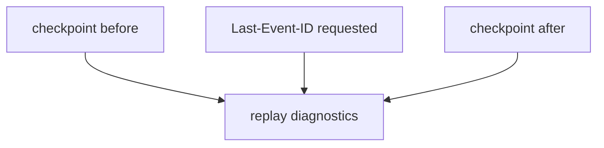

# M49-03 Missed Event Replay Diagnostics Spec

## Purpose

Add local diagnostics that show whether reconnect attempts requested replay from the latest checkpoint.

## Product Context

MCP HTTP servers may resume streams based on `Last-Event-ID`, but local runtime code cannot guarantee remote replay. The runtime should still prove it requests replay correctly and report when local checkpoints change across attempts.

## Scope

This spec delivers:

- replay request diagnostics for `Last-Event-ID`
- checkpoint before/after summaries
- gap/unknown replay status without claiming remote guarantees
- tests for redacted event id handling

Owned by other specs:

- reconnect policy in M49-01
- reconnect runner in M49-02
- trace report shape in M49-04

## Architecture

Diagnostics derive from M48 snapshots and drain reports.



## Public Contracts

```rust
pub struct McpClientHttpReplayDiagnostic {
    pub requested_resume: bool,
    pub checkpoint_advanced: bool,
}
```

## State and Failure Handling

- Diagnostics never mutate state.
- Missing checkpoints report `requested_resume = false`.
- Event id values remain redacted or represented only by presence/stable safe summaries.

## Security and Privacy

- Raw event ids are treated as sensitive.
- Diagnostics do not expose headers or stream data.

## Testing Strategy

- no checkpoint means no replay request
- existing checkpoint produces resume request diagnostics
- accepted events report checkpoint advancement
- failures preserve unknown replay status
- diagnostics avoid raw event ids

## Acceptance Criteria

- `CARGO_TARGET_DIR=target/codex-m49 cargo test -p agent-mcp mcp_client_http_missed_event_replay`
- `CARGO_TARGET_DIR=target/codex-m49 cargo fmt --all -- --check`
- `CARGO_TARGET_DIR=target/codex-m49 cargo clippy -p agent-mcp --all-targets -- -D warnings`

## Completion Signal

M49-03 is complete when reconnect flows expose safe replay diagnostics without overclaiming server replay guarantees.
