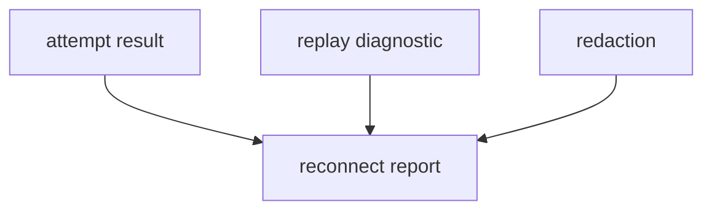

# M49-04 Reconnect Trace Report Spec

## Purpose

Add typed, redacted reconnect trace reports for CLI/Desktop and future background task surfaces.

## Product Context

Reconnect behavior must be inspectable without leaking sensitive operational metadata.

## Scope

This spec delivers:

- reconnect attempt report contracts
- final reconnect report contract
- redacted attempt failure summaries
- serialization tests for stable report shape
- report integration with runner outcomes

Owned by other specs:

- policy in M49-01
- runner behavior in M49-02
- replay diagnostics in M49-03
- README/final gates in M49-05

## Architecture

Reports are typed DTOs in `ruse-mcp` and do not depend on CLI/Desktop crates.



## Public Contracts

```rust
pub struct McpClientHttpReconnectAttempt {
    pub attempt: u32,
    pub outcome: String,
}

pub struct McpClientHttpReconnectReport {
    pub attempts: Vec<McpClientHttpReconnectAttempt>,
}
```

## State and Failure Handling

- Reports are built from attempt outcomes.
- Failures are redacted and bounded.
- Serialization shape is stable.
- Report building does not mutate runtime state.

## Security and Privacy

- No raw URLs, headers, session ids, event ids, stream data, or remote bodies appear in reports.

## Testing Strategy

- stable JSON shape tests
- success/failure attempt report tests
- redaction tests
- runner report integration tests

## Acceptance Criteria

- `CARGO_TARGET_DIR=target/codex-m49 cargo test -p ruse-mcp mcp_client_http_reconnect_trace`
- `CARGO_TARGET_DIR=target/codex-m49 cargo fmt --all -- --check`
- `CARGO_TARGET_DIR=target/codex-m49 cargo clippy -p ruse-mcp --all-targets -- -D warnings`

## Completion Signal

M49-04 is complete when reconnect reports are typed, stable, redacted, and integrated with runner outcomes.
