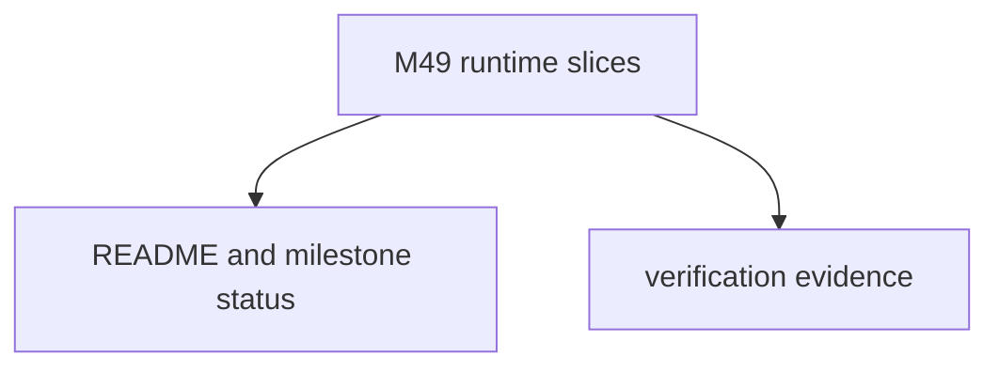

# M49-05 Hardening Docs Spec

## Purpose

Document the completed M49 reconnect runtime boundary and record final verification evidence.

## Product Context

M49 adds bounded reconnect and replay diagnostics. README and milestone status must describe exactly what works and what remains later work.

## Scope

This spec delivers:

- README update for HTTP stream reconnect behavior
- milestone status update for M49 completion
- final focused test evidence
- final workspace quality gate evidence

Owned by later specs:

- background stream supervision
- OAuth/DCR
- Desktop stream management UX
- MCP progress/logging/task protocol handling

## Architecture

Documentation-only hardening over runtime changes in `ruse-mcp`.

## Public Contracts

No new runtime contracts are introduced by this slice.

## State and Failure Handling

- Docs must not claim background scheduling, remote replay guarantees, OAuth, or Desktop stream UX.
- Verification evidence must use `target/codex-m49`.

## Security and Privacy

- Documentation must preserve redaction language for session ids, event ids, headers, stream bodies, and reconnect failures.

## Testing Strategy

- final M49 focused tests
- `git diff --check`
- `cargo fmt --all -- --check`
- `cargo xtask ci`

## Acceptance Criteria

- `CARGO_TARGET_DIR=target/codex-m49 cargo test -p ruse-mcp mcp_client_http_reconnect_policy`
- `CARGO_TARGET_DIR=target/codex-m49 cargo test -p ruse-mcp mcp_client_http_stream_reconnect_runner`
- `CARGO_TARGET_DIR=target/codex-m49 cargo test -p ruse-mcp mcp_client_http_missed_event_replay`
- `CARGO_TARGET_DIR=target/codex-m49 cargo test -p ruse-mcp mcp_client_http_reconnect_trace`
- `CARGO_TARGET_DIR=target/codex-m49 cargo xtask ci`

## Completion Signal

M49-05 is complete when docs, milestone status, plan evidence, and final gates prove M49 is complete.
