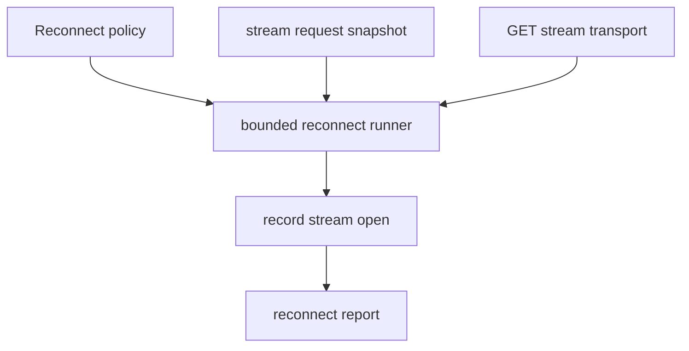

# M49 MCP HTTP Stream Reconnect Runtime Spec

## Purpose

Add the typed runtime foundation for reconnecting bounded MCP streamable HTTP GET streams with safe retry, backoff, and replay diagnostics.

## Product Context

M48 can open bounded GET SSE streams and record accepted event checkpoints. The next runtime gap is continuity after a stream open fails or ends: the client needs explicit reconnect policy, retry classification, resume requests, and redacted reports before later background schedulers own long-running streams.

## Scope

This milestone delivers:

- reconnect policy contracts with attempt budgets and bounded backoff
- retryable/non-retryable stream failure classification
- single-session reconnect runner over existing stream request, transport, and drain contracts
- missed-event replay request/report diagnostics based on `Last-Event-ID`
- redacted reconnect trace reports suitable for CLI/Desktop surfaces
- README, milestone status, focused checks, and final quality gate evidence

Owned by later milestones:

- background stream task scheduling and supervision
- server-specific replay guarantees beyond local request/report diagnostics
- OAuth/DCR and token refresh
- MCP progress, logging, task, and elicitation protocol handling
- Desktop stream management UX

## Architecture

`agent-mcp` owns reconnect policy and stream continuity contracts. The reconnect runner composes M48 request snapshots, stream transport, and event drain without introducing background task ownership.



## Public Contracts

M49 should introduce contracts shaped like:

```rust
pub struct McpClientHttpReconnectPolicy {
    pub max_attempts: u32,
    pub initial_backoff_ms: u64,
    pub max_backoff_ms: u64,
}

pub struct McpClientHttpReconnectReport {
    pub attempts: Vec<McpClientHttpReconnectAttempt>,
    pub final_last_event_id: Option<String>,
}
```

Names may evolve during implementation, but contracts must remain typed, serializable where useful, bounded, redacted, and fixture-testable.

## State and Failure Handling

- Reconnect attempts require an initialized HTTP client session.
- Retry decisions are deterministic and bounded by policy.
- Backoff values are capped and may be computed without sleeping in pure tests.
- `Last-Event-ID` is included on retry requests when a checkpoint exists.
- Accepted stream events advance the checkpoint through M48 drain behavior.
- Final failure reports do not expose URLs with credentials, headers, session ids, event ids, raw stream bodies, or raw remote errors.

## Security and Privacy

- Session ids, event ids, header values, and stream bodies remain sensitive.
- Reconnect does not grant local filesystem, command, Git, browser, Desktop, secret, plugin, or tool-call permissions.
- Local gateway policy remains authoritative before remote tool calls.

## Testing Strategy

- policy validation and backoff tests
- retry classification tests
- fixture reconnect runner tests
- replay/resume header diagnostics tests
- redaction tests for failed attempts
- final focused checks and workspace CI gate

## Acceptance Criteria

- `CARGO_TARGET_DIR=target/codex-m49 cargo test -p agent-mcp mcp_client_http_reconnect_policy`
- `CARGO_TARGET_DIR=target/codex-m49 cargo test -p agent-mcp mcp_client_http_stream_reconnect_runner`
- `CARGO_TARGET_DIR=target/codex-m49 cargo test -p agent-mcp mcp_client_http_missed_event_replay`
- `CARGO_TARGET_DIR=target/codex-m49 cargo test -p agent-mcp mcp_client_http_reconnect_trace`
- `CARGO_TARGET_DIR=target/codex-m49 cargo xtask ci`

## Completion Signal

M49 is complete when initialized HTTP MCP clients can run bounded reconnect attempts over typed stream contracts, preserve checkpoint continuity, emit redacted reconnect reports, document the boundary, and pass focused plus workspace gates.
