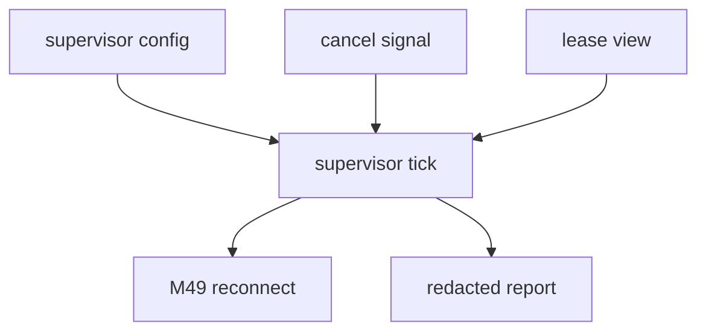

# M50-00 MCP HTTP Background Stream Supervision Technical Design Spec

## Purpose

Define the M50 implementation boundary for MCP HTTP stream supervision before code changes begin.

## Product Context

M49 introduced bounded reconnect runner and safe reports, but callers still own when reconnect attempts happen. M50 adds a scheduler-friendly supervision layer without starting unmanaged background loops.

## Scope

This spec delivers:

- supervisor contract ownership in `agent-mcp`
- lifecycle status and tick semantics
- runner composition over M49 reconnect reports
- cancellation and lease boundaries
- redacted report boundaries
- slice decomposition for M50 implementation

Owned by other specs:

- concrete supervisor contracts in M50-01
- bounded runner in M50-02
- cancellation and lease boundary in M50-03
- supervisor reports in M50-04
- README and final gates in M50-05

## Architecture

The supervisor must compose existing typed contracts rather than adding UI or long-lived runtime ownership.



## Public Contracts

```rust
pub struct McpClientHttpStreamSupervisorConfig {
    pub server_id: McpServerId,
    pub reconnect_policy: McpClientHttpReconnectPolicy,
}

pub enum McpClientHttpStreamSupervisorStatus {
    Idle,
    Running,
    WaitingRetry,
    Cancelled,
    Failed,
    Completed,
}
```

## State and Failure Handling

- M50-01 validates supervisor config without IO.
- M50-02 runs bounded supervision ticks through fixture stream transports.
- M50-03 stops cleanly on cancellation or invalid lease before side effects.
- M50-04 emits redacted supervisor reports.
- M50 does not spawn unbounded loops or hold scheduler leases internally.

## Security and Privacy

- Supervisor reports must not expose raw transport errors, headers, URLs with credentials, event ids, session ids, stream bodies, or remote failures.
- Supervision cannot bypass local policy or sandboxing.

## Testing Strategy

- pure contract tests
- fixture runner tests
- cancellation/lease tests
- report redaction tests
- final `agent-mcp` clippy and workspace CI gates

## Acceptance Criteria

- M50 slice specs and plans exist.
- Milestone index lists M50.
- Active work points at M50-01.

## Completion Signal

M50-00 is complete when the milestone has a concrete slice plan that can be implemented without re-deciding architecture.
