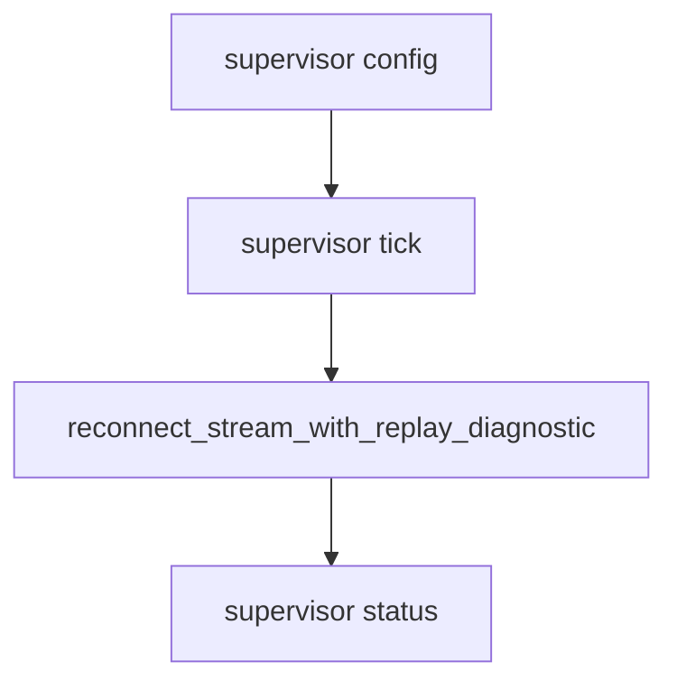

# M50-02 Supervisor Runner Spec

## Purpose

Add a bounded supervisor tick runner that composes supervisor config, initialized HTTP client state, stream transports, and M49 reconnect reports.

## Product Context

M50-01 defines what should be supervised. The runtime now needs a single explicit tick API that a scheduler can call without starting unmanaged loops.

## Scope

This spec delivers:

- supervisor tick API over initialized `McpHttpClient`
- fixture-driven successful tick behavior
- bounded max tick accounting
- reconnect report propagation
- safe terminal failure on invalid session or exhausted tick budget

Owned by other specs:

- cancellation and lease boundary in M50-03
- richer report DTOs in M50-04

## Architecture

The runner remains a composition layer in `ruse-mcp`.



## Public Contracts

```rust
impl<T> McpHttpClient<T> {
    pub async fn supervise_stream_tick(...);
}
```

Concrete names may change during implementation.

## State and Failure Handling

- Runner requires initialized matching server id.
- Each tick is explicit and bounded.
- Accepted events advance checkpoints through M49/M48 behavior.
- Failures use redacted summaries.

## Security and Privacy

- Runner reports expose no raw URLs, headers, session ids, event ids, stream bodies, or remote errors.

## Testing Strategy

- success tick
- retry then success tick
- invalid session failure
- exhausted tick budget
- checkpoint advancement through supervisor tick

## Acceptance Criteria

- `CARGO_TARGET_DIR=target/codex-m50 cargo test -p ruse-mcp mcp_client_http_stream_supervisor_runner`
- `CARGO_TARGET_DIR=target/codex-m50 cargo fmt --all -- --check`
- `CARGO_TARGET_DIR=target/codex-m50 cargo clippy -p ruse-mcp --all-targets -- -D warnings`

## Completion Signal

M50-02 is complete when supervisor ticks compose M49 reconnect safely and focused tests cover state transitions.
