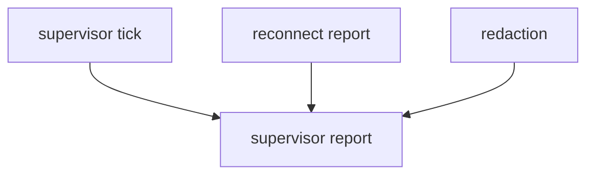

# M50-04 Supervisor Reports Spec

## Purpose

Add typed, redacted supervisor reports for CLI/Desktop and future background task surfaces.

## Product Context

Users need to inspect supervised stream state without seeing raw session metadata or stream payloads. M49 reports reconnect attempts; M50 reports supervision state around those attempts.

## Scope

This spec delivers:

- supervisor summary report contract
- redacted terminal reason summaries
- notification-ready status DTOs
- stable serialization tests
- runner report integration

Owned by other specs:

- final README docs and workspace gate in M50-05
- Desktop visual stream management in later milestones

## Architecture

Reports are typed DTOs in `ruse-mcp` and do not depend on CLI/Desktop crates.



## Public Contracts

```rust
pub struct McpClientHttpStreamSupervisorReport {
    pub status: McpClientHttpStreamSupervisorStatus,
    pub reconnect: Option<McpClientHttpReconnectReport>,
}
```

## State and Failure Handling

- Reports are built from supervisor outcomes.
- Failures are redacted and bounded.
- Serialization shape is stable.
- Report building does not mutate runtime state.

## Security and Privacy

- No raw URLs, headers, session ids, event ids, stream data, remote bodies, or raw scheduler internals appear in reports.

## Testing Strategy

- stable JSON shape tests
- success/failure/cancelled report tests
- redaction tests
- runner report integration tests

## Acceptance Criteria

- `CARGO_TARGET_DIR=target/codex-m50 cargo test -p ruse-mcp mcp_client_http_stream_supervisor_reports`
- `CARGO_TARGET_DIR=target/codex-m50 cargo fmt --all -- --check`
- `CARGO_TARGET_DIR=target/codex-m50 cargo clippy -p ruse-mcp --all-targets -- -D warnings`

## Completion Signal

M50-04 is complete when supervisor reports are typed, stable, redacted, and integrated with runner outcomes.
