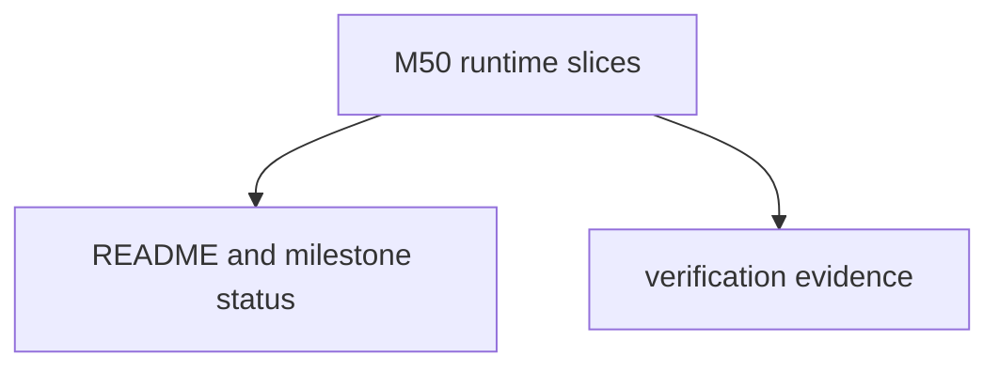

# M50-05 Hardening Docs Spec

## Purpose

Document the completed M50 supervision runtime boundary and record final verification evidence.

## Product Context

M50 adds bounded background stream supervision foundations. README and milestone status must describe exactly what works and what remains later work.

## Scope

This spec delivers:

- README update for HTTP stream supervision behavior
- milestone status update for M50 completion
- final focused test evidence
- final workspace quality gate evidence

Owned by later specs:

- OAuth/DCR
- Desktop stream management UX
- MCP progress/logging/task protocol handling
- server-specific replay guarantees

## Architecture

Documentation-only hardening over runtime changes in `ruse-mcp`.

## Public Contracts

No new runtime contracts are introduced by this slice.

## State and Failure Handling

- Docs must not claim unbounded background loops, remote replay guarantees, OAuth, or Desktop stream UX.
- Verification evidence must use `target/codex-m50`.

## Security and Privacy

- Documentation must preserve redaction language for session ids, event ids, headers, stream bodies, scheduler internals, and reconnect failures.

## Testing Strategy

- final M50 focused tests
- `git diff --check`
- `cargo fmt --all -- --check`
- `cargo xtask ci`

## Acceptance Criteria

- `CARGO_TARGET_DIR=target/codex-m50 cargo test -p ruse-mcp mcp_client_http_stream_supervisor_contracts`
- `CARGO_TARGET_DIR=target/codex-m50 cargo test -p ruse-mcp mcp_client_http_stream_supervisor_runner`
- `CARGO_TARGET_DIR=target/codex-m50 cargo test -p ruse-mcp mcp_client_http_stream_supervisor_cancellation`
- `CARGO_TARGET_DIR=target/codex-m50 cargo test -p ruse-mcp mcp_client_http_stream_supervisor_reports`
- `CARGO_TARGET_DIR=target/codex-m50 cargo xtask ci`

## Completion Signal

M50-05 is complete when docs, milestone status, plan evidence, and final gates prove M50 is complete.
