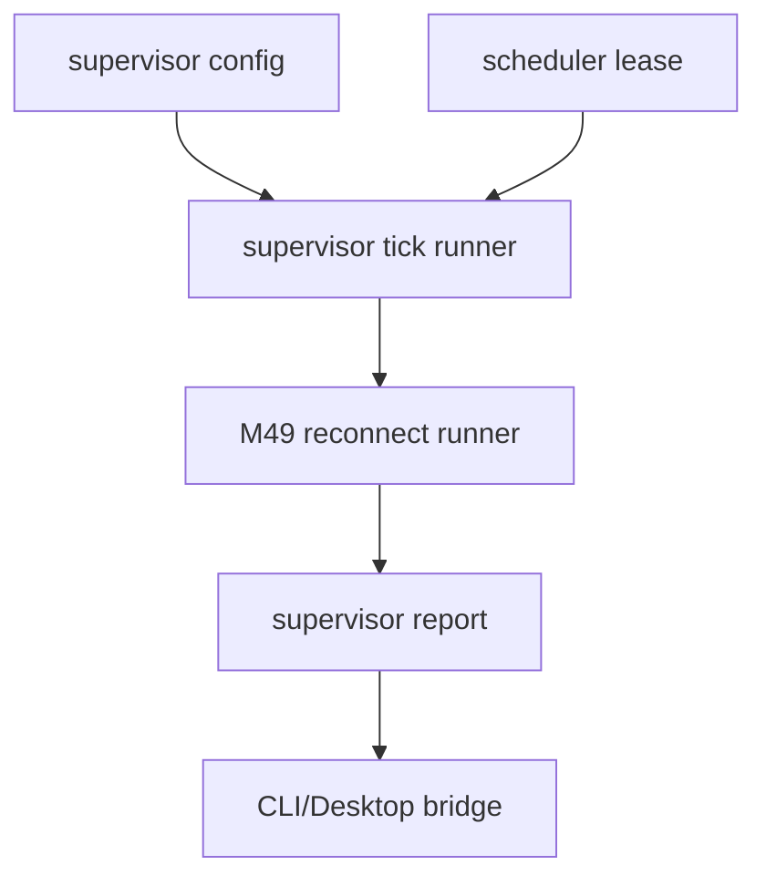

# M50 MCP HTTP Background Stream Supervision Runtime Spec

## Purpose

Add the runtime foundation for supervising MCP streamable HTTP GET streams as durable background work with bounded reconnect, leases, cancellation, and redacted status reports.

## Product Context

M49 can run explicit bounded reconnect attempts for an initialized HTTP MCP client, but ownership remains caller-driven. The next runtime gap is long-running stream supervision: background tasks need a typed way to start, tick, pause, cancel, and inspect stream supervision without moving MCP logic into CLI or Desktop.

## Scope

This milestone delivers:

- background stream supervisor contracts in `ruse-mcp`
- durable stream supervisor status and lifecycle summaries
- a bounded supervisor tick/runner that composes M49 reconnect reports
- scheduler-facing lease and cancellation integration points
- redacted notification and report DTOs for CLI/Desktop bridge surfaces
- README, milestone status, focused checks, and final quality gate evidence

Owned by later milestones:

- OAuth/DCR and token refresh
- Desktop stream management UX beyond typed reports
- MCP progress, logging, task, and elicitation protocol semantics
- server-specific replay guarantees beyond local checkpoint diagnostics

## Architecture

`ruse-mcp` owns stream supervision contracts and reconnect composition. Scheduler integration remains dependency-light: supervisor commands and reports are typed DTOs that `ruse-scheduler`, CLI, TUI, and Desktop can consume without owning MCP protocol details.



## Public Contracts

M50 should introduce contracts shaped like:

```rust
pub struct McpClientHttpStreamSupervisorConfig {
    pub server_id: McpServerId,
    pub policy: McpClientHttpReconnectPolicy,
    pub max_ticks: u32,
}

pub enum McpClientHttpStreamSupervisorStatus {
    Idle,
    Running,
    WaitingRetry,
    Cancelled,
    Failed,
    Completed,
}
```

Names may evolve during implementation, but contracts must remain typed, serializable where durable, redacted, and fixture-testable.

## State and Failure Handling

- Supervision requires an initialized HTTP client session.
- Each tick is bounded and explicit; M50 does not spawn unbounded loops.
- Lease/cancellation signals stop before new reconnect attempts.
- Supervisor status reports do not expose raw URLs, headers, session ids, event ids, stream bodies, or remote failures.
- Retry and replay diagnostics reuse M49 contracts.

## Security and Privacy

- Background supervision grants no local filesystem, command, Git, browser, Desktop, secret, plugin, or tool-call permissions.
- Local gateway policy remains authoritative before remote tool execution.
- Reports use presence/status summaries for checkpoints and redacted failure summaries.

## Testing Strategy

- pure supervisor contract serialization tests
- fixture supervisor tick state-machine tests
- cancellation and lease boundary tests
- redacted notification/report tests
- final focused checks and workspace CI gate

## Acceptance Criteria

- `CARGO_TARGET_DIR=target/codex-m50 cargo test -p ruse-mcp mcp_client_http_stream_supervisor_contracts`
- `CARGO_TARGET_DIR=target/codex-m50 cargo test -p ruse-mcp mcp_client_http_stream_supervisor_runner`
- `CARGO_TARGET_DIR=target/codex-m50 cargo test -p ruse-mcp mcp_client_http_stream_supervisor_cancellation`
- `CARGO_TARGET_DIR=target/codex-m50 cargo test -p ruse-mcp mcp_client_http_stream_supervisor_reports`
- `CARGO_TARGET_DIR=target/codex-m50 cargo xtask ci`

## Completion Signal

M50 is complete when MCP HTTP stream supervision has typed runtime contracts, bounded runner behavior, cancellation/lease boundaries, redacted reports, documentation, and focused plus workspace verification evidence.
