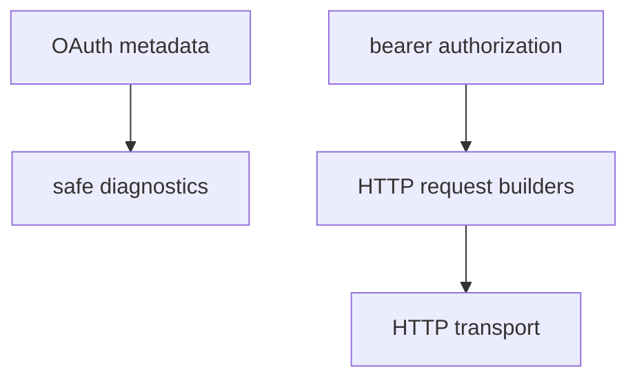

# M51-00 MCP HTTP OAuth Authorization Technical Design Spec

## Purpose

Define the implementation boundary for MCP HTTP OAuth authorization foundations.

## Product Context

M51 follows the HTTP stream supervision milestone. Protected MCP HTTP servers need authorization metadata and safe request construction before higher-level auth UX can be built.

## Scope

This spec delivers:

- crate ownership and dependency direction
- metadata and authorization DTO boundaries
- redaction and diagnostics rules
- focused slice decomposition
- verification gates

Owned by other specs:

- slice-level implementation details
- browser login and durable token storage

## Architecture

`agent-mcp::client_http` owns the contracts because they are transport-adjacent and shared by POST and GET stream request builders. No CLI, Desktop, scheduler, model, or secret-store crate depends back into `agent-mcp`.

## Public Contracts

- `McpClientHttpOAuthMetadata`
- `McpClientHttpProtectedResourceMetadata`
- `McpClientHttpAuthorization`
- `McpClientHttpAuthorizationDiagnostic`
- request builder helpers for POST and GET stream requests

## State and Failure Handling

- Metadata DTOs are immutable after construction.
- Validation failures return redacted `McpError::InvalidConfig`.
- Existing configured authorization headers conflict with explicit bearer authorization.
- Token acquisition failure is outside this milestone and should be represented by caller diagnostics, not hidden runtime behavior.

## Security and Privacy

- Never serialize raw bearer tokens in reports.
- Never include raw metadata bodies or remote auth errors in public diagnostics.
- Header conflict diagnostics must name the class of failure, not the configured header value.

## Testing Strategy

- contract serde tests
- URL validation tests
- header conflict tests
- report redaction tests
- focused and workspace gates

## Acceptance Criteria

- M51 slice specs and plans exist for M51-01 through M51-05.
- `docs/milestones/README.md` points active work at M51-01.

## Completion Signal

The technical design is complete when it decomposes M51 into implementation-ready slices and milestone docs point to the first slice.
