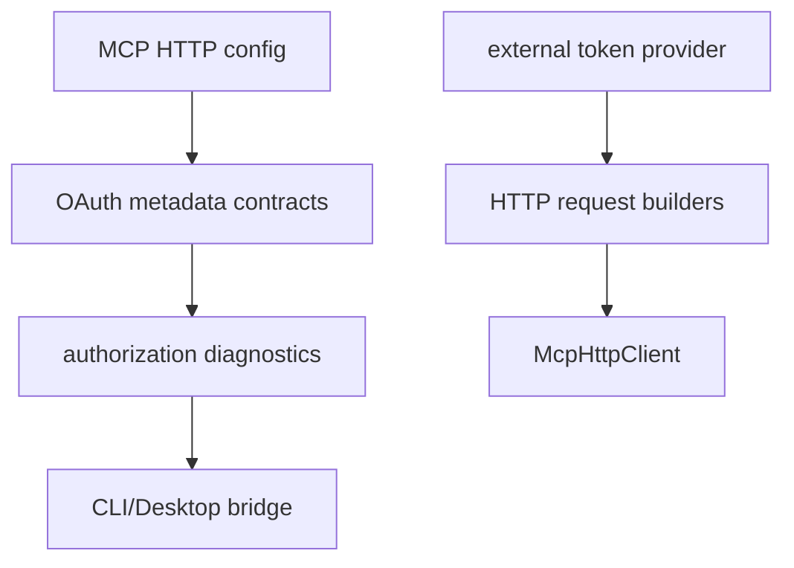

# M51 MCP HTTP OAuth Authorization Runtime Spec

## Purpose

Add a typed, redacted OAuth authorization foundation for MCP streamable HTTP clients so protected HTTP MCP servers can be discovered, diagnosed, and called with explicit bearer-token material supplied by a higher-level secret/auth layer.

## Product Context

M45-M50 make streamable HTTP MCP usable for request/response calls, SSE responses, session resume, GET stream ownership, reconnect, and supervision. The next runtime gap is authorization: protected MCP HTTP servers need metadata discovery, authorization requirements, safe diagnostics, and a narrow token application boundary without moving browser login, token storage, or Desktop UX into `agent-mcp`.

## Scope

This milestone delivers:

- OAuth/protected-resource metadata contracts for MCP HTTP clients
- safe metadata parsing and validation helpers
- authorization requirement diagnostics for HTTP MCP server configs
- explicit bearer token application to HTTP request and stream request builders
- redacted authorization reports for CLI/Desktop/scheduler surfaces
- README, milestone status, focused checks, and final quality gate evidence

Owned by later milestones:

- browser-based login and Desktop authorization UX
- durable token storage, refresh, revocation, and secret resolver integration
- dynamic client registration execution
- provider-specific OAuth flows
- server-specific authorization policy beyond typed metadata and diagnostics

## Architecture

`agent-mcp` owns protocol-adjacent OAuth contracts and redacted diagnostics. Token acquisition remains outside `agent-mcp`; callers pass explicit token material only at the request construction boundary. CLI/Desktop consume safe DTOs and never receive raw bearer tokens through reports.



## Public Contracts

M51 should introduce contracts shaped like:

```rust
pub struct McpClientHttpOAuthMetadata {
    pub issuer: Option<String>,
    pub authorization_endpoint: Option<String>,
    pub token_endpoint: Option<String>,
    pub registration_endpoint: Option<String>,
    pub scopes_supported: Vec<String>,
}

pub struct McpClientHttpAuthorization {
    pub bearer_token: String,
}
```

Names may evolve during implementation, but contracts must remain typed, serializable where durable, redacted, and fixture-testable.

## State and Failure Handling

- Metadata parsing validates URL shape and rejects unsupported malformed values.
- Diagnostics explain missing or unusable authorization metadata without exposing secrets.
- Bearer token application is explicit; no token lookup happens inside `agent-mcp`.
- Authorization headers are rejected if caller configuration already contains a conflicting authorization header.
- Stream and POST request builders share the same redaction and validation behavior.

## Security and Privacy

- Bearer tokens, authorization headers, client secrets, refresh tokens, raw metadata bodies, and remote error payloads are never exposed in public diagnostics or reports.
- `agent-mcp` grants no filesystem, command, Git, browser, Desktop, plugin, or secret-store permission.
- Token acquisition and storage are owned by later auth/secret layers.

## Testing Strategy

- pure metadata contract serialization tests
- metadata validation and redaction tests
- protected-resource/authorization diagnostic tests
- bearer token application tests for POST and GET stream requests
- final focused checks and workspace CI gate

## Acceptance Criteria

- `CARGO_TARGET_DIR=target/codex-m51 cargo test -p agent-mcp mcp_client_http_oauth_metadata`
- `CARGO_TARGET_DIR=target/codex-m51 cargo test -p agent-mcp mcp_client_http_oauth_discovery`
- `CARGO_TARGET_DIR=target/codex-m51 cargo test -p agent-mcp mcp_client_http_authorization_diagnostics`
- `CARGO_TARGET_DIR=target/codex-m51 cargo test -p agent-mcp mcp_client_http_bearer_authorization`
- `CARGO_TARGET_DIR=target/codex-m51 cargo xtask ci`

## Completion Signal

M51 is complete when MCP HTTP OAuth authorization has typed metadata contracts, safe diagnostics, explicit bearer token request boundaries, documentation, and focused plus workspace verification evidence.
