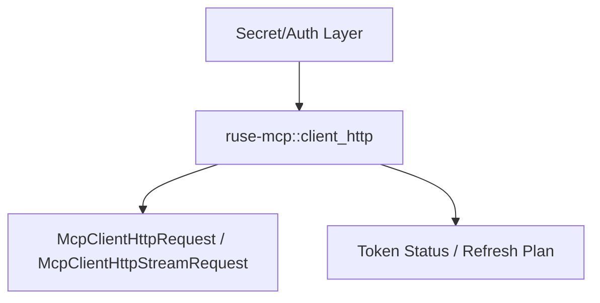

# M52 MCP HTTP OAuth Token Lifecycle Runtime Spec

## Purpose

Add a safe token lifecycle foundation for MCP streamable HTTP authorization. M51 can apply caller-provided bearer material to requests; M52 makes token state inspectable, lease-bounded, refresh-aware, and auditable without implementing browser login, provider-specific OAuth flows, or durable secret storage.

## Product Context

Protected MCP HTTP servers need more than a one-shot bearer header. CLI, TUI, Desktop, gateway, and scheduler surfaces need to know whether a token is present, expired, near refresh, scope-compatible, and safe to apply to a request. The runtime needs typed contracts for that state before higher-level auth UX or storage integration can safely exist.

## Scope

This spec delivers:

- redacted token lease and token status contracts
- token source references that avoid durable raw-token storage in `ruse-mcp`
- refresh planning diagnostics based on expiry/skew/scope metadata
- request factory helpers that apply valid token leases through the M51 bearer boundary
- docs and final verification evidence

Owned by later specs:

- browser login, device-code login, and Desktop auth UX
- provider-specific OAuth refresh network calls
- durable encrypted token vaults
- DCR execution, revocation execution, and account selection UX

## Architecture

`ruse-mcp::client_http` owns pure OAuth token lifecycle contracts and request-factory helpers. Secret storage and token acquisition remain outside `ruse-mcp`; callers pass token leases or token source references into the runtime boundary.



## Public Contracts

```rust
pub struct McpClientHttpOAuthTokenLease {
    pub access_token: String,
    pub expires_at_unix_ms: Option<u64>,
    pub scopes: Vec<String>,
}

pub struct McpClientHttpOAuthTokenStatus {
    pub usable: bool,
    pub diagnostics: Vec<McpClientHttpOAuthTokenDiagnostic>,
}
```

## State and Failure Handling

- Token contracts validate empty/control-character token material before use.
- Token status helpers are pure and do not mutate client state.
- Expired tokens are not applied to requests.
- Near-expiry tokens produce refresh warnings but may still be applied while usable.
- Diagnostic messages never include token material, refresh tokens, client secrets, or raw auth errors.

## Security and Privacy

- `Debug` and public diagnostics redact token material.
- `ruse-mcp` does not persist raw tokens.
- Token source references are identifiers, not secrets.
- Authorization headers conflict with explicit token application.

## Testing Strategy

- stable serde tests for public status/report contracts
- token validation and redacted debug tests
- expiry and refresh-skew planning tests
- request factory tests for POST and GET stream request boundaries
- focused M52 tests plus final `cargo xtask ci`

## Acceptance Criteria

- `CARGO_TARGET_DIR=target/codex-m52 cargo test -p ruse-mcp mcp_client_http_oauth_token`
- `CARGO_TARGET_DIR=target/codex-m52 cargo test -p ruse-mcp mcp_client_http_oauth_token_refresh`
- `CARGO_TARGET_DIR=target/codex-m52 cargo test -p ruse-mcp mcp_client_http_oauth_token_requests`
- `CARGO_TARGET_DIR=target/codex-m52 cargo xtask ci`

## Completion Signal

M52 is complete when MCP HTTP OAuth token leases, token diagnostics, refresh planning, and authorized request factory helpers are typed, redacted, documented, and verified.
