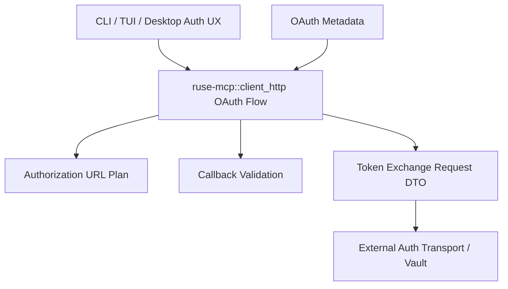

# M53 MCP HTTP OAuth Authorization Flow Runtime Spec

## Purpose

Add a safe OAuth authorization-flow foundation for MCP streamable HTTP clients. M51 can discover OAuth metadata and apply bearer authorization, and M52 can reason about token leases. M53 adds the typed, auditable flow contracts needed to start an authorization code flow with PKCE, validate callback material, and prepare token exchange requests without launching browsers, storing secrets, or executing provider-specific OAuth network calls.

## Product Context

Protected MCP HTTP servers need an authorization path before CLI, TUI, Desktop, or background surfaces can acquire token leases. The runtime should expose deterministic, redacted contracts for flow setup and validation so UI and auth-storage layers can be added later without inventing provider-specific state handling.

## Scope

This spec delivers:

- PKCE verifier, challenge, and state contracts
- authorization request planning from OAuth metadata and requested scopes
- callback validation for code/state/error outcomes
- token exchange request DTOs that carry redacted verifier material only at the final request boundary
- flow diagnostics and docs with final verification evidence

Owned by later specs:

- opening a browser or device-code flow
- listening on localhost callback ports
- provider-specific token exchange network calls
- durable encrypted token vaults
- Desktop account picker UX
- dynamic client registration, revocation execution, and refresh execution

## Architecture

`ruse-mcp::client_http` owns pure OAuth flow contracts next to existing metadata, authorization, and token lifecycle contracts. Callers provide randomness, client metadata, redirect URIs, requested scopes, and callback query values. `ruse-mcp` validates, plans, and renders safe DTOs but does not own browser launch, HTTP callback servers, secret storage, or remote token endpoint execution.



## Public Contracts

```rust
pub struct McpClientHttpOAuthPkceVerifier {
    pub verifier: String,
}

pub struct McpClientHttpOAuthAuthorizationRequestPlan {
    pub authorization_url: String,
    pub state_id: String,
    pub code_challenge_method: String,
    pub scopes: Vec<String>,
}

pub struct McpClientHttpOAuthCallbackValidation {
    pub accepted: bool,
    pub code: Option<String>,
    pub diagnostics: Vec<McpClientHttpOAuthFlowDiagnostic>,
}

pub struct McpClientHttpOAuthTokenExchangeRequest {
    pub token_endpoint: String,
    pub form: Vec<(String, String)>,
}
```

## State and Failure Handling

- Flow contracts are deterministic for caller-provided verifier, state, metadata, redirect URI, scopes, and callback query.
- Invalid verifier/state/redirect/client/scope values fail before producing URLs or token exchange DTOs.
- Callback state mismatch is terminal for the flow and never exposes the provided code or state values.
- Provider error callbacks produce redacted diagnostics and no token exchange request.
- Token exchange request construction validates callback acceptance and does not perform network I/O.

## Security and Privacy

- PKCE verifier, authorization code, state nonce, client secret, callback query, token endpoint bodies, and provider error descriptions are redacted from public diagnostics and `Debug`.
- Public authorization request plans may expose the final authorization URL because it is intended for user navigation, but diagnostics must not repeat secret-like input.
- `ruse-mcp` does not persist verifier, authorization code, refresh token, access token, client secret, or token response bodies.
- State validation is mandatory before token exchange request construction.

## Testing Strategy

- verifier and state validation tests
- S256 challenge determinism tests
- authorization URL serialization tests with stable parameter ordering
- callback success, state mismatch, and provider error tests
- token exchange request tests that prove redaction and no network execution
- focused M53 tests plus final `cargo xtask ci`

## Acceptance Criteria

- `CARGO_TARGET_DIR=target/codex-m53 cargo test -p ruse-mcp mcp_client_http_oauth_pkce_state`
- `CARGO_TARGET_DIR=target/codex-m53 cargo test -p ruse-mcp mcp_client_http_oauth_authorization_request`
- `CARGO_TARGET_DIR=target/codex-m53 cargo test -p ruse-mcp mcp_client_http_oauth_callback`
- `CARGO_TARGET_DIR=target/codex-m53 cargo test -p ruse-mcp mcp_client_http_oauth_flow_diagnostics`
- `CARGO_TARGET_DIR=target/codex-m53 cargo xtask ci`

## Completion Signal

M53 is complete when MCP HTTP OAuth authorization flows can be planned, validated, converted into token exchange request DTOs, documented, and verified without implementing browser UX, token endpoint execution, or durable secret storage.
