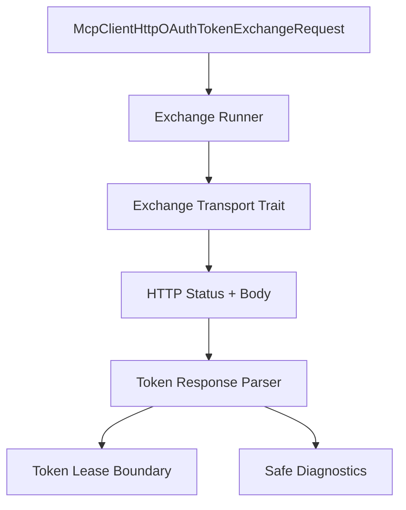

# M54-00 MCP HTTP OAuth Token Exchange Technical Design Spec

## Purpose

Define the architecture baseline for M54 token exchange execution before implementation slices start.

## Product Context

M53 intentionally stopped at token exchange request DTOs. M54 adds the runtime-owned execution and parsing layer needed by CLI, TUI, Desktop, and background auth coordinators while preserving explicit secret and storage boundaries.

## Scope

This spec delivers:

- ownership boundaries for token exchange execution
- transport request/response contracts
- token response parsing and diagnostics strategy
- lease conversion strategy
- redaction and verification rules

Owned by other specs:

- concrete token response structs in M54-01
- exchange transport implementation in M54-02
- runner diagnostics in M54-03
- lease conversion hardening in M54-04
- final docs in M54-05

## Architecture

`ruse-mcp::client_http` remains the owner for MCP HTTP OAuth exchange contracts. The runner accepts only the M53 `McpClientHttpOAuthTokenExchangeRequest`, builds a form POST request for an exchange transport, parses bounded JSON responses, and emits safe reports.



## File Layout

```text
crates/
  ruse-mcp/
    src/
      client_http.rs
      lib.rs
    tests/
      mcp_client_http_oauth_token_response.rs
      mcp_client_http_oauth_token_exchange_transport.rs
      mcp_client_http_oauth_token_exchange_runner.rs
      mcp_client_http_oauth_token_exchange_lease.rs
```

## Public Contracts

M54 adds token response contracts, safe diagnostics/reports, a token exchange transport trait, fixture transport, optional reqwest transport implementation, and runner helpers.

## State and Failure Handling

- Invalid exchange requests fail before transport execution.
- Transport failures are recoverable and redacted.
- Provider error responses are terminal for that exchange attempt but safe to show as diagnostics.
- Successful responses convert to lease material only after token type and token material validation.

## Security and Privacy

- Secret-bearing DTOs avoid durable serde derives.
- Safe reports are serializable and deterministic.
- `Debug` implementations redact codes, verifiers, token form fields, access tokens, refresh tokens, provider bodies, and client secrets.

## Testing Strategy

- focused tests for every slice
- redaction tests across success and failure paths
- fixture transport tests for deterministic exchange execution
- final `cargo xtask ci`

## Acceptance Criteria

- M54 slice specs and plans exist.
- M54 implementation slices can proceed without unresolved ownership questions.

## Completion Signal

M54-00 is complete when technical design, milestone decomposition, and verification strategy are recorded.
