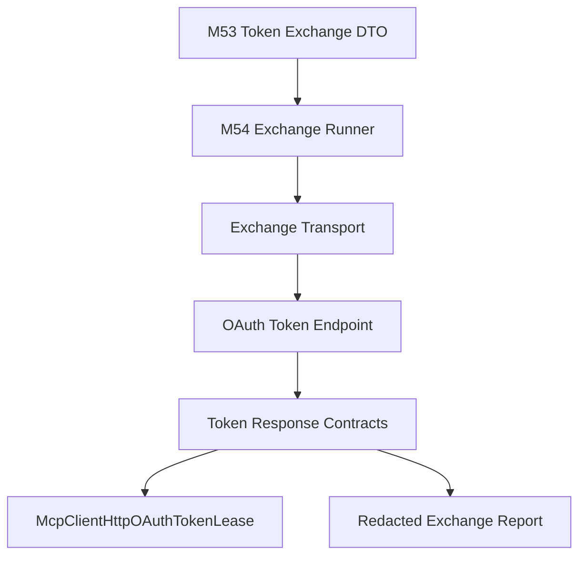

# M54 MCP HTTP OAuth Token Exchange Runtime Spec

## Purpose

Execute MCP HTTP OAuth authorization-code token exchange through a typed, redacted runtime boundary. M53 can build the token exchange DTO; M54 turns that DTO into a controlled HTTP form request, parses provider token responses, and produces existing token lease contracts without adding browser UX, durable token storage, refresh execution, revocation, or dynamic client registration.

## Product Context

Protected MCP streamable HTTP servers need a complete path from authorization callback to a usable access-token lease. CLI, TUI, Desktop, and future auth services can own user interaction and vault storage while delegating token endpoint execution and response validation to `ruse-mcp`.

## Scope

This spec delivers:

- token response and token error response contracts
- redacted token exchange diagnostics and reports
- async token exchange transport boundary for form POST execution
- fixture-grade exchange transport tests and optional reqwest implementation
- conversion from successful token response to `McpClientHttpOAuthTokenLease`
- docs and final verification evidence

Owned by later specs:

- browser/device login
- localhost callback server
- durable encrypted token vault
- refresh-token execution, revocation execution, and DCR execution
- Desktop account picker UX
- provider-specific quirks beyond standard form POST and JSON response parsing

## Architecture

`ruse-mcp::client_http` owns token exchange execution contracts next to existing HTTP transport and OAuth flow helpers. Callers provide a validated `McpClientHttpOAuthTokenExchangeRequest`; `ruse-mcp` sends a redacted form POST through an exchange transport, parses bounded JSON responses, and returns a safe report plus token lease material at the explicit secret boundary.



## Public Contracts

```rust
pub struct McpClientHttpOAuthTokenResponse {
    pub access_token: String,
    pub token_type: String,
    pub expires_in_seconds: Option<u64>,
    pub refresh_token: Option<String>,
    pub scope: Vec<String>,
}

pub struct McpClientHttpOAuthTokenExchangeReport {
    pub exchanged: bool,
    pub diagnostics: Vec<McpClientHttpOAuthTokenExchangeDiagnostic>,
}

#[async_trait::async_trait]
pub trait McpClientHttpOAuthTokenExchangeTransport {
    async fn exchange_token(
        &mut self,
        request: McpClientHttpOAuthTokenExchangeHttpRequest,
    ) -> Result<McpClientHttpOAuthTokenExchangeHttpResponse, McpError>;
}
```

## State and Failure Handling

- Exchange request validation happens before network execution.
- Transport failures produce redacted retryable diagnostics and no lease.
- Non-2xx provider responses parse safe OAuth error fields when possible and never expose raw response bodies.
- Successful responses require non-empty bearer-compatible access token material.
- Lease conversion uses caller-provided `now_unix_ms` plus `expires_in_seconds`; missing expiry remains allowed and produces existing token lifecycle warnings later.
- Refresh token material is parsed only as a redacted, non-durable boundary value and is not persisted by `ruse-mcp`.

## Security and Privacy

- Diagnostics and `Debug` never expose authorization codes, PKCE verifiers, access tokens, refresh tokens, client secrets, token endpoint form bodies, authorization headers, or raw provider responses.
- Token exchange form material is only passed to the explicit exchange transport boundary.
- Token responses are secret-bearing DTOs and must not derive `Serialize` unless the contract is explicitly safe.
- Safe reports are serializable and contain only deterministic public messages.

## Testing Strategy

- serde stability tests for safe reports and diagnostics
- redacted `Debug` tests for request/response/transport DTOs
- response parsing tests for success, provider error, invalid JSON, and unsupported token type
- fixture transport tests for success, retryable transport failure, and provider failure
- lease conversion tests for expiry and scope handling
- focused M54 tests plus final `cargo xtask ci`

## Acceptance Criteria

- `CARGO_TARGET_DIR=target/codex-m54 cargo test -p ruse-mcp mcp_client_http_oauth_token_response`
- `CARGO_TARGET_DIR=target/codex-m54 cargo test -p ruse-mcp mcp_client_http_oauth_token_exchange_transport`
- `CARGO_TARGET_DIR=target/codex-m54 cargo test -p ruse-mcp mcp_client_http_oauth_token_exchange_runner`
- `CARGO_TARGET_DIR=target/codex-m54 cargo test -p ruse-mcp mcp_client_http_oauth_token_exchange_lease`
- `CARGO_TARGET_DIR=target/codex-m54 cargo xtask ci`

## Completion Signal

M54 is complete when MCP HTTP OAuth authorization-code token exchange can be executed through a typed transport, parsed into token response contracts, converted to token leases, documented, and verified without implementing browser UX, durable storage, refresh execution, revocation, or DCR.
