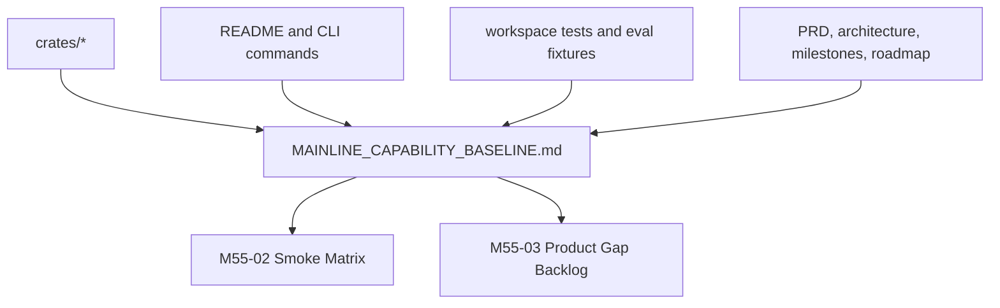

# M55-01 Capability Inventory Spec

## Purpose

Create a repository-grounded capability inventory that shows what `agent` can actually do today, what evidence proves it, and which mainline milestone owns the next gap. This prevents planning from relying on stale milestone history or protocol-heavy assumptions.

## Product Context

M55 resets the product roadmap toward a Claude Code / Codex Desktop-class local coding agent. M55-01 provides the source of truth for current completion across runtime, coding loop, providers, CLI/TUI, Desktop, context, memory, recovery, tasks, teams, plugins, MCP, packaging, and observability.

## Scope

This spec delivers:

- `docs/roadmap/MAINLINE_CAPABILITY_BASELINE.md`
- a deterministic capability table keyed by product domain
- evidence links to crates, CLI commands, tests, docs, and known gaps
- completion estimates and next milestone ownership for M56-M66
- explicit distinction between product-critical capabilities and parked MCP extension depth

Owned by other specs:

- smoke command coverage belongs to M55-02
- prioritized backlog shaping belongs to M55-03
- M56 implementation bootstrap belongs to M55-04
- code-level product improvements belong to M56 and later milestones

## Architecture

The inventory reads from the existing repository and does not introduce runtime code. It should point to authoritative implementation locations and verification commands, then feed M55-02 and M55-03.



## File Layout

```text
docs/
  roadmap/
    MAINLINE_CAPABILITY_BASELINE.md
  specs/
    M55-01-capability-inventory.spec.md
  plans/
    M55-01-capability-inventory.plan.md
```

## Public Contracts

The baseline document must use this stable row shape:

```text
Capability Row:
  domain
  product target
  current status: Strong | Partial | Early | Missing | Unknown
  implementation evidence
  verification evidence
  product gap
  next milestone
```

The document must include these domains at minimum:

- runtime spine, events, storage, checkpoints, replay
- local coding loop, file edits, shell/test loop, Git/diff flow
- model providers and provider configuration
- tool, policy, sandbox, approval, audit
- context assembly, compaction, repo intelligence
- memory and personalization
- CLI/TUI interaction model
- Desktop shared-runtime surface
- scheduler, background work, tasks
- worktree isolation, subagents, teams
- plugins, skills, MCP
- observability, evals, CI evidence
- packaging, settings, migration, release readiness

## State and Failure Handling

- `Strong` means current code and tests prove a capability is close to product-ready.
- `Partial` means core foundations exist but daily-driver UX, integration, or coverage is incomplete.
- `Early` means only skeletons, contracts, or narrow fixtures exist.
- `Missing` means no meaningful implementation evidence was found.
- `Unknown` is allowed only when paired with the exact command, file, or manual verification needed next.
- When evidence conflicts, prefer current code/tests over roadmap prose and record the inconsistency as a gap.

## Security and Privacy

- Do not include secrets, local absolute paths outside the repository, raw provider credentials, or private account identifiers.
- Treat permission, audit, sandbox, recovery, and redaction as first-class product domains.
- Mark MCP as an extension domain with high implementation depth but parked mainline priority unless it directly supports a product workflow.

## Testing Strategy

- inspect repository files with `rg --files`, `cargo metadata`, README command lists, and relevant test names
- verify Markdown formatting with `git diff --check -- docs/roadmap/MAINLINE_CAPABILITY_BASELINE.md`
- spot-check evidence links against actual paths
- compare the inventory against `docs/roadmap/PRODUCT_ROADMAP.md` and `docs/milestones/README.md`

## Acceptance Criteria

- `docs/roadmap/MAINLINE_CAPABILITY_BASELINE.md` exists with all required domains.
- Every domain has implementation evidence, verification evidence, a product gap, and next milestone ownership.
- MCP appears as a parked extension capability, not as the default near-term roadmap.
- Unknown items are actionable and point to a verification path.
- The document can feed M55-02 and M55-03 without needing another broad discovery pass.

## Completion Signal

M55-01 is complete when the mainline capability baseline is committed and gives future implementers a repository-backed answer to “what is real today, what is missing, and which milestone owns the gap?”
