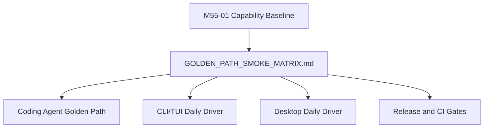

# M55-02 Golden Path Smoke Matrix Spec

## Purpose

Define the minimum smoke coverage that proves `agent` is moving toward a real daily coding-agent product across CLI, TUI, Desktop bridge, provider runtime, tool loop, permissions, recovery, trace, and replay.

## Product Context

The roadmap reset only helps if future milestones can prove product behavior. M55-02 converts the capability baseline into observable smoke checks so M56 and later milestones can add features without losing the shared-runtime, auditable, recoverable product shape.

## Scope

This spec delivers:

- `docs/roadmap/GOLDEN_PATH_SMOKE_MATRIX.md`
- smoke rows for local coding workflows, provider runtime, CLI/TUI/JSON, Desktop bridge, permissions, trace/replay, and recovery
- current status labels for pass, documented, blocked, and missing checks
- command paths or explicit blockers for each smoke row
- evidence expectations that future implementation milestones can satisfy

Owned by other specs:

- capability inventory source data belongs to M55-01
- backlog prioritization belongs to M55-03
- implementation of missing smoke helpers belongs to M56-M60 unless M55 discovers a tiny docs-safe gap
- full E2E eval suite expansion belongs to M56 and later milestones

## Architecture

The smoke matrix is a product verification contract. It should prefer existing commands and fixtures. If a missing helper is required, it must be added through `xtask`, CLI, or eval infrastructure in a later implementation slice rather than an undocumented script.



## File Layout

```text
docs/
  roadmap/
    GOLDEN_PATH_SMOKE_MATRIX.md
  specs/
    M55-02-golden-path-smoke-matrix.spec.md
  plans/
    M55-02-golden-path-smoke-matrix.plan.md
```

## Public Contracts

The smoke matrix must use this stable row shape:

```text
Smoke Row:
  id
  workflow
  surface
  command or verification path
  fixtures/configuration
  expected evidence
  current status: Pass | Documented | Blocked | Missing
  gap owner
```

Required smoke groups:

- repository session bootstrap
- fake-provider prompt/turn streaming
- file edit preview/apply and diff review
- shell command/test loop with bounded output
- Git status/diff evidence
- permission allow/deny/ask and audit evidence
- trace query and replay/fork evidence
- checkpoint/resume evidence
- CLI TTY, JSON, and TUI surfaces
- Desktop UI bridge or bridge simulation
- provider configuration and capability mismatch diagnostics
- memory/context contribution visibility

## State and Failure Handling

- `Pass` means the command was run or is already represented by a reliable existing gate.
- `Documented` means a command path exists but is not run by M55.
- `Blocked` means a dependency is missing and must be named.
- `Missing` means no current command or contract exists.
- A broad smoke claim must not be backed by a narrow unit test unless the row explicitly describes that narrow scope.
- Any command that needs real provider credentials must be opt-in and paired with a fake-provider alternative.

## Security and Privacy

- Smoke rows must avoid exposing secrets, raw prompts with sensitive data, local private paths outside the repo, or raw provider responses.
- Provider smoke checks must use fake or redacted fixtures by default.
- Permission, sandbox, audit, trace, and replay checks must be visible because they are product safety gates.
- Desktop smoke checks must go through shared UI bridge contracts rather than duplicating runtime behavior in UI docs.

## Testing Strategy

- inspect existing `xtask`, CLI, eval, and crate test commands
- run `git diff --check -- docs/roadmap/GOLDEN_PATH_SMOKE_MATRIX.md`
- optionally run any low-cost documented smoke command if it does not require real credentials or mutate user files
- mark commands not run in M55 as `Documented` rather than pretending they passed

## Acceptance Criteria

- `docs/roadmap/GOLDEN_PATH_SMOKE_MATRIX.md` exists with all required smoke groups.
- Each row has a command or a clear blocker.
- Status labels are honest and backed by current evidence.
- Future M56-M60 milestones can directly convert missing or blocked smoke rows into implementation tasks.
- No smoke row requires secrets by default.

## Completion Signal

M55-02 is complete when the golden-path smoke matrix is committed and gives future milestones a concrete way to prove local coding-agent workflows across shared runtime surfaces.
