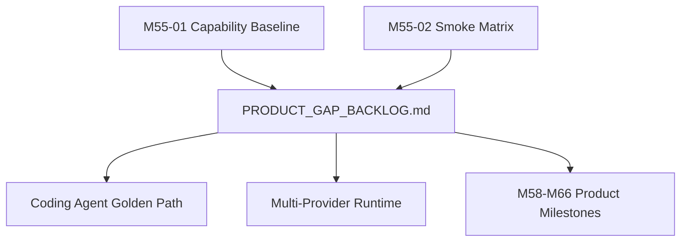

# M55-03 Product Gap Backlog Spec

## Purpose

Convert the M55 capability baseline and smoke matrix into a prioritized product backlog that maps concrete gaps to M56-M66. The backlog should make the next implementation choices obvious and keep mainline work centered on product outcomes.

## Product Context

The project already has substantial runtime foundations, but the product value is uneven across coding-agent UX, provider diversity, context intelligence, CLI/TUI, Desktop, task UX, recovery, teams, memory, packaging, and extension management. M55-03 translates that unevenness into a roadmap that can be implemented and reviewed one milestone at a time.

## Scope

This spec delivers:

- `docs/roadmap/PRODUCT_GAP_BACKLOG.md`
- P0/P1/P2 gap items grouped by target milestone M56-M66
- acceptance signals for each backlog item
- dependencies and non-goals for each product area
- explicit parking of MCP epilogue work outside mainline unless it unlocks product workflows

Owned by other specs:

- raw capability evidence belongs to M55-01
- smoke command details belong to M55-02
- M56 implementation-ready plans belong to M55-04 and M56 specs/plans
- detailed design for later milestones belongs to those future milestone specs

## Architecture

The backlog is a planning artifact, not a runtime API. It should link product domains to milestone ownership and acceptance evidence, then feed M55-04 and the M56-M66 milestone sequence.



## File Layout

```text
docs/
  roadmap/
    PRODUCT_GAP_BACKLOG.md
  specs/
    M55-03-product-gap-backlog.spec.md
  plans/
    M55-03-product-gap-backlog.plan.md
```

## Public Contracts

Backlog items must use this stable shape:

```text
Backlog Item:
  id
  priority: P0 | P1 | P2
  domain
  user-visible outcome
  current evidence
  gap
  target milestone
  acceptance signal
  dependencies
  status: Candidate | Planned | Deferred
```

Priority rules:

- `P0` blocks a credible local coding-agent daily-driver path.
- `P1` materially improves provider, context, CLI/Desktop, recovery, or release readiness.
- `P2` improves polish, extension depth, or non-blocking hardening.
- `Deferred` items must name the milestone or condition that can revive them.

## State and Failure Handling

- A gap can become `Planned` only when it has a target milestone and acceptance signal.
- Items with no owner remain `Candidate` and must not be treated as committed scope.
- Conflicting evidence between code and docs must be recorded as a backlog item or corrected in the source document.
- MCP epilogue work remains `Deferred` or parked unless it directly supports a user-visible workflow in M56-M66.

## Security and Privacy

- Backlog items must preserve security requirements around permissions, sandboxing, audit, trace, replay, secrets, redaction, and prompt-injection boundaries.
- Provider/account tasks must refer to diagnostics and redacted support output, not real credentials.
- Desktop tasks must preserve shared runtime ownership and avoid duplicating sensitive runtime logic in UI-only layers.

## Testing Strategy

- compare backlog items against M55-01 and M55-02 artifacts
- verify each P0 has a target milestone and acceptance signal
- run `git diff --check -- docs/roadmap/PRODUCT_GAP_BACKLOG.md`
- review roadmap consistency with `docs/roadmap/PRODUCT_ROADMAP.md` and `docs/milestones/README.md`

## Acceptance Criteria

- `docs/roadmap/PRODUCT_GAP_BACKLOG.md` exists and uses the required item shape.
- Every P0 is assigned to M56-M60 or explicitly justified.
- M56 has enough P0 detail to bootstrap implementation.
- M57-M66 contain appropriately scoped P1/P2 backlog without overplanning implementation details.
- MCP epilogue work is not promoted back into the mainline by accident.

## Completion Signal

M55-03 is complete when the product gap backlog is committed and gives M56-M66 a prioritized, evidence-backed queue of user-visible work.
