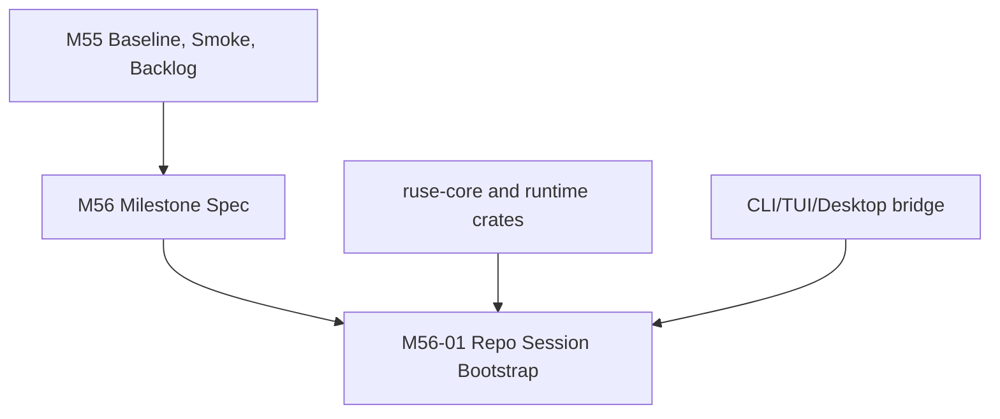

# M55-04 M56 Bootstrap Spec

## Purpose

Create the implementation-ready M56 planning package so the next milestone can immediately build the local coding-agent golden path instead of spending another turn reinterpreting the roadmap.

## Product Context

M56 is the first mainline milestone after the roadmap reset. It must prove that `agent` can open a repository, understand a small coding task, use tools safely, apply edits, run tests, expose diff/review evidence, and summarize the result through shared runtime surfaces.

## Scope

This spec delivers:

- `docs/specs/M56-coding-agent-golden-path-v1.spec.md`
- `docs/plans/M56-coding-agent-golden-path-v1.plan.md`
- the minimal first implementation slice needed to begin M56, starting with repository session bootstrap
- milestone index updates showing M56 as the next implementation focus after M55
- consistency updates between roadmap, milestones, and M55 completion artifacts

Owned by other specs:

- M56 implementation slices after the first bootstrap slice
- M57 provider adapter details
- M58 project context intelligence implementation
- M59/M60 CLI/Desktop daily-driver UX
- M61-M66 later product hardening

## Architecture

M56 planning must preserve shared-runtime ownership. CLI, TUI, and Desktop must consume runtime events and UI bridge contracts rather than each owning separate coding-agent logic.



## File Layout

```text
docs/
  specs/
    M56-coding-agent-golden-path-v1.spec.md
    M56-01-repo-session-bootstrap.spec.md
  plans/
    M56-coding-agent-golden-path-v1.plan.md
    M56-01-repo-session-bootstrap.plan.md
  milestones/
    README.md
```

## Public Contracts

The M56 milestone planning package must define:

```text
M56 Milestone Contract:
  user journey
  runtime-owned capabilities
  UI surface requirements
  tool/policy/audit requirements
  trace/replay/recovery requirements
  fake-provider and real-provider verification gates
  slice decomposition

M56 First Slice Contract:
  repository workspace input
  durable session/conversation creation expectation
  Git state and config diagnostics
  UI/JSON observable events
  failure and recovery behavior
  focused tests and smoke command
```

## State and Failure Handling

- M56 starts in `Planned` state until M55 is complete.
- M56-01 must be implementation-ready and must not depend on unplanned later slices.
- M56 milestone scope must remain vertical: repository session, edit/diff flow, command/test loop, final review summary, and deterministic golden-path E2E.
- If M55 baseline finds roadmap inconsistencies, fix the baseline and roadmap before declaring M56 ready.

## Security and Privacy

- M56 planning must require permission checks before file writes, shell commands, Git side effects, provider calls, and background work.
- First-slice session bootstrap must not expose secrets, raw provider config, or private paths outside the workspace.
- Desktop requirements must stay UI-safe and bridge-based.
- Fake-provider fixtures must be the default for deterministic tests.

## Testing Strategy

- verify M56 spec/plan contain purpose, scope, contracts, failure handling, security/privacy, testing, and acceptance criteria
- verify M56-01 spec/plan are concrete enough to start implementation
- run `git diff --check` for all M55-04/M56 files
- do not claim M56 implementation complete; this slice only creates the implementation-ready planning package

## Acceptance Criteria

- M56 milestone-level spec and plan exist.
- M56-01 repo session bootstrap spec and plan exist.
- M56 scope is tied to M55 baseline, smoke matrix, and product backlog.
- Milestone docs show M56 as the next implementation focus after M55.
- Planning documents do not expand MCP scope or duplicate runtime logic in UI surfaces.

## Completion Signal

M55-04 is complete when M56 has a milestone-level spec/plan plus a first implementation-ready slice spec/plan, and the milestone index clearly points the next worker to start M56-01.
