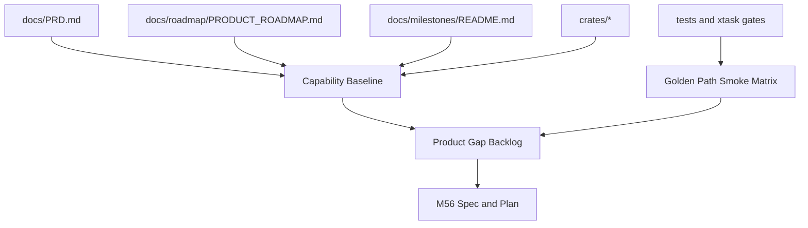

# M55 Product Baseline and Roadmap Reset Spec

## Purpose

M55 turns the repository from a long protocol/runtime implementation sequence back into a measurable product roadmap. It establishes the current product capability baseline, identifies gaps against the Claude Code / Codex Desktop-class target, defines golden-path smoke coverage, and prepares M56 so implementation can resume on user-visible coding-agent value instead of MCP detail expansion.

## Product Context

This milestone supports the PRD goals for one shared Rust runtime, complete coding-agent turns, provider-agnostic execution, recoverability, auditability, and CLI/Desktop parity. M01-M54 built strong runtime foundations and a mature MCP extension layer; the product roadmap now needs a clear baseline that maps existing crates, commands, tests, docs, and gaps to the mainline milestones M56-M66.

## Scope

This spec delivers:

- a mainline capability inventory across runtime, tools, policy, model providers, memory/context, CLI/TUI, Desktop, scheduler, worktree/team, plugins, MCP, packaging, observability, and evals
- a golden-path smoke matrix for CLI, TUI, Desktop bridge, provider runtime, coding loop, recovery, permissions, trace, and replay
- a prioritized product gap backlog mapped to M56-M66 with concrete owners, evidence, and acceptance signals
- M56 milestone-level spec and plan, plus only the first implementation-ready slice specs/plans that are needed to start M56 safely
- milestone index and roadmap consistency updates that mark MCP as parked unless it directly unlocks product workflows

Owned by later specs:

- M56 implementation of the coding-agent golden path
- M57 provider adapters and provider UX
- M58 repo-aware context intelligence implementation
- M59 CLI/TUI daily-driver UX
- M60 Desktop daily-driver UX
- M61-M66 task UX, recovery, worktree/team workflows, memory personalization, packaging, and extension hardening
- MX01 MCP epilogue work, which remains separate from the mainline roadmap

## Architecture

M55 is primarily a product architecture and verification milestone. It does not introduce runtime behavior unless a small smoke helper is necessary to make the baseline executable. Product artifacts live under `docs/roadmap/`, milestone coordination remains in `docs/milestones/`, and future executable smoke helpers, if added during slice implementation, should live in `xtask` or existing CLI/eval surfaces rather than ad hoc scripts.



## File Layout

```text
docs/
  roadmap/
    PRODUCT_ROADMAP.md
    MAINLINE_CAPABILITY_BASELINE.md
    GOLDEN_PATH_SMOKE_MATRIX.md
    PRODUCT_GAP_BACKLOG.md
  milestones/
    README.md
  specs/
    M55-product-baseline-roadmap-reset.spec.md
    M55-01-capability-inventory.spec.md
    M55-02-golden-path-smoke-matrix.spec.md
    M55-03-product-gap-backlog.spec.md
    M55-04-m56-bootstrap.spec.md
    M56-coding-agent-golden-path-v1.spec.md
  plans/
    M55-product-baseline-roadmap-reset.plan.md
    M55-01-capability-inventory.plan.md
    M55-02-golden-path-smoke-matrix.plan.md
    M55-03-product-gap-backlog.plan.md
    M55-04-m56-bootstrap.plan.md
    M56-coding-agent-golden-path-v1.plan.md
```

## Public Contracts

M55 defines documentation contracts rather than new Rust APIs.

```text
Capability Baseline Row:
  domain
  product target
  current implementation evidence
  current verification evidence
  completion estimate
  main gaps
  next milestone owner

Smoke Matrix Row:
  workflow
  surface
  command or verification path
  required fixtures or configuration
  expected evidence
  current status
  gap owner

Backlog Item:
  id
  priority
  capability domain
  user-visible outcome
  current evidence
  gap
  target milestone
  acceptance signal
  dependencies
```

The artifacts must be deterministic Markdown tables so future agents can update them with small diffs. Any executable smoke command added by M55 must be callable from `cargo xtask ...` or an existing CLI command and must write redacted evidence under `target/`.

## State and Failure Handling

- Baseline status starts as `Observed`, `Partial`, `Gap`, or `Unknown`; `Unknown` must include the command or file path needed to verify it.
- Smoke rows start as `Pass`, `Documented`, `Blocked`, or `Missing`; `Blocked` must name the missing dependency.
- Backlog items move from `Candidate` to `Planned` only when mapped to a milestone and acceptance signal.
- Roadmap inconsistencies are fixed in the baseline documents first, then reflected in `docs/milestones/README.md`.
- Existing MX01 MCP drafts must remain unstaged and must not be mixed into M55 commits.
- If workspace code changes are required for smoke execution, they must be isolated to a dedicated M55 slice and verified before commit.

## Security and Privacy

- Baseline and smoke artifacts must not include raw secrets, access tokens, local private paths outside the repository root, provider account identifiers, or unredacted command logs.
- Smoke commands must use fake providers or documented opt-in provider configuration by default.
- Permission, audit, trace, replay, and recovery coverage must be represented as product gates, not hidden internal assumptions.
- MCP is listed as an extension capability and parked from mainline expansion unless a product workflow explicitly depends on it.

## Testing Strategy

- documentation structure checks through `git diff --check`
- focused Markdown review for required sections and deterministic table headers
- command verification for any introduced `xtask`, CLI, or eval smoke helper
- final M55 docs/status consistency review across README, PRD, roadmap, milestones, specs, and plans
- no full Rust workspace gate is required for docs-only planning commits; any code or command-surface changes must run focused tests plus the relevant `cargo xtask` gate

## Acceptance Criteria

- `docs/roadmap/MAINLINE_CAPABILITY_BASELINE.md` exists and maps product domains to code/docs/tests evidence and M56-M66 ownership.
- `docs/roadmap/GOLDEN_PATH_SMOKE_MATRIX.md` exists and defines executable or explicitly blocked smoke checks for CLI/TUI/Desktop/provider/coding-loop/recovery paths.
- `docs/roadmap/PRODUCT_GAP_BACKLOG.md` exists and prioritizes gaps into M56-M66 without promoting MCP epilogue work to mainline.
- M55 slice specs/plans exist only for necessary slices: capability inventory, smoke matrix, gap backlog, and M56 bootstrap.
- M56 milestone-level spec/plan exist and are implementation-ready.
- `docs/milestones/README.md`, `docs/roadmap/PRODUCT_ROADMAP.md`, and README status remain consistent.
- M55 changes are committed in small stages without staging MX01 drafts.

## Completion Signal

M55 is complete when the repository contains a verified mainline product baseline, smoke matrix, prioritized gap backlog, updated milestone index, and M56-ready spec/plan set, with all M55 documentation changes committed separately from MX01 MCP epilogue drafts.
