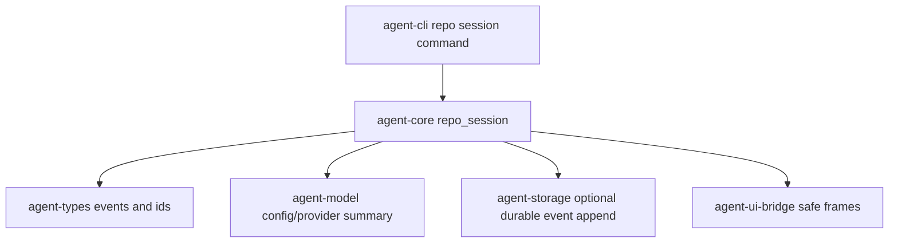

# M56-01 Repo Session Bootstrap Spec

## Purpose

Create the first product entrypoint for a coding-agent session: open a repository workspace, load runtime configuration, detect Git state, create durable runtime ids, surface provider diagnostics, and emit safe CLI/JSON evidence that the session is ready for the M56 edit/diff and command/test slices.

## Product Context

M55 identified repo session bootstrap as the first P0 gap for the local coding-agent daily-driver path. Existing tests prove runtime ids, workspace/session/conversation events, config checks, and local coding fixtures, but users do not yet have a first-class repo session bootstrap command that future M56 slices can build on.

## Scope

This spec delivers:

- `agent-core` repo session bootstrap contracts and diagnostics
- Git state detection for clean/dirty/non-Git workspaces without performing Git side effects
- effective config/provider summary using existing config and provider primitives
- durable runtime ids and workspace/session/conversation start events
- CLI text and JSON command surface for repo session bootstrap
- UI bridge mapping for repo session bootstrap events or snapshot frames when needed
- focused tests for core, CLI text, CLI JSON, and redaction

Owned by other specs:

- file edit/diff execution belongs to M56-02
- command/test loop execution belongs to M56-03
- final review summary belongs to M56-04
- deterministic end-to-end golden path belongs to M56-05
- provider capability matrix and native adapters belong to M57

## Architecture

`agent-core` owns the bootstrap report and runtime event creation. `agent-cli` owns argument parsing and text/JSON rendering. `agent-ui-bridge` owns UI-safe event or snapshot shapes. `agent-model` and existing config code provide provider/config diagnostics; `agent-storage` may be used when durable persistence is introduced, but M56-01 should keep storage boundaries explicit.



## File Layout

```text
crates/
  agent-core/
    src/
      repo_session.rs
      lib.rs
    tests/
      repo_session_bootstrap.rs
  agent-cli/
    src/
      command.rs
      output.rs
    tests/
      repo_session_bootstrap.rs
  agent-ui-bridge/
    src/
      event.rs
      frame.rs
    tests/
      repo_session_snapshot.rs
docs/
  specs/
    M56-01-repo-session-bootstrap.spec.md
  plans/
    M56-01-repo-session-bootstrap.plan.md
```

## Public Contracts

```rust
pub struct RepoSessionBootstrapInput {
    pub workspace_root: PathBuf,
    pub config_path: Option<PathBuf>,
    pub provider_override: Option<String>,
    pub model_override: Option<String>,
    pub client_kind: ClientKind,
    pub client_version: String,
}

pub struct RepoSessionBootstrapReport {
    pub workspace_id: WorkspaceId,
    pub conversation_id: ConversationId,
    pub turn_id: Option<TurnId>,
    pub workspace_root_display: String,
    pub trust_level: WorkspaceTrustLevel,
    pub git: RepoGitSummary,
    pub config: RepoConfigSummary,
    pub provider: RepoProviderSummary,
    pub events: Vec<RuntimeEvent>,
    pub diagnostics: Vec<RepoSessionDiagnostic>,
}

pub enum RepoGitState {
    Clean,
    Dirty,
    NotRepository,
    Unavailable,
}
```

CLI command shape should be product-oriented and stable:

```bash
agent-cli repo session --workspace .
agent-cli --json repo session --workspace .
```

If the repo command namespace conflicts with existing CLI parsing, use `agent-cli session start --workspace .` only after updating this spec and plan.

## State and Failure Handling

- Invalid or missing workspace root fails with exit code `2` in CLI and no durable session events.
- Non-Git workspace is allowed with `RepoGitState::NotRepository` and a warning diagnostic.
- Dirty Git workspace is allowed but reported with changed-file count and safe status summary.
- Config errors fail before provider/model invocation and must include redacted diagnostics.
- Provider capability mismatch is reported as diagnostic only in M56-01 unless it blocks bootstrap; full mismatch policy belongs to M57.
- Event creation must be deterministic enough for tests except generated ids/timestamps.

## Security and Privacy

- Display workspace paths relative to the selected root when possible; do not expose unrelated absolute paths.
- Do not expose secret values, secret reference names, provider tokens, raw config bodies, or environment variables.
- Git detection must not mutate the repository.
- Bootstrap must not grant filesystem, command, Git, network, MCP, plugin, or provider permissions.
- JSON output must be safe for Desktop logs.

## Testing Strategy

- core tests for valid Git repo, dirty repo, non-Git directory, invalid root, config diagnostics, and redaction
- CLI parser/render tests for text and JSON command forms
- UI bridge serialization/snapshot tests for repo session evidence
- focused commands:

```bash
cargo test -p agent-core repo_session_bootstrap
cargo test -p agent-cli repo_session_bootstrap
cargo test -p agent-ui-bridge repo_session_snapshot
```

## Acceptance Criteria

- `agent-core` exposes typed repo session bootstrap contracts and events.
- `agent-cli repo session --workspace .` renders a safe text summary.
- `agent-cli --json repo session --workspace .` renders parseable redacted frames.
- Git clean/dirty/non-Git states are covered by tests.
- Invalid workspace/config/provider input fails before turn execution.
- M56-02 can consume the bootstrap report or ids without redoing workspace/config detection.

## Completion Signal

M56-01 is complete when repo session bootstrap is implemented, tested, and committed with typed runtime contracts, CLI text/JSON output, UI-safe bridge evidence, and no edit/command side effects.
