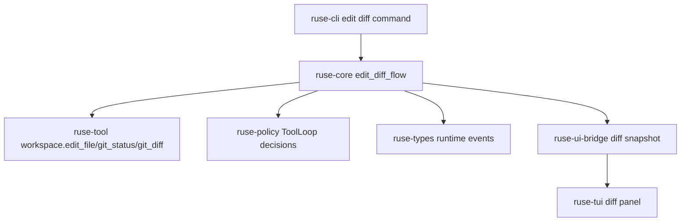

# M56-02 Edit and Diff Flow Spec

## Purpose

Make file edits reviewable and auditable as a product workflow. M56-02 standardizes how the runtime previews an edit, applies it through existing tool/policy paths, extracts changed-file and diff evidence, and exposes the same safe evidence to CLI/JSON and TUI/Desktop bridge consumers.

## Product Context

M55 backlog item `M56-GP-02` identified that edit and diff pieces already exist but are not integrated into one daily coding workflow. M56-01 now creates a safe repo session. M56-02 is the next vertical slice toward the M56 golden path: after a repo is opened, the agent must be able to propose a file change, show a preview, apply it, and report the resulting diff without leaking workspace-private or secret-like content.

## Scope

This spec delivers:

- `ruse-core` edit/diff flow contracts for preview, apply, changed files, diff summary, and diagnostics
- runtime orchestration over existing `workspace.edit_file`, `workspace.git_status`, and `workspace.git_diff` tools
- permission/audit evidence produced by existing tool-loop events rather than UI-owned logic
- CLI text and JSON command surface for deterministic edit/diff smoke usage
- UI bridge snapshot or frames for safe diff evidence that TUI/Desktop can render
- focused tests for preview-only, apply, expected-content mismatch, workspace confinement, JSON redaction, and TUI diff consumption

Owned by other specs:

- command/test execution and output classification belong to M56-03
- final review with test evidence, risks, and next actions belongs to M56-04
- full fake-provider golden path and replay/eval scenario belongs to M56-05
- polished TUI/CLI daily-driver ergonomics belong to M59
- Desktop visual diff review belongs to M60

## Architecture

`ruse-core` owns the edit/diff report and coordinates existing tools. `ruse-tool` continues to own concrete file edit and Git diff/status tools. `ruse-policy` and the existing `ToolLoop` continue to produce permission and audit events. `ruse-cli` renders commands and NDJSON frames. `ruse-ui-bridge` owns UI-safe diff snapshots; `ruse-tui` consumes those snapshots or approval previews without duplicating runtime edit logic.



## File Layout

```text
crates/
  ruse-core/
    src/
      edit_diff.rs
      lib.rs
    tests/
      edit_diff_flow.rs
  ruse-cli/
    src/
      command.rs
    tests/
      edit_diff_flow.rs
  ruse-ui-bridge/
    src/
      frame.rs
      lib.rs
    tests/
      edit_diff_snapshot.rs
  ruse-tui/
    src/
      diff_panel.rs
    tests/
      diff_panel.rs
docs/
  specs/
    M56-02-edit-diff-flow.spec.md
  plans/
    M56-02-edit-diff-flow.plan.md
```

## Public Contracts

```rust
pub struct EditDiffFlowInput {
    pub workspace_root: PathBuf,
    pub path: String,
    pub expected: Option<String>,
    pub replacement: String,
    pub apply: bool,
    pub ids: RuntimeIds,
}

pub struct EditDiffFlowReport {
    pub workspace_id: WorkspaceId,
    pub conversation_id: ConversationId,
    pub path: String,
    pub applied: bool,
    pub preview: EditPreviewSummary,
    pub changed_files: Vec<String>,
    pub diff: DiffSummary,
    pub events: Vec<RuntimeEvent>,
    pub diagnostics: Vec<EditDiffDiagnostic>,
}

pub struct EditPreviewSummary {
    pub resource: String,
    pub summary: String,
    pub content_hash: Option<String>,
    pub truncated: bool,
    pub redacted: bool,
}

pub struct DiffSummary {
    pub changed_file_count: u32,
    pub diff_line_count: u32,
    pub added_line_count: u32,
    pub removed_line_count: u32,
    pub preview: String,
    pub truncated: bool,
    pub redacted: bool,
}
```

CLI command shape:

```bash
ruse-cli repo edit --workspace . --path README.md --expected-file before.txt --replacement-file after.txt --preview
ruse-cli repo edit --workspace . --path README.md --expected-file before.txt --replacement-file after.txt --apply
ruse-cli --json repo edit --workspace . --path README.md --replacement-file after.txt --preview
```

If file arguments are too much for the first implementation, the CLI may support literal `--expected` and `--replacement` first, but tests must cover redaction and the plan must document why file arguments move later.

## State and Failure Handling

- Preview-only flow runs `workspace.edit_file` with `apply=false`, records tool-loop evidence, and must not mutate the file.
- Apply flow runs `workspace.edit_file` with `apply=true`, then reads `workspace.git_status` and `workspace.git_diff` for evidence.
- Expected-content mismatch is terminal for the edit attempt, leaves the file unchanged, and returns a redacted diagnostic.
- Non-Git workspace may still preview/apply the file edit; Git diff evidence becomes a recoverable diagnostic.
- Workspace traversal or sandbox escape is terminal and must not emit applied-change evidence.
- Tool-loop events are returned in order so trace/audit/replay consumers can reconstruct the edit.

## Security and Privacy

- File paths in reports must be workspace-relative and normalized.
- Diff previews must be bounded and must mark truncation.
- Secret-like content in diagnostics, CLI text, and JSON frames must be redacted.
- The flow must not bypass policy, sandbox, audit, or tool-loop execution.
- M56-02 must not run shell commands, tests, network calls, providers, MCP servers, or background tasks.

## Testing Strategy

- `ruse-core` tests for preview-only non-mutation, apply mutation, expected mismatch, non-Git behavior, Git changed-file/diff evidence, event ordering, and redaction
- `ruse-cli` tests for text/JSON command parsing and rendering, invalid workspace exit code `2`, and secret redaction
- `ruse-ui-bridge` tests for diff snapshot serialization, truncation, and redaction
- `ruse-tui` tests to ensure diff snapshot/approval preview can populate `DiffPanelState`
- focused commands:

```bash
cargo test -p ruse-tool file_edit_tool
cargo test -p ruse-tool git_tools
cargo test -p ruse-core edit_diff_flow
cargo test -p ruse-cli edit_diff_flow
cargo test -p ruse-ui-bridge edit_diff_snapshot
cargo test -p ruse-tui diff_panel
```

## Acceptance Criteria

- Core edit/diff report is typed, serializable where bridge-facing, and generated from existing tools.
- Preview mode returns diff evidence without mutating files.
- Apply mode mutates only workspace-confined files and returns changed-file plus diff summary.
- CLI text and JSON forms are parseable, redacted, and fail with code `2` for invalid input.
- UI bridge exposes safe diff evidence for TUI/Desktop consumers.
- M56-03 can consume changed-file and diff evidence without re-running edit detection.

## Completion Signal

M56-02 is complete when edit/diff preview and apply flows are implemented, focused tests pass, docs/milestone status are updated, and the slice is committed independently from M56-03 command/test work.
