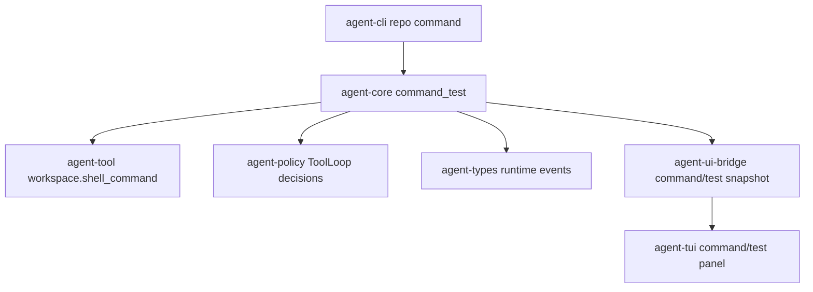

# M56-03 Command/Test Loop Spec

## Purpose

Make command and test execution visible, bounded, cancellable-ready, and useful as model feedback in the local coding-agent workflow. M56-03 standardizes how the runtime executes a workspace command through existing tool/policy/audit paths, classifies the result, records safe command evidence, and exposes the same evidence to CLI/JSON and UI bridge consumers.

## Product Context

M55 backlog item `M56-GP-03` identified that shell command execution, streaming/cancel foundations, and model tool observations exist in pieces, but the product loop still lacks a typed command/test report. M56-01 opens a durable repository session and M56-02 produces edit/diff evidence. M56-03 is the next vertical slice: after edits, the agent must be able to run a verification command, capture bounded output and failure classification, and feed the observation back into the model loop without moving runtime logic into presentation crates.

## Scope

This spec delivers:

- `agent-core` command/test loop contracts for command intent, bounded output, result classification, cancellation readiness, diagnostics, and events
- runtime orchestration over the existing `workspace.shell_command` tool through `ToolLoop` and policy
- bounded, redacted stdout/stderr evidence suitable for final review and replay reconstruction
- classification for success, non-zero exit, timeout, tool failure, policy denial/waiting, and invalid input
- CLI text and JSON command surface for deterministic command/test smoke usage
- UI bridge snapshot for safe command/test evidence that TUI/Desktop can render
- focused tests for success, failing command, timeout, bounded output, secret redaction, invalid workspace/cwd, policy events, and observation feedback

Owned by other specs:

- edit preview/apply and diff evidence belong to M56-02
- final review aggregation of changed files, command/test evidence, risks, and next actions belongs to M56-04
- full deterministic fake-provider golden-path E2E and eval/replay fixture belongs to M56-05
- polished terminal command streaming and interactive cancellation UX belongs to M59
- crash/retry recovery UX belongs to M62

## Architecture

`agent-core` owns the command/test loop report and coordinates the existing shell command tool. `agent-tool` remains the concrete process execution boundary. `agent-policy` and `ToolLoop` continue to produce permission and audit events. `agent-cli` renders commands and NDJSON frames. `agent-ui-bridge` owns UI-safe command snapshots; `agent-tui` consumes those snapshots without duplicating command execution logic.



## File Layout

```text
crates/
  agent-core/
    src/
      command_test.rs
      lib.rs
    tests/
      command_test_loop.rs
  agent-cli/
    src/
      command.rs
    tests/
      command_test_loop.rs
  agent-ui-bridge/
    src/
      frame.rs
      lib.rs
    tests/
      command_test_snapshot.rs
  agent-tui/
    src/
      command_panel.rs
      render.rs
      lib.rs
    tests/
      command_panel.rs
docs/
  specs/
    M56-03-command-test-loop.spec.md
  plans/
    M56-03-command-test-loop.plan.md
```

If implementation finds an existing TUI panel is the correct home for command evidence, it may extend that file instead of creating `command_panel.rs`, but command execution logic must remain in `agent-core`.

## Public Contracts

```rust
pub struct CommandTestLoopInput {
    pub workspace_root: PathBuf,
    pub program: String,
    pub args: Vec<String>,
    pub cwd: String,
    pub timeout_ms: u64,
    pub classify_as_test: bool,
    pub ids: RuntimeIds,
}

pub struct CommandTestLoopReport {
    pub workspace_id: WorkspaceId,
    pub conversation_id: ConversationId,
    pub command: CommandIntentSummary,
    pub status: CommandExecutionStatus,
    pub classification: CommandFailureClassification,
    pub stdout: BoundedCommandOutput,
    pub stderr: BoundedCommandOutput,
    pub timed_out: bool,
    pub cancellation: CommandCancellationState,
    pub observation: CommandObservationSummary,
    pub events: Vec<RuntimeEvent>,
    pub diagnostics: Vec<CommandTestDiagnostic>,
}

pub struct CommandIntentSummary {
    pub display: String,
    pub cwd: String,
    pub classify_as_test: bool,
}

pub enum CommandExecutionStatus {
    Succeeded,
    Failed,
    TimedOut,
    WaitingApproval,
    Denied,
    ToolFailed,
}

pub enum CommandFailureClassification {
    None,
    TestFailure,
    CommandFailure,
    Timeout,
    PolicyDenied,
    WaitingApproval,
    ToolFailure,
    InvalidInput,
}

pub struct BoundedCommandOutput {
    pub text: String,
    pub byte_count: u64,
    pub truncated: bool,
    pub redacted: bool,
}

pub struct CommandCancellationState {
    pub cancellable: bool,
    pub reason: String,
}

pub struct CommandObservationSummary {
    pub message: String,
    pub truncated: bool,
    pub redacted: bool,
}
```

CLI command shape:

```bash
agent-cli repo command --workspace . -- cargo test -p agent-core command_test_loop
agent-cli repo command --workspace . --cwd crates/agent-core --timeout-ms 30000 -- cargo test
agent-cli repo test --workspace . -- cargo test -p agent-core command_test_loop
agent-cli --json repo test --workspace . -- cargo test -p agent-core command_test_loop
```

`repo test` is a product alias that sets `classify_as_test=true`; it must not bypass the same command execution path.

## State and Failure Handling

- Invalid workspace root or cwd is terminal for the command attempt and must not start a process.
- The command always routes through `workspace.shell_command`, `ToolLoop`, and policy before side effects occur.
- Successful exit status `0` becomes `Succeeded` with `None` classification.
- Non-zero exit status becomes `Failed`; when `classify_as_test=true`, classification becomes `TestFailure`.
- Timeout result becomes `TimedOut` with `Timeout` classification and cancellation state indicating the command has already been stopped.
- Policy ask/deny states become `WaitingApproval` or `Denied`; they must return events and safe diagnostics without claiming command output exists.
- Tool execution failures become recoverable diagnostics where possible and must not expose raw environment or private paths.
- Output and observation text must be bounded and redacted before entering CLI/JSON/UI surfaces.
- The report must preserve ordered runtime events so trace/audit/replay consumers can reconstruct command intent and outcome.

## Security and Privacy

- Command display, cwd, diagnostics, stdout, stderr, and observation text must redact secret-like tokens.
- Environment variables are not accepted by the M56-03 product CLI surface; environment support remains behind the lower-level allowlisted shell tool.
- Cwd must remain workspace-relative and sandbox-confined.
- Shell execution must not bypass policy, sandbox, audit, or tool-loop execution.
- M56-03 must not add provider calls, MCP calls, network permissions, background execution, or final review aggregation.

## Testing Strategy

- `agent-core` tests for success, non-zero exit, test failure classification, timeout, bounded output, invalid workspace/cwd, policy event ordering, and redaction
- `agent-cli` tests for text/JSON command parsing and rendering, `repo test` alias behavior, invalid input exit code `2`, and secret redaction
- `agent-ui-bridge` tests for command/test snapshot serialization, truncation, classification labels, and redaction
- `agent-tui` tests to ensure command/test snapshots can populate UI state without executing commands
- existing shell/tool/model checks remain in scope:

```bash
cargo test -p agent-tool shell_command_tool
cargo test -p agent-core command_test_loop
cargo test -p agent-core comprehensive_turn_observations
cargo test -p agent-cli command_test_loop
cargo test -p agent-ui-bridge command_test_snapshot
cargo test -p agent-tui command_panel
```

## Acceptance Criteria

- Core command/test report is typed, serializable where bridge-facing, and generated from the existing shell command tool through `ToolLoop`.
- Command output is bounded, redacted, and classified as success, command failure, test failure, timeout, policy denial/waiting, or tool failure.
- Cancellation readiness is explicit in the report even if interactive cancellation UX remains later work.
- CLI text and JSON forms are parseable, redacted, and fail with code `2` for invalid input.
- UI bridge exposes safe command/test evidence for TUI/Desktop consumers.
- The comprehensive model loop can receive command observations as bounded tool feedback.
- M56-04 can consume command/test evidence without re-running commands.

## Completion Signal

M56-03 is complete when command/test loop planning is committed, implementation uses shared runtime/tool/policy boundaries, focused tests pass, docs/milestone status are updated, and the slice is committed independently from M56-04 final review work.
