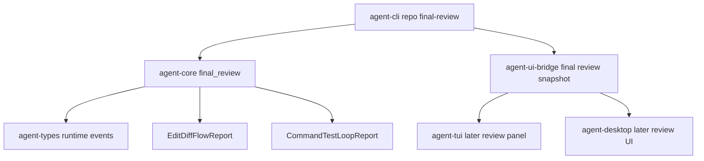

# M56-04 Final Review Summary Spec

## Purpose

Make the end of a local coding-agent turn reviewable as a typed product artifact. M56-04 standardizes a final review summary that reports changed files, command/test evidence, trace and audit evidence, unresolved risks, next actions, diagnostics, and replay reconstruction status.

## Product Context

M56-01 creates a repository session, M56-02 applies or previews edits with diff evidence, and M56-03 runs verification commands with bounded command/test evidence. M56-04 closes the user-facing loop for those slices: after the runtime has changed files and run checks, the user needs one stable summary explaining what changed, what ran, what evidence exists, what remains risky, and what to do next.

## Scope

This spec delivers:

- `agent-core` final review contracts for changed files, command/test evidence, trace/audit ids or counts, risks, next actions, diagnostics, and replay reconstruction
- reconstruction from ordered runtime events where possible, including existing local coding fixture events
- direct composition from `EditDiffFlowReport` and `CommandTestLoopReport` for product command surfaces
- CLI text and JSON surface for deterministic final review smoke usage
- UI bridge snapshot for safe final review evidence that TUI/Desktop can render later
- focused tests for event reconstruction, direct report composition, redaction, missing evidence diagnostics, JSON snapshot shape, and CLI rendering

Owned by other specs:

- edit/diff execution belongs to M56-02
- command/test execution belongs to M56-03
- deterministic end-to-end fake-provider scenario and eval/replay fixture belongs to M56-05
- richer terminal review UX belongs to M59
- Desktop visual final review belongs to M60
- crash/fork/retry recovery UX belongs to M62

## Architecture

`agent-core` owns final review construction and replay reconstruction. `agent-cli` renders text and NDJSON frames. `agent-ui-bridge` owns UI-safe review snapshots. TUI/Desktop consume snapshots without deriving runtime truth independently.



## File Layout

```text
crates/
  agent-core/
    src/
      final_review.rs
      lib.rs
    tests/
      final_review.rs
  agent-cli/
    src/
      command.rs
    tests/
      final_review.rs
  agent-ui-bridge/
    src/
      frame.rs
      lib.rs
    tests/
      final_review_snapshot.rs
docs/
  specs/
    M56-04-final-review-summary.spec.md
  plans/
    M56-04-final-review-summary.plan.md
```

If implementation finds that TUI consumption is low-risk and small, it may add a simple panel, but it is not required for M56-04 acceptance. The required bridge contract must be present.

## Public Contracts

```rust
pub struct CodingFinalReview {
    pub workspace_id: WorkspaceId,
    pub conversation_id: ConversationId,
    pub summary: String,
    pub changed_files: Vec<String>,
    pub command_results: Vec<FinalReviewCommandResult>,
    pub trace_id: Option<String>,
    pub trace_event_count: usize,
    pub audit_event_count: usize,
    pub replay_reconstructed: bool,
    pub unresolved_risks: Vec<String>,
    pub next_actions: Vec<String>,
    pub diagnostics: Vec<FinalReviewDiagnostic>,
}

pub struct FinalReviewCommandResult {
    pub command: String,
    pub status: String,
    pub classification: String,
    pub exit_code: Option<i32>,
    pub timed_out: bool,
    pub summary: String,
}

pub struct FinalReviewInput {
    pub edit: Option<EditDiffFlowReport>,
    pub command: Option<CommandTestLoopReport>,
    pub events: Vec<RuntimeEvent>,
    pub trace_id: Option<String>,
}
```

CLI command shape:

```bash
agent-cli --local-summary
agent-cli repo final-review --fixture local-coding
agent-cli --json repo final-review --fixture local-coding
```

The first implementation may use a deterministic fixture entrypoint before M56-05 wires full golden-path scenario execution. It must still use the same typed final review contract as later real workflows.

## State and Failure Handling

- Final review construction must be pure over reports/events and must not execute tools.
- Missing changed-file evidence produces a recoverable diagnostic and an unresolved risk.
- Missing command/test evidence produces a recoverable diagnostic and an unresolved risk.
- Non-zero command/test results become unresolved risks unless already classified as expected or explicitly waived by future inputs.
- Trace/audit counts are derived from runtime events or observability helpers; missing evidence must not be invented.
- Replay reconstruction from persisted events must either prove a review can be reconstructed or report why evidence is incomplete.
- All display strings must be bounded and redacted before entering CLI/JSON/UI surfaces.

## Security and Privacy

- Final review summaries must not expose raw secrets, secret reference names, full environment variables, or absolute private paths outside selected workspace evidence.
- Review generation must not execute commands, read files, contact providers, use network, or mutate state.
- Runtime events included in review-derived surfaces must be normalized or summarized, not dumped raw.
- Redaction must cover changed files, command strings, command output summaries, diagnostics, risks, and next actions.

## Testing Strategy

- `agent-core` tests for direct composition from M56-02/M56-03 reports, reconstruction from local coding events, missing evidence diagnostics, failed command risks, next-action generation, and redaction
- `agent-cli` tests for text and JSON final review fixture output
- `agent-ui-bridge` tests for final review snapshot serialization, redaction, bounded fields, and frame encoding
- focused commands:

```bash
cargo test -p agent-core final_review
cargo test -p agent-cli final_review
cargo test -p agent-ui-bridge final_review_snapshot
cargo test -p agent-cli local_coding
```

## Acceptance Criteria

- Final review is a typed core contract, not text assembled only in CLI.
- Final review includes changed files, command/test evidence, trace/audit evidence, unresolved risks, next actions, diagnostics, and replay reconstruction status.
- Existing `--local-summary` can be backed by or kept consistent with the final review contract.
- JSON output emits a UI-safe final review snapshot and done frame.
- Missing or failed evidence is visible as diagnostics/risks, not hidden.
- M56-05 can consume the final review contract for the deterministic golden-path E2E.

## Completion Signal

M56-04 is complete when final review planning is committed, implementation has typed runtime and UI bridge contracts, focused tests pass, docs/milestone status are updated, and the slice is committed independently from M56-05 golden-path E2E work.
