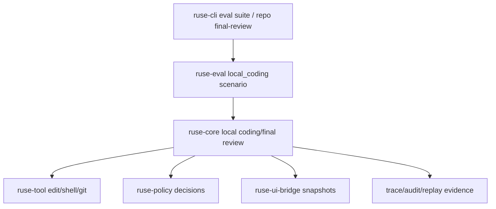

# M56-05 Golden Path E2E Spec

## Purpose

Prove the M56 coding-agent golden path as one deterministic, CI-safe product scenario. M56-05 connects repo bootstrap, edit/diff, command/test, final review, trace/audit, replay, CLI/JSON, and eval evidence so the milestone can be verified as a coherent local coding workflow rather than separate slice fixtures.

## Product Context

M56-01 through M56-04 now provide repository session diagnostics, edit/diff evidence, command/test evidence, and a final review summary. The remaining gap is product-level proof: one fake-provider or fixture-driven scenario must exercise the workflow end to end and write stable evidence that can be run by CLI/JSON and the eval gate without provider credentials.

## Scope

This spec delivers:

- deterministic local coding golden-path scenario using fake-provider or fixture-controlled runtime behavior
- eval support for a local coding scenario that passes under strict mode
- default eval suite coverage for the M56 golden path with checked-in scenario/golden files or stable generated evidence
- CLI/JSON smoke coverage that emits repo/session, edit/diff, command/test, final review, trace/audit/replay evidence
- redacted evidence artifacts under `target/ruse-eval` or equivalent output dir
- documentation of real-provider opt-in behavior without requiring secrets in default CI

Owned by other specs:

- provider diversity belongs to M57
- repo-aware context retrieval belongs to M58
- terminal daily-driver polish belongs to M59
- Desktop daily-driver app flow belongs to M60
- recovery product UX belongs to M62

## Architecture

The E2E scenario must use shared runtime crates and existing typed contracts. Eval and CLI may orchestrate the scenario, but runtime behavior remains in `ruse-core` and supporting runtime crates. Golden files must contain redacted summaries, not raw secrets or unstable absolute paths.



## File Layout

```text
docs/
  eval/
    default.suite.json
    scenarios/m56-golden-path.eval.json
    goldens/default-m56-golden-path.golden.json
crates/
  ruse-eval/
    src/
      runner.rs
      manifest.rs
    tests/
      runner.rs
      corpus.rs
  ruse-cli/
    tests/
      golden_path_e2e.rs
      eval_suite_commands.rs
  ruse-core/
    tests/
      comprehensive_local_coding_e2e.rs
      final_review.rs
```

## Public Contracts

The scenario should use the existing eval manifest schema if possible:

```json
{
  "schema_version": 1,
  "id": "m56-golden-path",
  "name": "M56 golden path",
  "kind": "local_coding",
  "fixtures": {
    "workspace": "fixtures/m56-golden-path-workspace"
  },
  "expectations": {
    "expected_status": "passed",
    "required_events": [
      "tool_call_proposed",
      "permission_decision_recorded",
      "tool_execution_completed",
      "tool_observation_recorded",
      "final_response_produced"
    ]
  }
}
```

If the current manifest schema cannot express all evidence without broad churn, M56-05 may add explicit local-coding evidence fields while keeping the schema typed and serde-friendly.

## State and Failure Handling

- The default E2E must run without real provider credentials.
- Scenario output must be deterministic across local and CI runs.
- Missing Git, tool, policy, trace, audit, replay, or final review evidence must fail the scenario in strict mode.
- Secret-like strings and absolute temp paths must be redacted or normalized before golden comparison.
- Real-provider opt-in failures must be diagnostic-only and must not fail default CI.

## Security and Privacy

- Do not store raw provider tokens, env vars, absolute private paths, or unbounded command output in goldens.
- Golden evidence must be bounded, redacted, and stable.
- Tool side effects must stay inside temporary/workspace-confined fixtures.
- The E2E must use policy/audit/tool-loop paths for edit and command work.

## Testing Strategy

- `ruse-eval` tests for strict local-coding scenario pass/fail behavior
- CLI tests for default suite including M56 golden path
- eval golden comparison/update tests for the new scenario
- focused commands:

```bash
cargo test -p ruse-eval local_coding
cargo test -p ruse-cli golden_path_e2e
cargo test -p ruse-cli eval_suite_commands
cargo xtask eval
```

## Acceptance Criteria

- `docs/eval/default.suite.json` includes an M56 golden-path scenario.
- `cargo xtask eval` runs the M56 scenario and passes in strict mode.
- CLI/JSON smoke proves session, edit/diff, command/test, final review, trace/audit, and replay evidence.
- Golden evidence is deterministic and redacted.
- M56 can be closed with one documented command path and known limitations.

## Completion Signal

M56-05 is complete when the deterministic local coding golden path is implemented, included in the default eval suite, verified by focused checks, documented as the M56 acceptance path, and committed independently from final M56 hardening/closeout docs.
