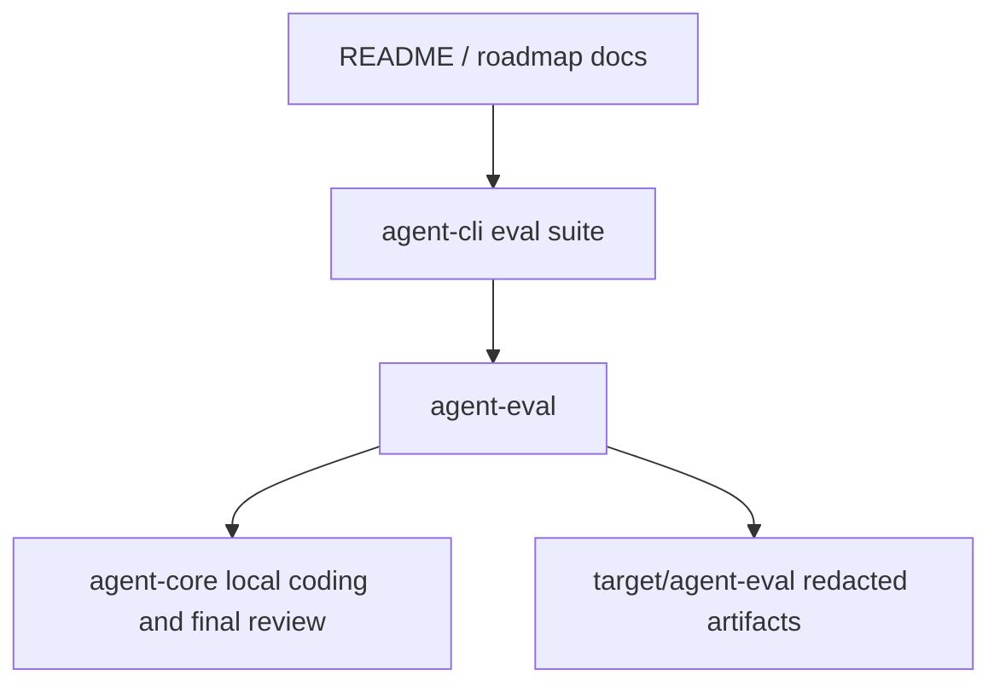

# M56-06 Hardening Docs and Verification Spec

## Purpose

Close M56 by documenting the deterministic coding-agent golden path, recording the final verification gates, and updating roadmap and milestone status from active implementation to complete.

## Product Context

M56-01 through M56-05 implemented the local coding-agent path: repo/session diagnostics, edit/diff evidence, command/test evidence, final review, and a default eval scenario. The remaining product gap is discoverability and release confidence: a developer must know which command proves the M56 workflow and what limitations remain before M57 provider work begins.

## Scope

This spec delivers:

- README guidance for the deterministic M56 golden-path command and related CLI/JSON inspection commands
- roadmap and milestone status updates that mark M56 complete after final gates pass
- final verification evidence for `cargo fmt`, workspace clippy, workspace tests, and `cargo xtask eval`
- documentation of real-provider opt-in limitations without requiring credentials in default CI

Owned by other specs:

- native provider support belongs to M57
- repo-aware context intelligence belongs to M58
- polished CLI/TUI daily-driver UX belongs to M59
- real Desktop workflow belongs to M60
- crash/recovery product UX belongs to M62

## Architecture

No new runtime logic is introduced. Documentation must describe the existing shared-runtime path: `agent-cli` invokes `agent-eval`, which uses `agent-core` local-coding/final-review contracts and writes redacted eval artifacts.



## File Layout

```text
README.md
docs/
  milestones/README.md
  roadmap/PRODUCT_ROADMAP.md
  roadmap/GOLDEN_PATH_SMOKE_MATRIX.md
  specs/M56-06-hardening-docs-verification.spec.md
  plans/M56-06-hardening-docs-verification.plan.md
  plans/M56-coding-agent-golden-path-v1.plan.md
```

## Public Contracts

No new public Rust contracts are added. The documented command path is:

```bash
cargo xtask eval
```

The durable evidence artifacts remain:

```text
target/agent-eval/eval-run-report.json
target/agent-eval/eval-summary.txt
```

## State and Failure Handling

- M56 remains in progress until all final gates pass.
- Verification failures keep milestone status active and must be documented in the final handoff.
- Default M56 acceptance must remain deterministic and credential-free.
- Real-provider usage is documented as opt-in and must fail safely if provider credentials are absent.

## Security and Privacy

- Documentation must not include provider tokens, local private paths, or raw command logs.
- Eval artifacts are redacted summaries and must stay under `target/agent-eval`.
- The documented golden path must use existing policy, tool, trace, audit, and replay boundaries.

## Testing Strategy

- Run the final M56 gate:
  - `cargo fmt --all -- --check`
  - `cargo clippy --workspace --all-targets -- -D warnings`
  - `cargo test --workspace`
  - `cargo xtask eval`
- Check the worktree before committing so generated target artifacts are not staged.

## Acceptance Criteria

- README explains how to run and inspect the deterministic M56 golden path.
- Product roadmap and milestone docs mark M56 complete and M57 as next.
- Final M56 verification gates pass locally.
- The closeout commit contains documentation/status updates and the M56-06 spec/plan.

## Completion Signal

M56-06 is complete when final verification passes, M56 is marked complete in the docs, and the closeout commit is created.
