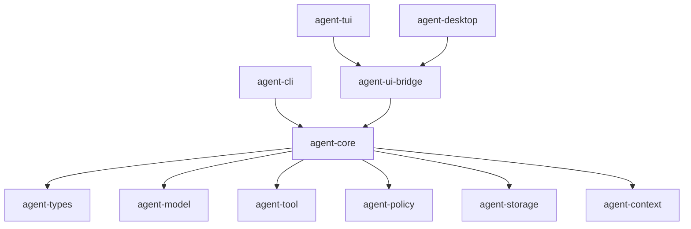

# M56 Coding Agent Golden Path v1 Spec

## Purpose

M56 turns the runtime foundations into one credible local coding-agent workflow. A user should be able to open a repository, ask for a small change, let the runtime assemble safe context, propose and execute tools through policy, review edits and command evidence, and receive a final summary that is traceable, auditable, replayable, and suitable for CLI/TUI first with Desktop bridge parity.

## Product Context

M55 showed that `agent` has broad foundations but lacks a vertical daily-driver path. M56 addresses the P0 backlog items M56-GP-01 through M56-GP-05 and the smoke rows GP-01 through GP-11 from the M55 artifacts. This milestone is the bridge between runtime completeness and product usefulness.

## Scope

This spec delivers:

- repository session bootstrap with workspace, Git, config, provider, durable conversation, and UI/JSON diagnostics
- edit and diff flow that exposes previews, applied changes, changed files, and audit evidence
- command/test loop with streaming/cancel-ready observations and bounded output
- final review summary with changed files, commands/tests, risks, trace/audit ids, and next actions
- deterministic golden-path E2E using fake provider fixtures plus a documented real-provider opt-in path
- CLI/JSON surfaces first, with TUI/Desktop bridge contracts preserved for M59/M60

Owned by other specs:

- native Anthropic/Gemini/local provider adapters belong to M57
- repo-aware context retrieval belongs to M58
- polished terminal daily-driver UX belongs to M59
- real Desktop app workflow belongs to M60
- recovery product UX belongs to M62
- packaging/beta release gates belong to M65

## Architecture

M56 must preserve the shared-runtime rule: runtime behavior lives in `agent-core` and adjacent runtime crates; CLI/TUI/Desktop are presentation and command surfaces over typed events and UI bridge frames.



## File Layout

```text
crates/
  agent-core/
    src/
      repo_session.rs
      local_coding.rs
    tests/
      repo_session_bootstrap.rs
      comprehensive_local_coding_e2e.rs
  agent-cli/
    src/
      command.rs
      output.rs
    tests/
      repo_session_bootstrap.rs
      local_coding.rs
      json_mode.rs
  agent-ui-bridge/
    src/
      event.rs
      frame.rs
    tests/
      repo_session_snapshot.rs
docs/
  specs/
    M56-coding-agent-golden-path-v1.spec.md
    M56-01-repo-session-bootstrap.spec.md
  plans/
    M56-coding-agent-golden-path-v1.plan.md
    M56-01-repo-session-bootstrap.plan.md
```

## Public Contracts

M56 should expose typed runtime contracts before adding UI polish.

```rust
pub struct RepoSessionBootstrapInput {
    pub workspace_root: PathBuf,
    pub config_path: Option<PathBuf>,
    pub provider_override: Option<String>,
    pub model_override: Option<String>,
}

pub struct RepoSessionBootstrapReport {
    pub workspace_id: WorkspaceId,
    pub conversation_id: ConversationId,
    pub workspace_root_display: String,
    pub git: RepoGitSummary,
    pub config: RepoConfigSummary,
    pub provider: RepoProviderSummary,
    pub diagnostics: Vec<RepoSessionDiagnostic>,
}

pub struct CodingFinalReview {
    pub changed_files: Vec<String>,
    pub command_results: Vec<String>,
    pub trace_id: Option<String>,
    pub audit_event_count: usize,
    pub unresolved_risks: Vec<String>,
    pub next_actions: Vec<String>,
}
```

Durable/wire-visible contracts must be serializable, redacted, and versionable. UI-facing forms must pass through `agent-ui-bridge`; CLI text rendering may be separate but must derive from the same report data.

## State and Failure Handling

- Repo session bootstrap starts in `Accepted`, emits workspace/session/conversation/config/provider diagnostics, then becomes ready for a turn.
- Missing or invalid workspace root is a terminal input error and must not create partial durable state.
- Non-Git workspace is allowed but must produce a diagnostic and disable Git-specific assumptions.
- Invalid config or provider mismatch fails before model invocation with redacted diagnostics.
- Tool failures become bounded observations unless they violate policy, timeout, or side-effect safety.
- Replay evidence must reconstruct the final review summary from persisted events or explicitly report why it cannot.

## Security and Privacy

- Do not expose raw secrets, provider tokens, secret reference names, full environment variables, or private paths outside the selected workspace.
- File writes, commands, Git side effects, network/provider calls, and background execution must route through existing policy/audit paths.
- Fake provider remains the default deterministic path; real providers are opt-in.
- Prompt-injection-sensitive file content must be treated as context/tool output, not as permission policy.
- UI bridge reports must be redacted and safe for Desktop logs.

## Testing Strategy

- focused unit tests for repo session bootstrap contracts and diagnostics
- CLI tests for text and JSON bootstrap output
- core integration tests for edit/diff, command/test loop, final review, and replay reconstruction
- eval or smoke fixture for the deterministic golden path
- redaction tests for config/provider diagnostics and command output
- final M56 gate: focused tests plus `cargo xtask ci` when implementation is complete

## Acceptance Criteria

- M56-01 through M56-05 specs/plans exist before their implementation slices start.
- A CLI/JSON golden path can open a repo, apply a small edit, run a verification command, show a diff summary, and produce a final review.
- The workflow records runtime events, permission decisions, audit evidence, trace evidence, and replay evidence.
- Fake-provider execution is deterministic and CI-safe.
- At least one real-provider configuration path is documented and fails safely when credentials are unavailable.
- TUI/Desktop bridge contracts receive the same safe runtime truth without duplicating runtime logic.

## Completion Signal

M56 is complete when a deterministic local coding-agent golden path is implemented, documented, tested, traceable, replayable, and usable from CLI/JSON, with TUI/Desktop bridge contracts ready for M59/M60 product polish.
