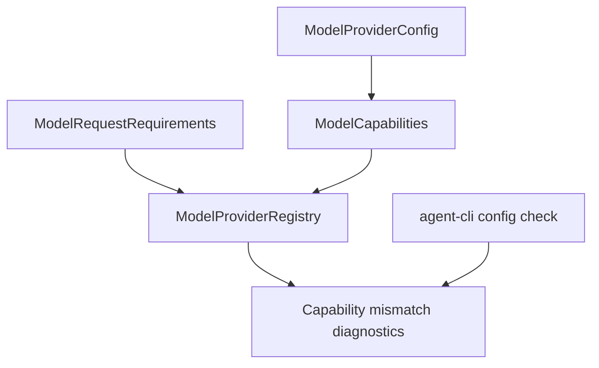

# M57-01 Provider Capability Matrix Spec

## Purpose

Add a typed provider/model capability matrix so the runtime can explain what each configured provider can do and reject unsupported turns before model invocation.

## Product Context

M57 starts by strengthening the existing `agent-model` provider registry. Current capabilities cover streaming, tool calls, structured outputs, and context tokens, but they are too small for product UX: users also need model metadata, image support, output limits, cost hints, and stable mismatch diagnostics in CLI/JSON.

## Scope

This spec delivers:

- extended typed capability profile for configured providers
- request requirements that can express M57 product needs without provider-specific strings
- deterministic default profiles for `fake` and `open_ai_compatible`
- stable mismatch diagnostics that name missing capabilities and remain redacted
- CLI/JSON config diagnostics that expose provider capabilities at a summary level

Owned by other specs:

- HTTP request/response mapping for Anthropic, Gemini, and local providers belongs to later M57 adapter slices
- real provider account onboarding belongs to M60/M65 unless a CLI diagnostic is needed here
- context-size planning belongs to M58 after capabilities are available

## Architecture

`agent-model` owns capability contracts and matching. `agent-core` and `agent-cli` may render summaries from those contracts but must not duplicate capability logic.



## File Layout

```text
crates/
  agent-model/
    src/
      registry.rs
      config.rs
      lib.rs
    tests/
      provider_capability_matrix.rs
      provider_registry.rs
  agent-cli/
    src/
      command.rs
    tests/
      config_diagnostics.rs
  agent-ui-bridge/
    src/
      frame.rs
```

## Public Contracts

M57-01 may extend existing structs or introduce helper structs. The public shape should support:

```rust
pub struct ModelCapabilities {
    pub streaming: bool,
    pub tool_calls: bool,
    pub structured_outputs: bool,
    pub image_input: bool,
    pub max_context_tokens: Option<u32>,
    pub max_output_tokens: Option<u32>,
    pub cost: Option<ModelCostProfile>,
}

pub struct ModelCostProfile {
    pub input_per_million: Option<String>,
    pub output_per_million: Option<String>,
    pub currency: String,
}

pub enum ModelCapability {
    Streaming,
    ToolCalls,
    StructuredOutputs,
    ImageInput,
    ContextTokens,
    OutputTokens,
}
```

Cost values should avoid floating-point drift in durable JSON; strings or fixed decimal representations are acceptable.

## State and Failure Handling

- Missing capability diagnostics are deterministic and sorted by capability enum order.
- Unknown model-specific metadata is allowed as `None`, not a failure.
- Invalid capability profiles fail config/registry validation before provider registration.
- Capability mismatch remains recoverable when fallback can choose another provider.

## Security and Privacy

- Capability diagnostics must not include prompt text, provider tokens, secret ref names, or raw endpoint URLs with credentials.
- CLI/JSON output must be bounded and stable.
- Cost metadata is descriptive only and must not claim billing accuracy unless supplied by a trusted static profile.

## Testing Strategy

- `agent-model` tests for serialization, default profiles, requirement matching, and mismatch diagnostics
- registry tests proving fallback/capability checks use the extended requirements
- CLI tests proving config check renders provider capability summaries without secrets
- focused commands:

```bash
cargo test -p agent-model provider_capability_matrix
cargo test -p agent-model provider_registry
cargo test -p agent-cli config_diagnostics
```

## Acceptance Criteria

- Provider capabilities cover streaming, tool calls, structured outputs, image input, context tokens, output tokens, and optional cost metadata.
- Missing capability reports are typed, deterministic, and redacted.
- CLI/JSON config check exposes enough provider capability summary for users to understand provider selection.
- Existing fake/OpenAI-compatible provider behavior remains compatible.

## Completion Signal

M57-01 is complete when capability profiles and mismatch diagnostics are implemented, surfaced in config diagnostics, covered by focused tests, and committed independently from provider adapter work.
