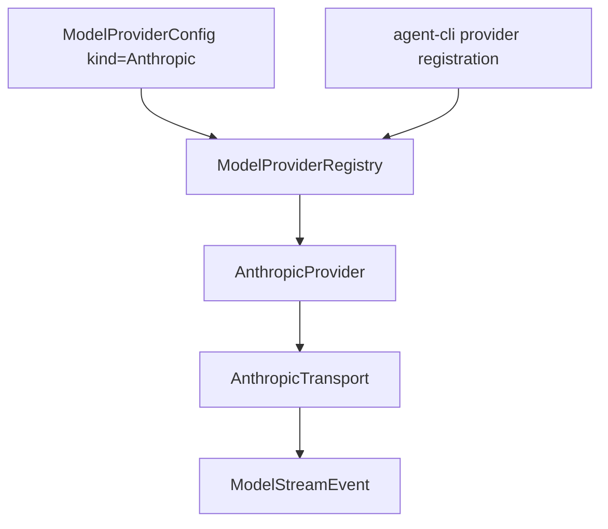

# M57-02 Anthropic Adapter Spec

## Purpose

Add a native Anthropic provider adapter so configured Claude providers can be registered, capability-checked, and invoked through the shared `agent-model` runtime contracts.

## Product Context

M57 turns provider choice into a typed product surface. M57-01 added capability profiles and diagnostics; this slice adds the first native non-OpenAI provider while preserving the M56 golden path and keeping provider-specific request/stream logic inside `agent-model`.

## Scope

This spec delivers:

- `ModelProviderKind::Anthropic` config support with safe API-key validation
- Anthropic request builder for the Messages API using existing `ModelRequest` messages
- fixture-backed and reqwest-backed Anthropic transport traits
- streaming text delta, tool-use, completion, retryability, and redaction mapping into `ModelStreamEvent`
- default Anthropic capability profile and CLI/JSON config visibility through the M57-01 capability matrix
- CLI live-provider registration support that resolves secrets before network use

Owned by other specs:

- Gemini adapter belongs to M57-03
- local/Ollama-compatible provider belongs to M57-04
- provider onboarding UX and fallback polish belongs to M57-05
- multimodal message schema expansion belongs to later context/provider work beyond the current text-only `ModelRequest`

## Architecture

Anthropic runtime behavior lives in `agent-model`. CLI only wires configured providers to the typed adapter and redacts registration errors. UI bridge surfaces continue to consume provider capability summaries through the existing config snapshot DTOs.



## File Layout

```text
crates/
  agent-model/
    src/
      anthropic.rs
      config.rs
      lib.rs
      registry.rs
    tests/
      anthropic.rs
      provider_capability_matrix.rs
      provider_config.rs
  agent-cli/
    src/
      command.rs
      providers.rs
    tests/
      config_diagnostics.rs
      live_provider_registration.rs
docs/
  specs/M57-02-anthropic-adapter.spec.md
  plans/M57-02-anthropic-adapter.plan.md
```

## Public Contracts

M57-02 extends existing contracts rather than replacing them:

```rust
pub enum ModelProviderKind {
    Fake,
    OpenAiCompatible,
    Anthropic,
}

pub struct AnthropicHttpRequest {
    pub url: String,
    pub secret_ref: SecretRef,
    pub body: serde_json::Value,
    pub timeout_ms: u64,
}

pub struct AnthropicHttpResponse {
    pub request_id: String,
    pub sse_chunks: Vec<String>,
}

#[async_trait]
pub trait AnthropicTransport: Send + Sync {
    async fn send(
        &self,
        request: AnthropicHttpRequest,
    ) -> Result<AnthropicHttpResponse, AnthropicError>;
}
```

Expected request body shape:

```json
{
  "model": "claude-3-5-sonnet-latest",
  "messages": [
    {
      "role": "user",
      "content": [{ "type": "text", "text": "hello" }]
    }
  ],
  "max_tokens": 1024,
  "stream": true
}
```

Expected stream mapping:

- `message_start` starts the model stream with a bounded request id
- `content_block_delta` text deltas emit `ModelStreamEvent::Delta`
- `content_block_start` and `input_json_delta` tool-use blocks emit `ModelStreamEvent::ToolCall` after valid JSON input is complete
- `message_delta` and `message_stop` produce `ModelStreamEvent::Completed`
- malformed stream JSON maps to a retryable provider error with a redacted message

## State and Failure Handling

- Missing Anthropic API-key refs fail config validation or registration before network calls.
- Invalid provider kind, invalid config, transport failure, provider status response, and stream parse errors map to typed `AnthropicError` codes.
- HTTP 429 and 5xx provider responses are retryable; missing credentials, invalid config, and 4xx non-rate-limit responses are terminal.
- Tool-use partial JSON is accumulated by content-block index and emitted only when it parses as an object.
- Unknown Anthropic event types are ignored unless required to complete an active tool-use block.

## Security and Privacy

- API keys and secret ref names must not appear in public errors, CLI output, JSON frames, logs, or tests.
- Authorization headers are never serialized in durable request fixtures.
- Provider response bodies are summarized, redacted, and bounded before being included in errors.
- Endpoint errors sanitize URLs to remove credentials and query strings.
- Tests use fixture transports and require no live Anthropic account.

## Testing Strategy

- `agent-model` tests for request body shape, required secret refs, invalid provider kind, stream text/completion mapping, tool-use mapping, retryability, and redaction
- config tests for `ModelProviderKind::Anthropic` serde and secret requirement
- capability matrix tests for Anthropic defaults
- CLI config diagnostics tests for Anthropic provider summaries in text and JSON
- CLI live-provider registration tests for enabled Anthropic providers and missing-secret redaction before network use
- focused commands:

```bash
cargo test -p agent-model anthropic
cargo test -p agent-model provider_config
cargo test -p agent-model provider_capability_matrix
cargo test -p agent-cli config_diagnostics
cargo test -p agent-cli live_provider_registration
```

## Acceptance Criteria

- Anthropic providers can be configured, registered, and capability-checked without network access in tests.
- Anthropic fixture streams produce started, text delta, tool call, and completed runtime events.
- CLI text and JSON config diagnostics expose Anthropic capabilities without secrets.
- Missing Anthropic credentials fail before invocation and remain redacted.
- Existing fake and OpenAI-compatible behavior remains compatible.

## Completion Signal

M57-02 is complete when the native Anthropic adapter, default capabilities, CLI registration, redacted diagnostics, focused tests, docs/status updates, and implementation commit are complete.
