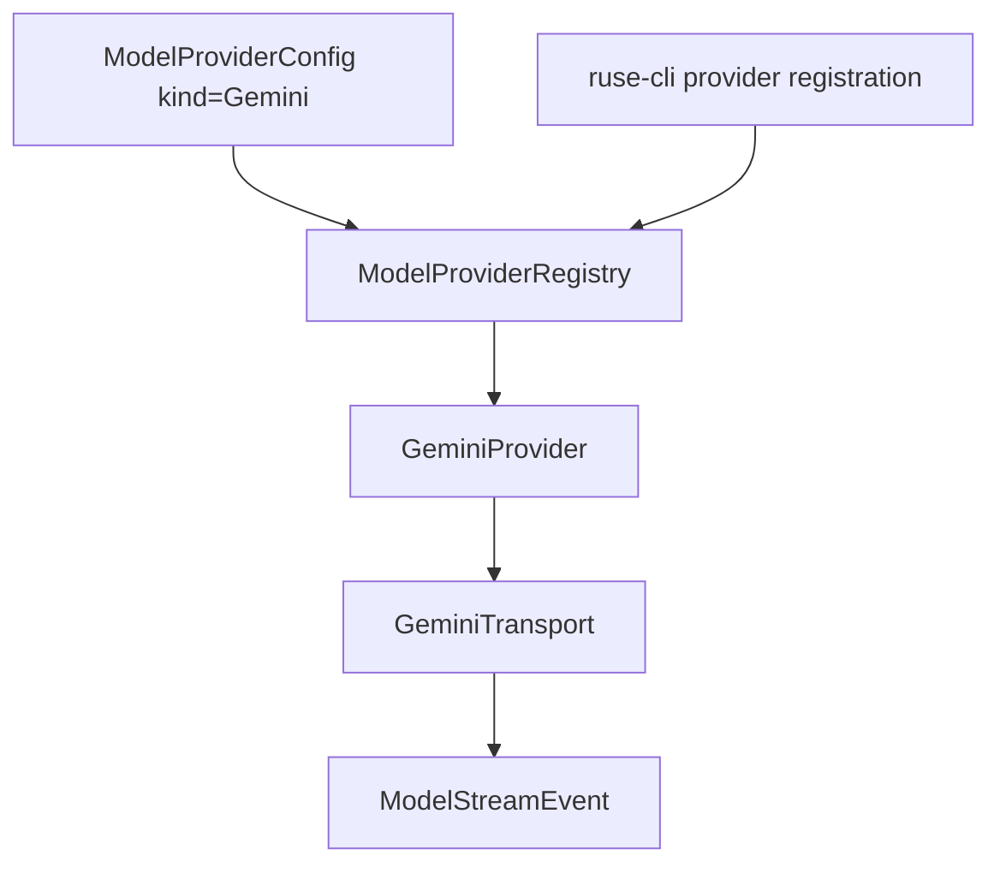

# M57-03 Gemini Adapter Spec

## Purpose

Add a native Gemini provider adapter so configured Google Gemini providers can be registered, capability-checked, and invoked through the shared `ruse-model` provider runtime.

## Product Context

M57 is making provider choice typed and diagnosable across major model families. M57-01 added capability profiles and M57-02 added Anthropic; this slice adds Gemini while preserving the same runtime contracts, CLI diagnostics, and redaction guarantees.

## Scope

This spec delivers:

- `ModelProviderKind::Gemini` config support with safe API-key validation
- Gemini `streamGenerateContent` request builder using existing text-only `ModelRequest` messages
- fixture-backed and reqwest-backed Gemini transport traits
- streaming text, function-call/tool-use, completion, retryability, and redaction mapping into `ModelStreamEvent`
- default Gemini capability profile and CLI/JSON config visibility through the capability matrix
- CLI live-provider registration support that resolves secrets before network use

Owned by other specs:

- local/Ollama-compatible provider belongs to M57-04
- provider UX/fallback polish belongs to M57-05
- multimodal Gemini content parts belong to later context/provider work after `ModelRequest` supports non-text inputs
- provider-specific tool declaration generation belongs to later tool schema work unless required by this adapter's fixtures

## Architecture

Gemini protocol logic lives in `ruse-model`. CLI wiring constructs configured providers and renders existing typed summaries. UI bridge consumers continue to receive provider capability metadata through config snapshots and do not own Gemini behavior.



## File Layout

```text
crates/
  ruse-model/
    src/
      gemini.rs
      config.rs
      lib.rs
      registry.rs
    tests/
      gemini.rs
      provider_capability_matrix.rs
      provider_config.rs
  ruse-cli/
    src/
      command.rs
      providers.rs
    tests/
      config_diagnostics.rs
      live_provider_registration.rs
docs/
  specs/M57-03-gemini-adapter.spec.md
  plans/M57-03-gemini-adapter.plan.md
```

## Public Contracts

M57-03 extends the provider enum and adds Gemini-specific transport contracts:

```rust
pub enum ModelProviderKind {
    Fake,
    OpenAiCompatible,
    Anthropic,
    Gemini,
}

pub struct GeminiHttpRequest {
    pub url: String,
    pub secret_ref: SecretRef,
    pub body: serde_json::Value,
    pub timeout_ms: u64,
}

pub struct GeminiHttpResponse {
    pub request_id: String,
    pub sse_chunks: Vec<String>,
}

#[async_trait]
pub trait GeminiTransport: Send + Sync {
    async fn send(
        &self,
        request: GeminiHttpRequest,
    ) -> Result<GeminiHttpResponse, GeminiError>;
}
```

Expected request body shape:

```json
{
  "contents": [
    {
      "role": "user",
      "parts": [{ "text": "hello" }]
    }
  ],
  "generationConfig": {
    "maxOutputTokens": 1024
  }
}
```

Expected endpoint shape:

```text
https://generativelanguage.googleapis.com/v1beta/models/{model}:streamGenerateContent?alt=sse
```

The API key must be sent through a header such as `x-goog-api-key`; it must not be serialized into durable request fixtures or appended to the URL query.

Expected stream mapping:

- response start emits `ModelStreamEvent::Started` from the transport request id
- candidate content parts with `text` emit `ModelStreamEvent::Delta`
- candidate content parts with `functionCall` emit `ModelStreamEvent::ToolCall` using a deterministic call id when Gemini does not provide one
- candidate `finishReason` and `usageMetadata.candidatesTokenCount` emit `ModelStreamEvent::Completed`
- malformed stream JSON maps to a retryable provider error with a redacted message

## State and Failure Handling

- Missing Gemini API-key refs fail config validation or registration before network calls.
- Invalid provider kind, invalid config, transport failure, provider status response, and stream parse errors map to typed `GeminiError` codes.
- HTTP 429 and 5xx provider responses are retryable; missing credentials, invalid config, and 4xx non-rate-limit responses are terminal.
- Function-call arguments must be emitted as JSON objects. Non-object args produce an invalid-stream-event provider error.
- Unknown Gemini response fields are ignored.

## Security and Privacy

- API keys and secret ref names must not appear in public errors, CLI output, JSON frames, logs, or tests.
- API keys are sent via headers, not durable request JSON or URLs.
- Provider response bodies are summarized, redacted, and bounded before they appear in errors.
- Endpoint errors sanitize URLs to remove credentials and query strings.
- Tests use fixture transports and require no live Gemini account.

## Testing Strategy

- `ruse-model` tests for request body shape, endpoint URL construction, required secret refs, invalid provider kind, stream text/completion mapping, function-call mapping, retryability, and redaction
- config tests for `ModelProviderKind::Gemini` serde and secret requirement
- capability matrix tests for Gemini defaults
- CLI config diagnostics tests for Gemini provider summaries in text and JSON
- CLI live-provider registration tests for enabled Gemini providers and missing-secret redaction before network use
- focused commands:

```bash
cargo test -p ruse-model gemini
cargo test -p ruse-model provider_config
cargo test -p ruse-model provider_capability_matrix
cargo test -p ruse-cli config_diagnostics
cargo test -p ruse-cli live_provider_registration
```

## Acceptance Criteria

- Gemini providers can be configured, registered, and capability-checked without network access in tests.
- Gemini fixture streams produce started, text delta, tool call, and completed runtime events.
- CLI text and JSON config diagnostics expose Gemini capabilities without secrets.
- Missing Gemini credentials fail before invocation and remain redacted.
- Existing fake, OpenAI-compatible, and Anthropic behavior remains compatible.

## Completion Signal

M57-03 is complete when the native Gemini adapter, default capabilities, CLI registration, redacted diagnostics, focused tests, docs/status updates, and implementation commit are complete.
