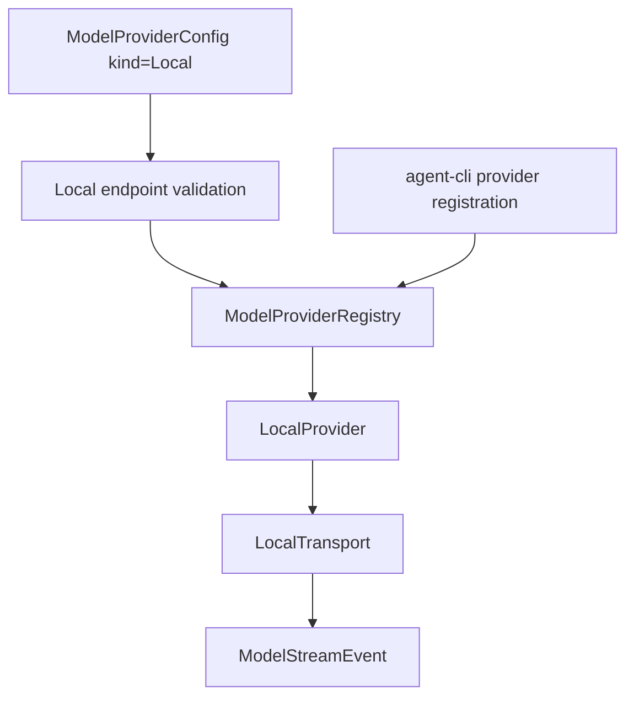

# M57-04 Local Provider Adapter Spec

## Purpose

Add a local/Ollama-compatible provider adapter so users can configure local model endpoints with explicit endpoint safety, capability diagnostics, and deterministic fixture-backed runtime behavior.

## Product Context

M57 has added typed provider capabilities plus native Anthropic and Gemini adapters. The remaining provider family in this milestone is local runtime support: users should be able to point `agent` at an Ollama-style local endpoint without weakening the existing secret, URL, and diagnostic boundaries.

## Scope

This spec delivers:

- `ModelProviderKind::Local` config support with explicit local endpoint validation
- local/Ollama-compatible chat request builder using existing text-only `ModelRequest` messages
- fixture-backed and reqwest-backed local transport traits
- streaming text, tool-call, completion, retryability, and redaction mapping into `ModelStreamEvent`
- default local capability profile and CLI/JSON config visibility through the capability matrix
- CLI live-provider registration support that does not require API keys

Owned by other specs:

- provider UX/fallback polish belongs to M57-05
- model-specific local capability probing belongs to later provider discovery work
- multimodal local model inputs belong to later context/provider work after `ModelRequest` supports non-text inputs
- package-managed local runtime installation belongs to M65 or later desktop onboarding work

## Architecture

Local provider protocol logic lives in `agent-model`. Endpoint validation stays in shared model config, because CLI/Desktop should not duplicate local URL rules. CLI only constructs configured providers and renders typed summaries.



## File Layout

```text
crates/
  agent-model/
    src/
      local.rs
      config.rs
      lib.rs
      registry.rs
    tests/
      local_provider.rs
      provider_capability_matrix.rs
      provider_config.rs
  agent-cli/
    src/
      command.rs
      providers.rs
    tests/
      config_diagnostics.rs
      live_provider_registration.rs
docs/
  specs/M57-04-local-provider-adapter.spec.md
  plans/M57-04-local-provider-adapter.plan.md
```

## Public Contracts

M57-04 extends the provider enum and adds local transport contracts:

```rust
pub enum ModelProviderKind {
    Fake,
    OpenAiCompatible,
    Anthropic,
    Gemini,
    Local,
}

pub struct LocalHttpRequest {
    pub url: String,
    pub body: serde_json::Value,
    pub timeout_ms: u64,
}

pub struct LocalHttpResponse {
    pub request_id: String,
    pub jsonl_chunks: Vec<String>,
}

#[async_trait]
pub trait LocalTransport: Send + Sync {
    async fn send(&self, request: LocalHttpRequest) -> Result<LocalHttpResponse, LocalError>;
}
```

Expected request body shape:

```json
{
  "model": "llama3.1",
  "messages": [
    { "role": "user", "content": "hello" }
  ],
  "stream": true
}
```

Expected endpoint shape:

```text
http://localhost:11434/api/chat
```

Local provider configs must supply an explicit `base_url`. Accepted local hosts are `localhost`, `127.0.0.1`, and `[::1]` with `http` or `https`. Non-local HTTP/HTTPS endpoints are rejected for `ModelProviderKind::Local`.

Expected stream mapping:

- response start emits `ModelStreamEvent::Started` from the transport request id
- JSONL chunks with `message.content` emit `ModelStreamEvent::Delta`
- JSONL chunks with Ollama-style `message.tool_calls[].function` emit `ModelStreamEvent::ToolCall`
- final chunks with `done=true` emit `ModelStreamEvent::Completed`
- malformed JSONL maps to a retryable provider error with a redacted message

## State and Failure Handling

- Local providers do not require `api_key`.
- Missing `base_url` or non-local endpoints fail config validation before registration.
- Invalid provider kind, invalid config, transport failure, provider status response, and stream parse errors map to typed `LocalError` codes.
- Local HTTP transport errors are retryable; invalid config and unsafe endpoints are terminal.
- Tool-call arguments may be JSON objects or JSON-encoded strings; non-object arguments produce an invalid-stream-event provider error.

## Security and Privacy

- Local provider diagnostics must not expose URL credentials, query strings, prompt text, or secret-like response body content.
- Local HTTP is allowed only for local loopback hosts.
- Request fixtures do not contain credentials or environment variable names.
- Provider response bodies are summarized, redacted, and bounded before they appear in errors.
- Tests use fixture transports and require no running local model server.

## Testing Strategy

- `agent-model` tests for request body shape, endpoint URL construction, local endpoint validation, stream text/completion mapping, tool-call mapping, retryability, and redaction
- config tests for `ModelProviderKind::Local` serde, no-secret behavior, required local base URL, and remote endpoint rejection
- capability matrix tests for local defaults
- CLI config diagnostics tests for local provider summaries in text and JSON
- CLI live-provider registration tests for enabled local providers without secrets
- focused commands:

```bash
cargo test -p agent-model local_provider
cargo test -p agent-model provider_config
cargo test -p agent-model provider_capability_matrix
cargo test -p agent-cli config_diagnostics
cargo test -p agent-cli live_provider_registration
```

## Acceptance Criteria

- Local providers can be configured, registered, and capability-checked without credentials.
- Non-local endpoints are rejected for local providers.
- Local fixture streams produce started, text delta, tool call, and completed runtime events.
- CLI text and JSON config diagnostics expose local capabilities without endpoint credentials or secrets.
- Existing fake, OpenAI-compatible, Anthropic, and Gemini behavior remains compatible.

## Completion Signal

M57-04 is complete when the local provider adapter, endpoint safety validation, default capabilities, CLI registration, redacted diagnostics, focused tests, docs/status updates, and implementation commit are complete.
