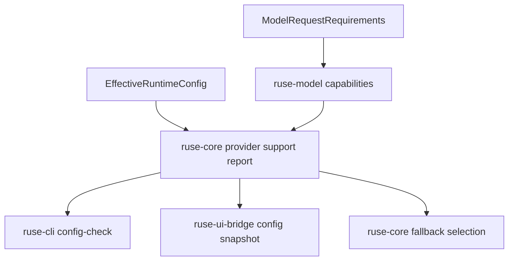

# M57-05 Provider UX Fallback Spec

## Purpose

Make provider selection and fallback behavior understandable before a turn starts, and ensure runtime fallback only invokes providers that satisfy the turn requirements.

## Product Context

M57 has typed provider capabilities and adapters for OpenAI-compatible, Anthropic, Gemini, and local providers. The remaining product gap is operational UX: users need to know whether their selected provider can run coding-agent turns, which fallback providers are usable, and what happened when fallback is used. This slice closes M57 by turning provider capability data into redacted support output and by covering the M56 coding golden path with provider fallback.

## Scope

This spec delivers:

- typed provider compatibility summaries for selected and fallback providers
- CLI text and JSON config-check output that reports coding-turn provider support without exposing endpoints or secrets
- fallback selection that never invokes incompatible fallback providers
- deterministic regression coverage proving a tool-capable fallback provider can run the M56 local coding path
- stable, redacted diagnostics when selected and fallback providers cannot satisfy requirements

Owned by other specs:

- interactive Desktop provider onboarding belongs to M60
- provider install/keychain setup belongs to M65
- model-specific capability probing belongs to later provider discovery work
- context-window planning beyond static capability checks belongs to M58

## Architecture

Capability matching remains in `ruse-model`. Runtime compatibility reporting and fallback selection live in `ruse-core`, because they combine effective config, invocation policy, and turn requirements. CLI and UI bridge surfaces render typed summaries without owning provider rules.



## File Layout

```text
crates/
  ruse-model/
    src/
      invocation_policy.rs
      registry.rs
    tests/
      invocation_policy.rs
      provider_capability_matrix.rs
  ruse-core/
    src/
      model_runtime.rs
      provider_support.rs
      lib.rs
    tests/
      model_runtime_resolver.rs
      model_invocation_policy_runner.rs
      streaming_retry_cancel_replay.rs
      comprehensive_local_coding_e2e.rs
  ruse-cli/
    src/
      command.rs
    tests/
      config_diagnostics.rs
  ruse-ui-bridge/
    src/
      frame.rs
      lib.rs
docs/
  specs/M57-05-provider-ux-fallback.spec.md
  plans/M57-05-provider-ux-fallback.plan.md
```

## Public Contracts

M57-05 may introduce exact names that fit the codebase, but the public durable shape should support:

```rust
pub struct ProviderSupportReport {
    pub selected_provider: String,
    pub selected_model: String,
    pub requirements: ModelRequestRequirements,
    pub providers: Vec<ProviderSupportSummary>,
}

pub struct ProviderSupportSummary {
    pub provider_id: String,
    pub kind: ModelProviderKind,
    pub role: ProviderSupportRole,
    pub fallback_index: Option<u32>,
    pub enabled: bool,
    pub compatible: bool,
    pub missing: Vec<ModelCapability>,
}

pub enum ProviderSupportRole {
    Selected,
    Fallback,
    CatalogOnly,
}
```

The UI bridge JSON shape should remain additive. Existing `UiConfigSnapshot` fields must remain compatible, while provider support data may be added as optional fields or a new typed snapshot frame.

Config-check text should include a compact support line such as:

```text
Provider support: selected=openai missing=tool_calls; fallback[0]=local compatible=true
```

Exact wording may differ, but output must be stable, sorted where order is not semantic, and must not include raw endpoint URLs, secret ref names, provider tokens, prompts, or response bodies.

## State and Failure Handling

- Compatibility reports evaluate a fixed coding-turn requirement profile for config-check: streaming and tool calls required, structured outputs and image input not required, with bounded context/output expectations.
- Disabled providers are reported as incompatible and are never selected for fallback.
- Runtime fallback skips providers that are registered but missing required capabilities, and continues to the next fallback candidate.
- Missing fallback providers remain configuration errors because the policy references an unavailable provider.
- If no compatible provider exists, the terminal error includes provider ids and missing capability labels only.
- Once a stream has emitted model output or a tool call, fallback is not attempted for that stream failure.

## Security and Privacy

- Provider support output must not include endpoint URLs, API key provider/name pairs, raw secret values, authorization headers, prompts, or provider response bodies.
- Public diagnostics may include provider ids, provider kinds, enabled flags, fallback indexes, and missing capability labels.
- JSON support summaries must be bounded and serde-friendly.
- Tests must use fixture providers and require no network or credentials.

## Testing Strategy

- `ruse-model` tests for fallback compatibility helpers and deterministic missing capability labels
- `ruse-core` tests for provider support report construction from effective config
- `ruse-core` runtime tests proving selected incompatible providers can fail over to compatible fallback before invocation where policy allows it
- streaming retry tests proving incompatible fallback entries are skipped before a compatible fallback is invoked
- CLI config-check tests for text and JSON provider support summaries and redaction
- M56 local coding regression test proving a tool-capable fallback provider can complete the deterministic coding path
- focused commands:

```bash
cargo test -p ruse-model invocation_policy
cargo test -p ruse-core model_runtime_resolver
cargo test -p ruse-core model_invocation_policy_runner
cargo test -p ruse-core streaming_retry_cancel_replay
cargo test -p ruse-core comprehensive_local_coding_e2e
cargo test -p ruse-cli config_diagnostics
```

## Acceptance Criteria

- Config-check text and JSON explain whether selected and fallback providers can run coding-agent turns.
- Runtime fallback does not invoke providers that are missing required capabilities.
- A compatible fallback provider can run the M56 local coding path under deterministic tests.
- Provider support diagnostics are stable, typed, bounded, and redacted.
- Existing M57 provider adapters and M56 golden-path behavior remain compatible.

## Completion Signal

M57-05 is complete when provider support reports, fallback compatibility behavior, CLI/JSON support output, M56 provider fallback regression coverage, focused verification, docs/status updates, and the implementation commit are complete.
